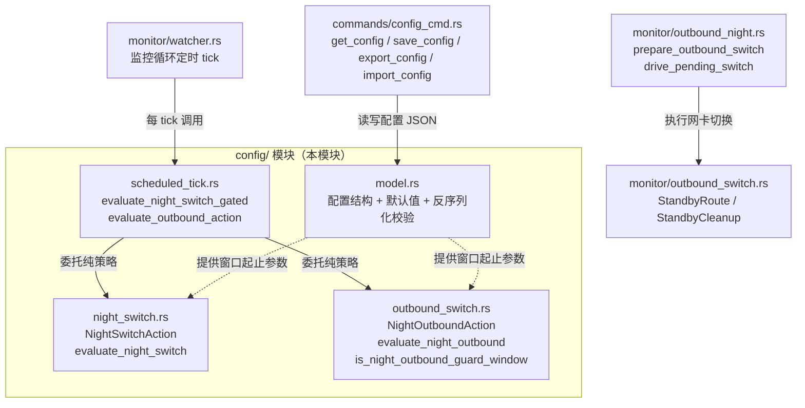
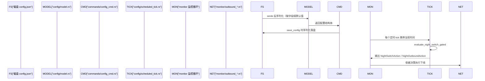

# 桌面端后端配置模块（desktop_backend_configuration）

## 模块概述

`desktop_backend_configuration` 是桌面端（`tauri-app/src-tauri`）Tauri Rust 后端中负责**用户配置模型定义与定时策略评估**的核心模块。它位于 [`tauri-app/src-tauri/src/config/`](tauri-app/src-tauri/src/config/) 目录下，主要承担两类职责：

1. **配置数据模型层**：定义持久化配置项的结构体、字段默认值、以及自定义反序列化校验逻辑（如网关地址、强制网络名等字段的合法性约束）。
2. **定时策略评估层**：根据当前时间与用户配置的"夜间窗口"参数，计算当前应当触发的动作——包括**夜间自动下线/联网切换**（night switch）与**夜间出口网卡切换**（outbound switch）。

该模块本身不直接操作系统网络或执行登录动作，而是为监控调度器、命令层提供**纯函数式的决策依据**，便于单测与复用。

---

## 目录结构

```
tauri-app/src-tauri/src/config/
├── model.rs          # 配置数据模型与默认值、自定义反序列化
├── night_switch.rs   # 夜间自动联网/下线策略评估
├── outbound_switch.rs# 夜间出口网卡切换策略评估
└── scheduled_tick.rs # 定时轮询时的组合式门控评估
```

---

## 核心组件

### 1. `config/model.rs` — 配置数据模型

负责定义应用持久化配置的 Rust 结构（serde 序列化/反序列化），提供默认值函数与字段校验。

| 组件 | 职责 |
| --- | --- |
| `default_auto_login_cooldown_secs` | 自动登录冷却时间（秒）的默认值 |
| `default_campus_check_end_minutes` / `default_campus_check_start_minutes` | 校园网状态自动检查窗口的起止时间（分钟） |
| `default_campus_exit_end_minutes` / `default_campus_exit_start_minutes` | 夜间自动下线窗口的起止时间（分钟） |
| `default_fixed_gateway` | 固定网关地址默认值 |
| `default_log_retention_days` | 日志保留天数默认值 |
| `default_max_disconnect_reconnect` | 断线后最大重连次数默认值 |
| `default_true` | 布尔型字段统一默认开启 |
| `deserialize_campus_gateway` | 自定义 serde 反序列化器，校验校园网网关地址格式 |
| `deserialize_required_network_name` | 自定义 serde 反序列化器，强制要求"指定网络名"字段非空 |

**要点**：
- 使用 serde 的 `#[serde(default = "...")]` 模式，保证旧版本配置文件缺失字段时仍能正常加载（向后兼容）。
- 自定义反序列化器集中处理非法配置（如空网络名、非法 IP 段），避免在业务逻辑中散落校验代码。

### 2. `config/night_switch.rs` — 夜间联网/下线策略

| 组件 | 职责 |
| --- | --- |
| `NightSwitchAction` | 枚举类型，表示评估结果：保持现状 / 自动下线 / 自动联网 |
| `evaluate_night_switch` | 纯函数：输入当前时间 + 配置的夜间窗口起止（分钟）+ 当前登录状态，输出 `NightSwitchAction` |

### 3. `config/outbound_switch.rs` — 夜间出口网卡策略

| 组件 | 职责 |
| --- | --- |
| `NightOutboundAction` | 枚举类型：保持当前出口 / 切换到备用网卡 / 恢复默认出口 |
| `evaluate_night_outbound` | 评估当前时刻是否处于夜间出口切换窗口内 |
| `is_night_outbound_guard_window` | 判断当前时间是否处于"保护窗口"（防止频繁抖动、短暂切换后立即回切） |

### 4. `config/scheduled_tick.rs` — 定时门控组合

| 组件 | 职责 |
| --- | --- |
| `evaluate_night_switch_gated` | 在 `evaluate_night_switch` 之上叠加门控逻辑（如当日已触发过则跳过、看门狗保护状态等） |
| `evaluate_outbound_action` | 在 `evaluate_night_outbound` 之上叠加门控，输出最终行动决策 |

这两个函数是监控循环每"tick"一次时调用的**统一入口**，将纯策略评估与运行时状态（是否当日已执行、是否处于保护期）解耦。

---

## 架构与组件关系



---

## 数据流：配置从加载到执行



---

## 与其他模块的依赖关系

| 方向 | 模块 | 说明 |
| --- | --- | --- |
| 被依赖（上游调用者） | [desktop_backend_commands](desktop-backend-commands.md) | `commands/config_cmd.rs` 的 `get_config` / `save_config` / `export_config` / `import_config` / `show_window` 直接读写本模块定义的配置结构 |
| 被依赖（调度执行） | [desktop_backend_monitoring](desktop-backend-monitoring.md) | `monitor/watcher.rs`、`monitor/outbound_night.rs`、`monitor/outbound_switch.rs` 在每轮定时循环中调用 `scheduled_tick.rs` 的门控评估函数 |
| 被依赖（运行时状态） | [desktop_backend_infrastructure](desktop-backend-infrastructure.md) | `infra/state/mod.rs` 中全局 AppState 持有本模块配置实例；`infra/logger.rs` 的日志保留天数由 `default_log_retention_days` 提供默认值 |
| 无直接依赖 | [desktop_backend_networking](desktop-backend-networking.md) | 本模块不直接操作网卡，仅输出策略决策 |
| 无直接依赖 | [desktop_backend_auth_protocol](desktop-backend-auth-protocol.md) | 本模块不参与登录协议，仅被监控循环调用以决定"是否自动联网/下线" |

---

## 设计要点

1. **纯函数优先**：`night_switch.rs` 与 `outbound_switch.rs` 中的评估函数均为纯函数（输入参数 + 当前时间，输出动作枚举），便于单元测试与多平台复用。
2. **门控分层**：`scheduled_tick.rs` 作为薄封装层，将"纯策略"与"运行时门控（当日已触发、保护窗口）"分离，避免策略函数感知全局状态。
3. **向后兼容**：`model.rs` 为每个字段提供 `default_*` 函数，旧配置文件升级时自动补全缺失字段；自定义反序列化器在加载早期即拒绝非法配置。
4. **单一职责**：本模块不直接执行网络操作或登录动作，决策与执行分离，便于在 [desktop_backend_monitoring](desktop-backend-monitoring.md) 中集中处理执行细节（看门狗、回滚、日志）。

---

## 参考页面

- 命令层读写入口：[desktop_backend_commands](desktop-backend-commands.md)（`commands/config_cmd.rs`、`commands/system.rs` 中的 `set_log_retention_days`）
- 调度与执行：[desktop_backend_monitoring](desktop-backend-monitoring.md)（`monitor/watcher.rs`、`monitor/scheduled.rs`、`monitor/outbound_night.rs`、`monitor/outbound_switch.rs`）
- 全局状态与日志：[desktop_backend_infrastructure](desktop-backend-infrastructure.md)（`infra/state/mod.rs`、`infra/logger.rs`）
- 前端配置交互：[desktop_frontend_settings](desktop-frontend-settings.md)（`useSettings`、`InitData`）
- 前端配置存储：[desktop_frontend_hooks](desktop-frontend-hooks.md)（`useConfigStore`、`flushPendingConfig`、`hasPendingConfig`）
