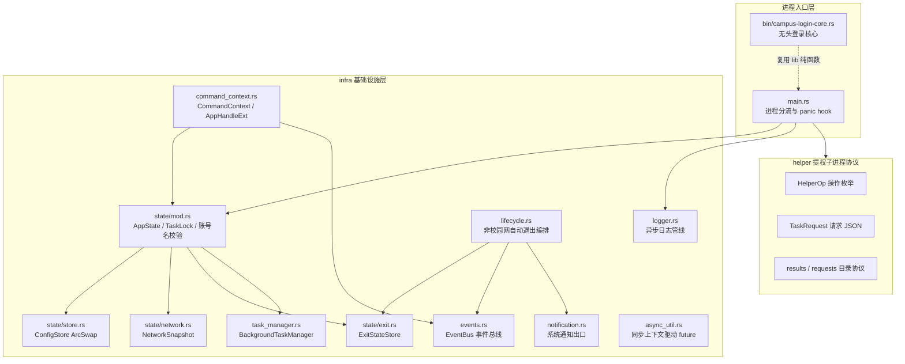
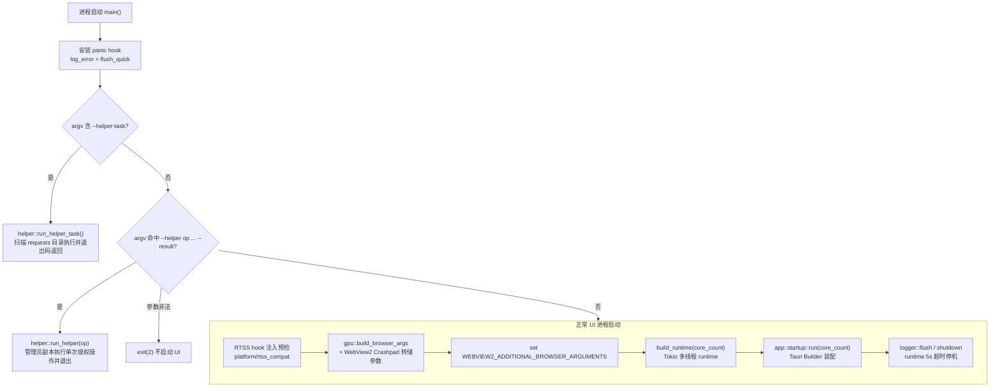
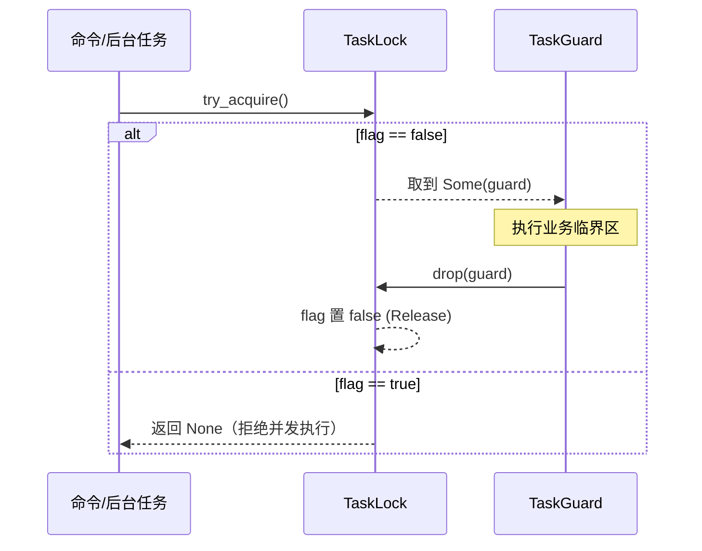
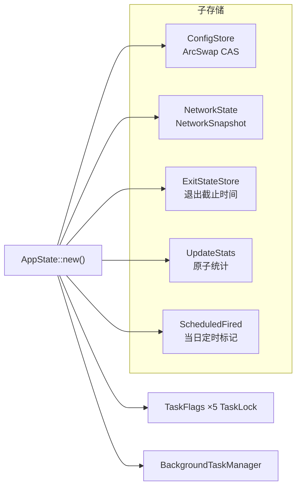
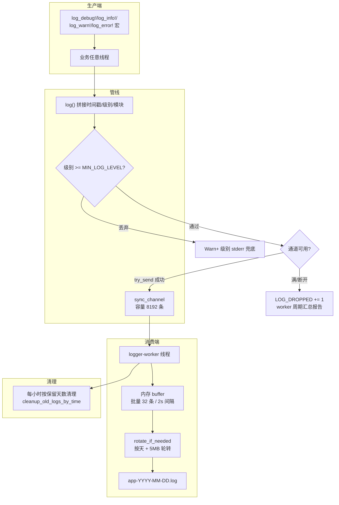
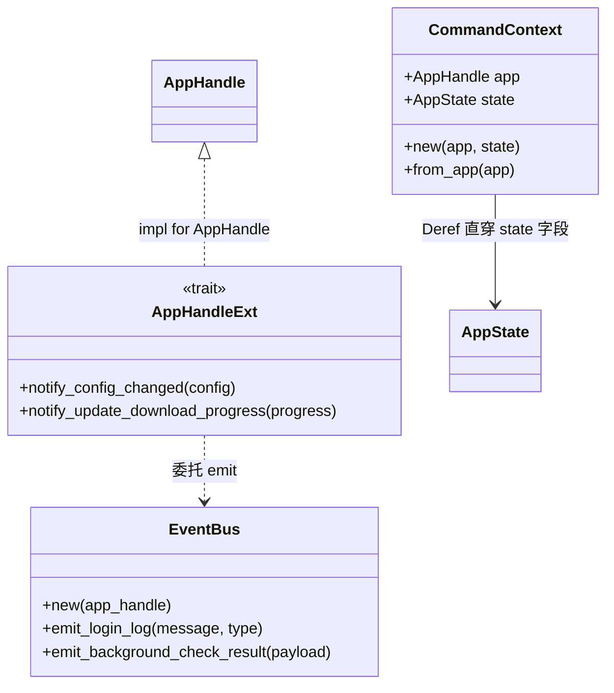
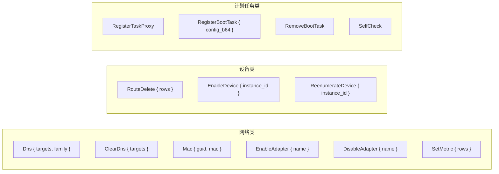
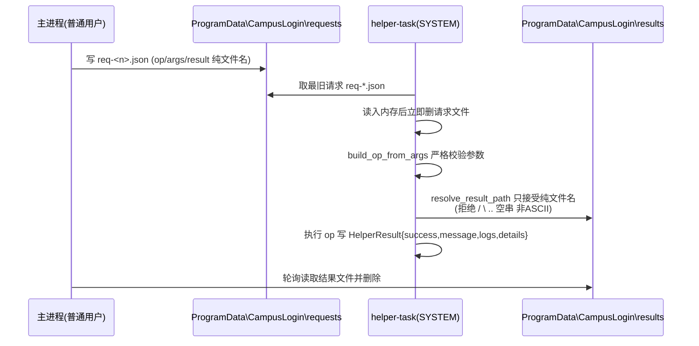
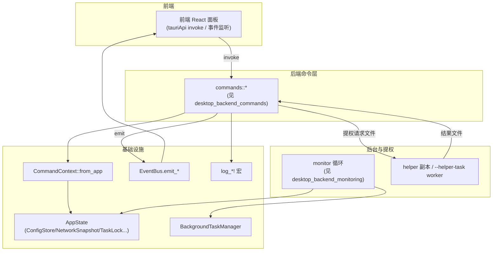

# 桌面后端基础设施（desktop_backend_infrastructure）

## 简介

`desktop_backend_infrastructure` 是桌面端 Rust 后端（`tauri-app/src-tauri`）的**横向支撑层**：它不直接实现登录、网络检测、DNS 等业务逻辑，而是为所有业务模块提供进程入口、全局状态容器、异步日志管线、事件总线、后台任务生命周期、命令上下文、退出/生命周期编排以及提权子进程协议。

本模块的核心职责：

1. **进程入口**（`main.rs`）：多形态启动分流——正常 UI 进程、提权 helper 子进程（`--helper`）、计划任务 worker（`--helper-task`）；
2. **全局应用状态**（`infra/state`）：`AppState` 聚合配置快照、任务互斥锁、网络快照、退出状态、定时动作当日标记与更新统计；
3. **异步日志**（`infra/logger`）：单 worker 写盘、有界通道丢弃策略、按天/大小轮转与按保留天数清理；
4. **事件与命令上下文**（`infra/events` / `infra/command_context`）：统一的前端事件出口与命令层依赖注入；
5. **后台任务管理器**（`infra/task_manager`）：以 `CancellationToken` 统一管理周期性后台任务；
6. **提权子进程协议**（`helper/mod.rs`）：主进程与管理员副本/SYSTEM 计划任务之间的请求-结果文件协议。

业务模块如何使用这些设施（登录命令、后台检测循环、系统命令等）请参考：

- [桌面后端命令层](desktop-backend-commands.md)
- [桌面后端应用生命周期](desktop-backend-app-lifecycle.md)
- [桌面后端配置模型](desktop-backend-configuration.md)
- [桌面后端监控](desktop-backend-monitoring.md)
- [桌面后端平台特定能力](desktop-backend-platform-specific.md)

---

## 一、模块结构总览

---

## 二、进程入口与启动分流（`main.rs`）

`main.rs` 是整个桌面端 Rust 进程的唯一入口，承担**三种执行形态**的分流职责。release 模式下 `windows_subsystem = "windows"`（无控制台），因此所有诊断必须走文件日志。

### 2.1 启动分流流程

关键点：

- **panic hook**：即使配置为 `panic=abort`（注：实际 release profile 已改为 unwind，见 `tauri-app/src-tauri/Cargo.toml`），hook 仍能把崩溃信息写入日志并快速 flush（500ms 超时），避免阻塞进程终止。
- **helper 拦截先于 Tauri 装配**：`--helper` / `--helper-task` 必须在单实例、托盘等装配之前退出，否则会导致 UI 被误拉起。
- **WebView2 环境创建之前**完成两件事：RTSS（MSI Afterburner）hook 注入预检、`WEBVIEW2_ADDITIONAL_BROWSER_ARGUMENTS` 环境变量设置（含 GPU 适配参数与 Crashpad minidump 落盘目录 `Roaming\com.campus.login\crashdumps`）。env 必须在 Tokio worker 线程起来之前设置，避免 `std::env::set_var` 的并发竞态。

### 2.2 Tokio runtime 与无头核心

- `app::startup::build_runtime`：worker 线程数 = `core_count.clamp(2, 8)`，blocking 线程数 = `(core_count*4).clamp(8, 64)`，命名 `campus-worker`，并通过 `tauri::async_runtime::set(handle)` 注入 Tauri。
- **`campus-login-core`**（`src/bin/campus-login-core.rs`）：一个独立二进制，由 SYSTEM 计划任务 `CampusLoginCoreBoot` 在 Windows 尚未登录时拉起，复用 `campus_login_lib` 的 Portal 探测与协议纯函数，完成锁屏态校园网登录。它**不初始化桌面 logger**、**不依赖 Tauri 运行时**，只追加写独立的 `core.log`（超 512KB 截断）。退出码语义：0=已在线或登录成功，1=配置/不可恢复错误，2=超时未成功。其注册/注销由 `HelperOp::RegisterBootTask` / `RemoveBootTask` 完成。

---

## 三、全局应用状态（`infra/state`）

### 3.1 `AppState` 结构

`AppState` 通过 `tauri::Builder::manage()` 注册为全局托管状态，是所有命令与后台任务共享的单一状态容器。

| 子结构 | 类型 | 职责 |
| --- | --- | --- |
| `config` | `ConfigStore` | `ArcSwap<Config>` 配置快照，支持 CAS 循环更新 |
| `tasks` | `TaskFlags` | 5 把 `TaskLock`：检测 / 登录 / 注销 / 质量检测 / 下载 |
| `task_manager` | `BackgroundTaskManager` | 周期性后台任务的注册与取消 |
| `network` | `NetworkState` | `ArcSwap<NetworkSnapshot>` 网络状态一致性快照 |
| `exit` | `ExitStateStore` | 退出标志、自动退出截止时间、校园退出窗口 |
| `update_stats` | `UpdateStats` | 通知/恢复/适配器自启等 8 个原子统计字段 |
| `scheduled` | `ScheduledFired` | 定时登录/注销当日触发标记与补试计数 |

### 3.2 `TaskLock` 互斥锁

基于 `AtomicBool` 的 CAS 自旋锁：

5 把锁对应：`is_checking`、`is_logging_in`、`is_logging_out`、`is_quality_checking`、`is_downloading`。锁的持有者用 RAII guard，panic/提前 return 都能自动释放（与 panic=unwind 的 release profile 配合）。

### 3.3 账号名校验工具

- `validate_account_name(name)`：长度 1–32，字符类为字母、数字、下划线、中文、连字符（正则 `^[a-zA-Z0-9_\u{4e00}-\u{9fff}-]+$`），供用户重命名/新建账号命令调用；
- `sanitize_account_id(user)`：自动建号（R2）时的宽松替换——非法字符替换为 `_` 并按字符截断 32，保证任何输入都有确定输出；
- `AccountItem`：账号列表出站条目（`id` = 文件名 stem，`displayName` 前端可读，外加脱敏 `user`/`operator`/`passwordSaved`，密码绝不明文出站）。

### 3.4 状态层依赖关系

---

## 四、异步日志管线（`infra/logger`）

### 4.1 架构

日志管线采用**单写者 + 有界通道**设计，所有业务线程只负责 `try_send`，实际落盘由独立 `logger-worker` 线程完成。

### 4.2 关键设计决策

| 决策 | 值 / 行为 | 动机 |
| --- | --- | --- |
| 通道容量 | 8192 条（约 1.6MB 上限） | 审计 A17：原为无界 channel，写盘卡顿时内存无限放大 |
| 满时策略 | `try_send` 丢弃 + `LOG_DROPPED` 原子计数；worker 每 ≥30s 或累计 ≥1000 条汇总一条丢弃报告 | 绝不阻塞调用线程；高优先级（Warn+）日志同时落 stderr 兜底 |
| 批量落盘 | 满 32 条或距上次 flush 超 2000ms；遇 `Flush{ack}` 立即刷 | 避免每条日志一次 write+flush |
| 单文件上限 | 5MB，超出 rename 为带时间戳归档；失败回退截断 | 防止单文件无限增长 |
| 归档文件数 | 保留最新 5 个（`MAX_LOG_FILES`） | 磁盘占用封顶 |
| 按天清理 | worker 每 3600s 扫描一次；`set_log_retention_days()` 应用即清理 | 重装/升级后旧日志首次启动即被清；`days=0` 表示永久保留 |
| 级别运行时切换 | `set_debug_mode(bool)`（tauri command）切 Debug/Info；`MIN_LOG_LEVEL` 用 `ArcSwap` 热替换 | 前端日志面板可动态开启调试 |
| 日志目录 | 优先安装目录 `logs/`，不可写（Program Files 安装）时回退 `app_data_dir/logs/` | per-machine 安装时安装目录只读 |

### 4.3 对外接口

- 宏：`log_debug!` / `log_info!` / `log_warn!` / `log_error!`（`#[macro_export]`，全 crate 可用）；
- 命令：`set_debug_mode(enabled)` 注册在 Tauri invoke handler；
- 函数：`get_log_dir(app_handle)`、`read_recent_logs(app_handle, lines)`（从文件尾倒读，只取尾部 N 行）、`flush()` / `flush_quick()` / `shutdown()`（main 退出与 panic hook 用）。

---

## 五、事件总线与命令上下文（`infra/events` / `infra/command_context`）

### 5.1 `EventBus`

`EventBus<'a>` 封装所有 `app_handle.emit` 调用，保证事件名与 payload 结构与前端 `tauriApi` 监听侧严格对齐。典型事件：

- `login-log`：登录/注销操作日志（前端 LogPanel）；
- `background-check-result`：后台检测综合结果；
- `auto-login-result`：自动登录/断线重连结果；
- `network-quality-result`：网络质量检测结果；
- `update-available` / `config-changed` / `update-download-progress`：更新与配置类事件；
- `scheduled-action-skipped`、`mac-reset-cycle`：审计类通知。

### 5.2 `CommandContext` 与 `AppHandleExt`

设计意图：命令函数不再反复写 `app_handle.state::<AppState>()` 样板；事件发射统一委托 `EventBus`，事件名/payload 保持向后兼容。

---

## 六、后台任务与生命周期编排

### 6.1 `BackgroundTaskManager`

- 以 `HashMap<String, TaskHandle>` 按名注册任务；`TaskHandle` 持有 `Arc<CancellationToken>` + Tauri JoinHandle；
- `spawn(name, build_future)`：同名已存在则拒绝；任务自然结束或 panic 时自动从 map 移除（仅当 map 中仍是自己这一实例）；
- 取消通过 `CancellationToken` 协作式传播，后台循环每轮检查令牌。

### 6.2 `lifecycle.rs`：非校园网自动退出

`start_campus_exit(app_handle, state)` 在校园网验证不通过时触发（受 `config.campus_exit_on_fail` 与生效时段 `campus_exit_start/end_minutes` 门控）：30s 后最小化到托盘、再 30s 后强制退出；退出状态全部写入 `ExitStateStore`（`is_quitting` / `auto_exit_deadline` / `campus_exit_*`），全局快捷键 `CommandOrControl+Shift+C` 可取消倒计时（`CANCEL_EXIT_SHORTCUT`）。

### 6.3 系统通知出口（`notification.rs`）

`emit_notification(app_handle, title, body, mascot)` 是**唯一**系统通知出口：仅当 `enable_notification` 开启且主窗口不可见/最小化（用户看不到应用界面）时才弹 Windows 通知中心；前台 toast/日志走 `EventBus` 事件，避免双通道重复。

### 6.4 `async_util.rs`：同步上下文驱动 future

`block_on` 统一入口：优先用当前 Tokio runtime handle；当前线程完全无 runtime 上下文时（如裸 `std::thread::scope` 子线程），使用 `OnceLock` 自持的兜底多线程 Runtime——**不能**退回 `tauri::async_runtime::block_on`（其内部退化为 `Handle::block_on`，驱动的 future 访问不到 timer/IO，reqwest 构造超时计时器时会 panic "there is no reactor running"，这是 2026-09-05 注销流程崩溃事故的根因）。

---

## 七、提权子进程协议（`helper/mod.rs`）

桌面端许多网络操作（改 MAC、设 DNS+DoH、启用/禁用适配器、改接口跃点、注册计划任务）需要管理员或 SYSTEM 权限。`helper` 模块定义了主进程与提权副本之间的**文件型请求-结果协议**。

### 7.1 两种执行形态

| 形态 | 入口 | 提权方式 | 适用场景 |
| --- | --- | --- | --- |
| 单次 helper 副本 | `--helper <op> [args] --result <文件名>` | 主进程经 CMSTPLUA 静默 / runas 拉起管理员副本 | 改 MAC、设 DNS 等即时操作 |
| 计划任务 worker | `--helper-task` | SYSTEM 主体计划任务（`platform/task_proxy.rs` 注册） | 无 UAC 的周期性/开机提权操作 |

### 7.2 `HelperOp` 操作枚举

`build_op_from_args(op, args)` 同时被命令行解析（`parse_helper_args`）与 worker 请求 JSON（`TaskRequest{op, args, result}`）复用，保证两种形态操作语义一致。

### 7.3 安全收口（审计 A11 / P0-2）

- **代理根目录**：优先 `SHGetKnownFolderPath(FOLDERID_ProgramData)`（不受环境变量劫持），校验为绝对路径且盘符/根前缀合法后，回退 `PROGRAMDATA` 环境变量，最后硬编码 `C:\ProgramData\CampusLogin`；
- **结果写收口**：worker 以 SYSTEM 身份运行，只写 `results\` 下的纯文件名——`resolve_result_path` 拒绝任何路径分隔符、`..`、空串，杜绝任意路径写原语；
- **worker 不初始化 logger**：诊断收集进 `HelperResult.logs`，由主进程读取后统一落日志文件，避免跨进程写同一日志文件竞争；
- **请求处理竞态**：`process_request` 读入内存后**立即删除请求文件**，之后的篡改/重建不影响本次执行；worker 空扫 3 轮（每轮 400ms）再退出，兜住 `MultipleInstances=IgnoreNew` 下连续触发时第二个请求在首实例运行期落盘的竞态。

---

## 八、数据与控制流汇总

---

## 九、与其他模块的关系

| 关联模块 | 关系 |
| --- | --- |
| [桌面后端命令层](desktop-backend-commands.md) | 所有 `#[tauri::command]` 函数的统一入口；通过 `CommandContext` 访问 `AppState`，通过 `EventBus` 回推前端 |
| [桌面后端应用生命周期](desktop-backend-app-lifecycle.md) | `app::startup::run` 装配 Tauri Builder、托盘、窗口恢复；本模块提供 `AppState` 托管与 logger 初始化时机 |
| [桌面后端配置模型](desktop-backend-configuration.md) | `ConfigStore` 是 `Config` 的 `ArcSwap` 快照容器；夜间切换/定时动作标记存于 `ScheduledFired` |
| [桌面后端监控](desktop-backend-monitoring.md) | 后台检测循环注册进 `BackgroundTaskManager`；网络快照写入 `NetworkState` |
| [桌面后端平台特定能力](desktop-backend-platform-specific.md) | `task_proxy.rs` 注册 SYSTEM 计划任务，与本模块 `helper` worker 配套；`rtss_compat` 预检在 `main.rs` 极早期执行 |
| [桌面后端账号管理](desktop-backend-account-management.md) | `validate_account_name` / `sanitize_account_id` / `AccountItem` 是账号持久层的校验与出站契约 |
| [桌面后端更新](desktop-backend-update.md) | `UpdateStats` 持有更新通知与 WebView 恢复滑动窗口的原子计数 |
| [桌面后端 VPN 集成](desktop-backend-vpn-integration.md) | 复用 `async_util` 的 block_on 统一入口发起 WebVPN 请求 |
| [构建部署配置](build-deployment-configuration.md) | `Cargo.toml` 定义 lib/bin 双产物（`campus_login_lib` + `campus-login-core`），release profile 使用 panic=unwind + thin LTO |

---

## 十、关键常量速查

| 常量 | 值 | 位置 |
| --- | --- | --- |
| 日志通道容量 | 8192 条 | `infra/logger.rs::LOG_CHANNEL_CAPACITY` |
| 单文件日志上限 | 5 MB | `infra/logger.rs::MAX_LOG_SIZE` |
| 归档文件数上限 | 5 | `infra/logger.rs::MAX_LOG_FILES` |
| 批量落盘阈值 | 32 条 / 2000ms | `infra/logger.rs::BATCH_FLUSH_THRESHOLD` |
| 默认日志保留天数 | 7 天 | `infra/logger.rs::LOG_RETENTION_DAYS` |
| 自动退出延迟 | 20000 ms | `infra/state/mod.rs::AUTO_EXIT_DELAY_MS` |
| 取消退出快捷键 | `CommandOrControl+Shift+C` | `infra/state/mod.rs::CANCEL_EXIT_SHORTCUT` |
| 无头核心总循环上限 | 600 s / 每 7 s 一轮 | `bin/campus-login-core.rs` |
