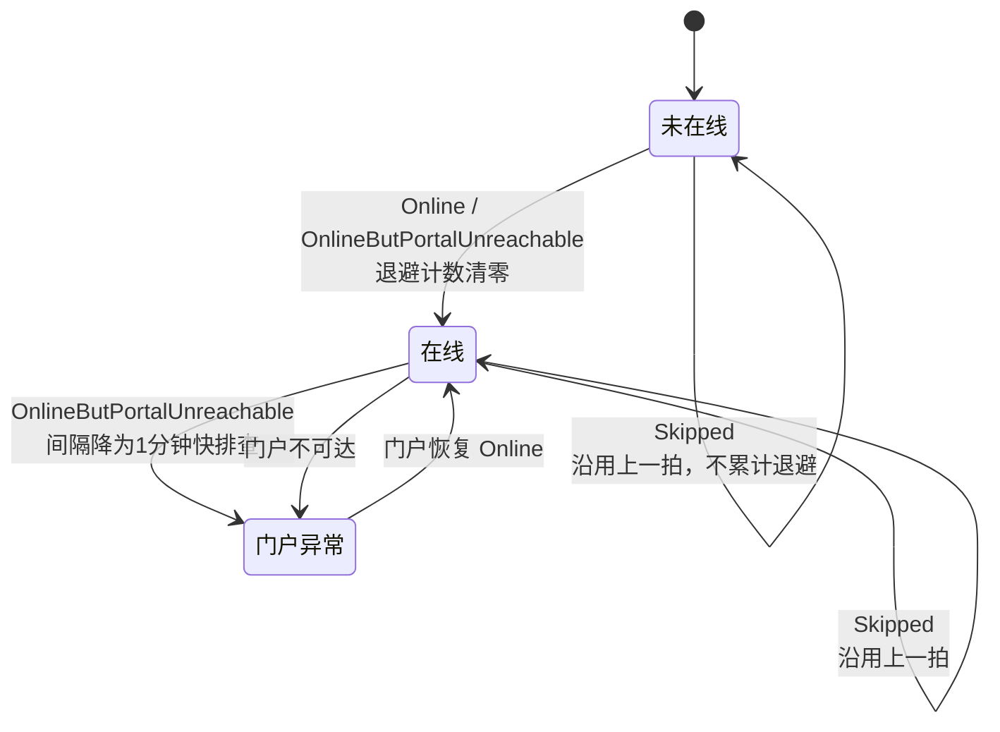
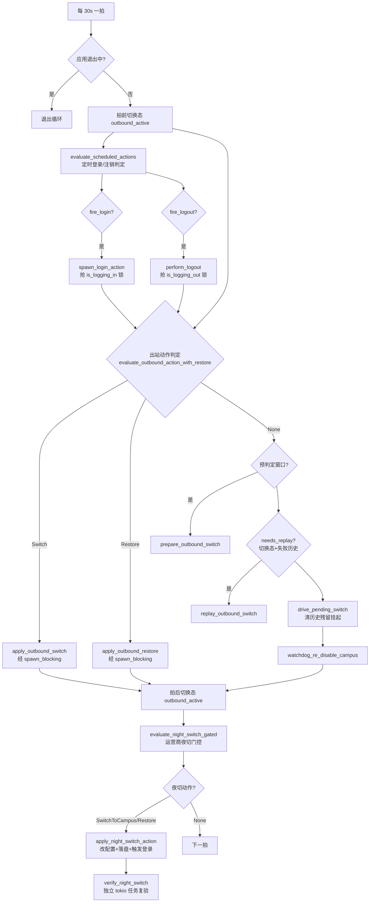
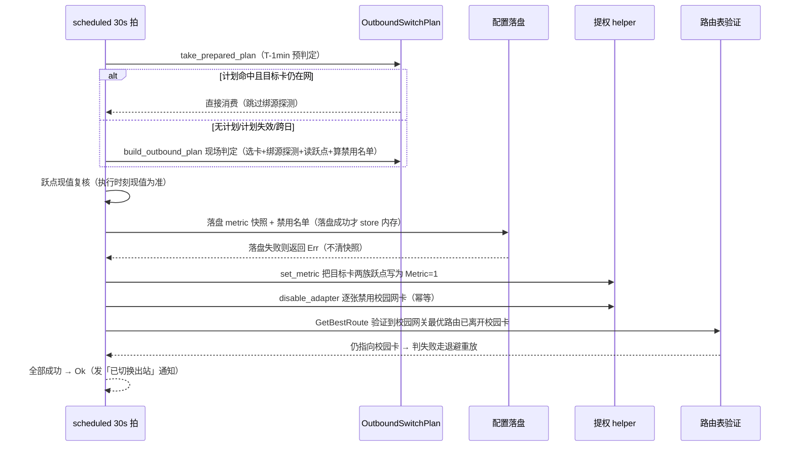
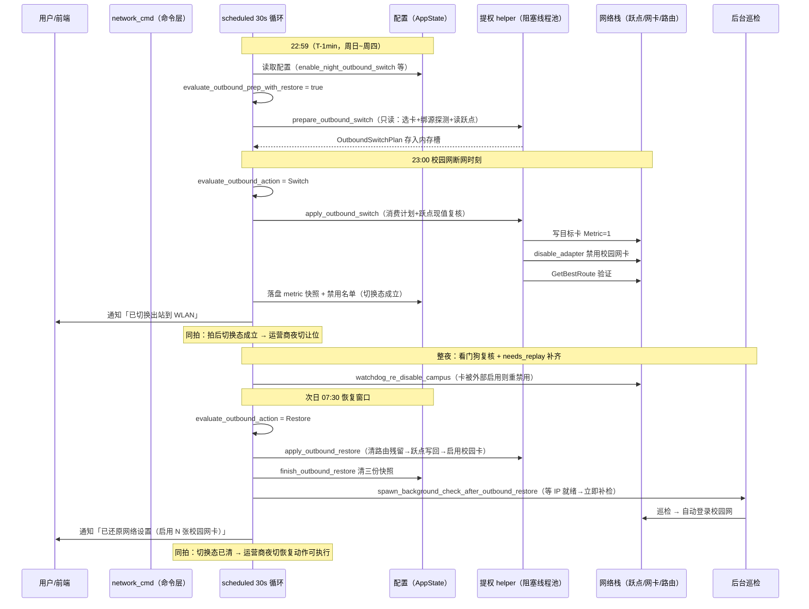

# 桌面后端监控模块（desktop_backend_monitoring）

## 简介

`tauri-app/src-tauri/src/monitor/` 是桌面端（Tauri Windows 应用）的**后台监控与定时编排**中枢。它不直接面向用户界面，而是在应用启动后以独立后台任务形式持续运行，承担四类职责：

1. **后台巡检循环**——按动态间隔检测校园网状态、Portal 在线情况，驱动自动登录/掉线重连；
2. **每日定时动作**——定时登录、定时注销、晚间断网自动切换运营商（夜切）；
3. **夜间出站切换**——校园网夜间断网时把整机出站切换到非校园网卡（改跃点、禁用校园网卡），清晨自动还原；
4. **启动期任务编排**——把上述循环在应用启动时统一拉起并纳入任务管理器跟踪。

模块内各子文件的组织在 `tauri-app/src-tauri/src/monitor/mod.rs` 中声明：`watcher`、`auto_auth`、`latency`、`adapter_watch`、`campus_check`、`outbound_switch`、`portal_check`、`quality_scheduler`、`background_emit`、`background_check`、`background_task`、`outbound_night`、`scheduled`、`dynamic_interval`。

本页聚焦题目给定的核心组件：`dynamic_interval.rs`、`outbound_night.rs`、`outbound_switch.rs`、`portal_check.rs`、`scheduled.rs`、`watcher.rs`；其余兄弟模块（`background_check`、`auto_auth` 等）只在交互处引用。

---

## 模块架构

```mermaid
flowchart TD
    subgraph 启动编排["watcher.rs（启动编排）"]
        RST["run_startup_tasks<br/>注册并 spawn 所有后台循环"]
    end

    subgraph 巡检循环["后台巡检族"]
        BT["background_task.rs<br/>start_background_check_inner"]
        BC["background_check.rs<br/>run_background_check"]
        PI["portal_check.rs<br/>check_adapter_portal"]
        CC["campus_check.rs<br/>check_campus_network"]
        DI["dynamic_interval.rs<br/>DynamicInterval 状态机"]
        AA["auto_auth.rs<br/>自动登录/掉线重连"]
    end

    subgraph 定时编排["scheduled.rs（30s 拍循环）"]
        SRL["run_scheduled_action_loop"]
        SL["定时登录/注销<br/>spawn_login_action / perform_logout"]
        NS["运营商夜切<br/>apply_night_switch_action"]
        VE["verify_night_switch<br/>chkstatus 复验"]
    end

    subgraph 夜间出站["outbound_night.rs（实现层）"]
        OS["apply_outbound_switch<br/>切换：写跃点+禁用校园卡"]
        OR["apply_outbound_restore<br/>还原：清快照+启用校园卡"]
        PP["prepare_outbound_switch<br/>T-1min 预判定计划"]
        RW["replay_outbound_switch<br/>未生效补齐"]
        WD["watchdog_re_disable_campus<br/>看门狗重禁用"]
        RC["reconcile_outbound_on_startup<br/>启动对账"]
        MS["manual_outbound_switch / restore<br/>手动入口"]
    end

    subgraph 动作层判定["outbound_switch.rs（纯动作层/判定辅助）"]
        IC["is_campus_adapter<br/>逐卡校园网判定"]
        SC["select_outbound_candidate<br/>出站候选选择"]
        SD["select_campus_to_disable<br/>待禁用名单"]
        SN["snapshot_json / disabled_adapters_json<br/>快照序列化"]
        SR["standby_cleanup_decision<br/>历史兜底路由删除判定"]
    end

    subgraph 配置判定["config 层（纯函数，双端单点）"]
        NT["night_switch.rs<br/>NightSwitchAction"]
        NB["outbound_switch.rs<br/>NightOutboundAction"]
        ST["scheduled_tick.rs<br/>编排门控组合"]
    end

    RST --> BT
    RST --> SRL
    RST --> RC
    RST --> AA
    BT --> BC
    BC --> CC
    BC --> PI
    BC --> AA
    BC --> DI
    SRL --> SL
    SRL --> NS
    SRL --> OS
    SRL --> OR
    SRL --> PP
    SRL --> RW
    SRL --> WD
    NS --> VE
    OS --> PP
    OS --> SN
    OS --> IC
    OS --> SC
    OS --> SD
    OR --> SR
    OS -.读取判定.-> NB
    OS -.读取判定.-> NT
    SRL -.读取组合判定.-> ST
    SL -.读取判定.-> ST
```

---

## 核心组件详解

### 1. `watcher.rs` —— 启动编排

`run_startup_tasks(app_handle)` 是应用启动后拉起全部后台循环的唯一入口（由 [desktop_backend_app_lifecycle](desktop_backend_app_lifecycle.md) 在应用就绪阶段调用）。它从 `CommandContext` / `AppState` 读取配置，按开关条件经 `task_manager.spawn` 注册可取消任务：

| 任务名 | 条件 | 行为 |
|---|---|---|
| `startup_bg_check` | `enable_background_check` | 启动后台巡检循环（`start_background_check_inner`） |
| `startup_quality_once` | `enable_network_quality` | 启动后等网络就绪立即做一次全量质量检测 |
| `startup_latency` | 质量检测 + `enable_latency_test` | 启动定时延迟测试循环（间隔每拍重读配置） |
| `startup_auto_login` | 无条件 | 启动期自动登录尝试 |
| `scheduled_actions` | 无条件 | 30s 一拍的定时动作循环（定时登录/注销/夜切/出站切换编排） |

设计要点：所有任务经 `task_manager.spawn` 注册，退出/关机时可被统一取消；注册失败只记 `log_warn`，不阻断启动。

### 2. `dynamic_interval.rs` —— 动态巡检间隔状态机

后台巡检间隔不再固定，而是随登录状态自适应：

- **三档常量**：`BACKOFF_CAP_MS = 300_000`（5 分钟）、`ONLINE_INTERVAL_MS = 600_000`（10 分钟）、`FAST_INTERVAL_MS = 60_000`（1 分钟）。
- `CheckOutcome` 四态：`NotOnline` / `Online` / `OnlineButPortalUnreachable` / `Skipped`（抢锁失败、取适配器失败等早退，保持上一拍节奏）。
- `DynamicInterval::next_ms(outcome, base_ms)`：未登录按 `base × 2^(streak-1)` 退避封顶 5 分钟；已登录档取 `10min` 与用户配置的较大者；登录成功/门户恢复自动复位退避计数。
- `portal_reset_window_open(now_min)`：MAC 重置检测只在每日 08:30（`PORTAL_RESET_START_MINUTES = 510`）之后启用——可登录时段之前门户拒绝属预期，不应累计触发换 MAC。

调用方在 `background_task.rs` 的循环里逐拍调用 `dyn_interval.next_ms(last_outcome, base_eff)`，`base_eff` 还会经轻量化模式（`app/lightweight`）调整下限。

### 3. `portal_check.rs` —— Portal 检测结果封装

`check_adapter_portal(adapter, app_handle)` 对单张适配器调用 `auth::portal::check_portal_full`，把结果收敛为 `PortalCheckResult` 三态：

- `Success { online, message, reachable, login_available, uid }`——`uid` 为 Portal 页面携带的完整在线账号（账号+运营商后缀），供夜切复验使用；
- `Error { is_request_failed }`——请求失败（`request_failed`）与异常分开，供 `failure_tracker` 做适配器级失败计数；
- `NotFound`——未找到主适配器。

每类结果都经 `EventBus::emit_login_log` 向前端推送检测日志。它是巡检循环（`background_check.rs`）判定「在线/未在线/门户不可达」的数据源。

### 4. `scheduled.rs` —— 定时动作编排循环

`run_scheduled_action_loop` 是独立轻量循环（**30 秒一拍**，分钟粒度判定），不受 `enable_background_check` 开关管（定时动作与巡检是两个独立功能）。每拍执行顺序：

关键语义：

- **定时登录/注销**：复用 `auth::service::full_login` / `full_logout`（与手动/托盘登录同一把 `is_logging_in` / `is_logging_out` 锁）；当日额度标记（`login_day` / `logout_day`）在**抢锁成功后**置位（审计 A7——被互斥跳过的拍不消耗额度）；登录失败按 30s 拍补试最多 `SCHEDULED_LOGIN_MAX_RETRIES = 20` 次（约 10 分钟窗口）后才放弃当日额度，注销仍是单次语义。
- **启动对账**：`reconcile_scheduled_logout_on_startup`——冷启动时若当日注销时刻已过，只消耗当日额度不执行动作（避免「刚打开应用就被踢下线」）；定时登录不消耗（启动补登录正是用户预期）。
- **与出站切换的硬约束互斥**（spec §2）：同拍先做出站动作，随后以**拍后**切换态门控运营商夜切——切入切换态后运营商夜切让位（从热点出站登录校园 Portal 必然失败）；出站还原未完成时夜切恢复同样等待；出站没切上（无候选）则夜切照常。定时登录在切换态下跳过且**不消耗当日标记**（还原成功后下一拍仍能补登）。
- **运营商夜切**：`apply_night_switch_action` 把当前 `operator` 暂存进 `night_operator_restore`、`operator` 置空串（=无锡学院），落盘后触发登录；`verify_night_switch` 等 15s 后查 eportal `chkstatus`（JSONP）核对在线账号 uid 与期望运营商后缀（重试 3 次、间隔 5s、单次 15s 超时），仍不符则注销重登一轮再复验，最终不符发告警通知。
- `portal_origin(portal_url)`：从配置的 portal_url 提取 origin 供 chkstatus 请求使用，空值回退默认 portal 地址；`expected_operator_display`：空串展示为「无锡学院」。

### 5. `outbound_switch.rs` —— 夜间出站动作层（纯判定与序列化）

桌面侧「切到哪张卡、禁用哪张卡」的纯函数层，判定规则与 `campus_check` 同源但按适配器粒度：

| 函数 | 职责 |
|---|---|
| `is_campus_adapter(ip, gateway, campus_gateway, portal_host, probe)` | 逐卡判定是否在校园网：IP 与校园网关同 /18 网段，或绑该卡源 IP 可达校园网关/portal 主机（`probe` 闭包注入，生产传 `check_gateway_reachable_from`，单测传纯闭包）；SSID 不参与归因 |
| `portal_probe_host(portal_url)` | 从 portal_url 提取可作绑源探测目标的私网 IPv4（域名/公网/IPv6/空值一律返回空串） |
| `effective_outbound_priority(priority, details)` | 用户已排序按原序透传；未排序默认「无线卡优先、有线卡随后」 |
| `select_outbound_candidate(...)` | 按优先级名序选出站目标卡：跳过列表外/无 IP/无网关/校园网内/自身网关不可达的卡 |
| `select_campus_to_disable(...)` | 选出要临时禁用的校园网卡：优先级内、有 IP、判校园网、非目标卡、总线可判定（`unsafe_to_disable` 注入——仅跳过实例 ID 读不到的卡；USB 网卡**不再排除**） |
| `snapshot_json(guid, rows)` | 序列化目标卡两族跃点快照为 `[{guid, family, automatic, metric}]` |
| `disabled_adapters_json` / `parse_disabled_adapters` | 待禁用名单 `[{guid, name}]` 序列化/解析（空串→空名单；非法 JSON→Err，与「无禁用动作」严格区分） |
| `StandbyRoute` / `parse_standby_route` | 历史兜底默认路由快照（2026-10-18 事故后**不再创建**，只保留解析能力供还原清理残留） |
| `standby_cleanup_decision(same_key_metrics, standby_metric, rows_outside_exact)` | 删除判定四态 `StandbyCleanup`：`AlreadyGone`（表里没有）/ `ForeignRowKept`（跃点不符=用户自己的行）/ `LastDefaultPath`（删了直接断网）/ `Safe`（可安全删除） |

> 历史背景：原「兜底默认路由」第三步已于 2026-10-18 事故后彻底删除——它与目标卡自己的 DHCP 默认路由共享「下一跳+接口」、只差跃点，Windows 判重不看跃点，既加不上（每夜重放），删时又会误删用户自己的默认路由（WLAN 直接断网）。

### 6. `outbound_night.rs` —— 夜间出站实现层

这是本模块最厚的实现文件，把 `outbound_switch.rs` 的纯判定落到**系统写入**（经提权 helper）。核心概念与常量：

- **切换态快照**（三份，落盘成功才认定切换态成立）：`outbound_metric_restore`（跃点快照）、`outbound_disabled_adapters`（禁用名单）、`outbound_standby_route`（历史兜底路由）。任一非空即 `outbound_switch_active`。
- **退避阶梯**：切换/还原各自独立记账（`OUTBOUND_SWITCH_*` / `OUTBOUND_RESTORE_*`），首败 60s 起步、每失败翻倍、封顶 300s——避免 30s 一拍整夜重试刷日志/弹通知。
- **单飞闸** `OutboundActionGuard`（RAII）：切换与还原互斥，手动入口（命令线程）与 30s 调度拍（后台线程）可能同时进 `apply_outbound_*`；后到者立即返回「忙」，由下一拍或用户重试。
- **UAC 降级策略**：首试保持静默（CMSTPLUA 可用时零打扰），仅「提权通道失败」（UAC 拒绝/超时/结果文件缺失，`OUTBOUND_CHANNEL_FAIL_COUNT > 0`）才允许降级弹 UAC；业务性失败（跃点行不存在等）不抬计数（弹 UAC 无意义）。
- **告警节奏**：还原连续失败达 `OUTBOUND_RESTORE_ALERT_FAILS = 3` 发首次告警，此后每 `REMIND_EVERY = 20` 次重复一次；达 `GIVE_UP_FAILS = 40`（约 3.3 小时）损坏快照按空名单放行收尾——「卡死比残留更糟」。

#### 6.1 切换（Switch）：`apply_outbound_switch`

预判定机制（`prepare_outbound_switch` / `OutboundSwitchPlan`）：切换时刻前 1 分钟（`OUTBOUND_PREP_LEAD_MINUTES`）把**只读**的选卡、绑源 ICMP 探测、读跃点、禁用名单算好存进程内槽位（`OUTBOUND_PREPARED_PLAN`，不落盘），到点只做落盘 + 提权写入——切点（23:00/23:30）正是运营商断网时刻，晚切几秒就是多断几秒。计划保鲜期 3 分钟（`OUTBOUND_PLAN_MAX_AGE_MS`），跨日/超时丢弃回现场判定；到点复核目标卡仍在网才执行。

#### 6.2 还原（Restore）：`apply_outbound_restore`

恢复窗口 `[night_restore_minutes（默认 07:30）, 23:00)` 内按「反向顺序」执行，已完成步骤幂等：

1. **清理历史兜底路由**：只删「前缀+下一跳+接口+跃点」四元组全等那一行，且删后仍有其他默认路由；`AlreadyGone` / `ForeignRowKept` / `LastDefaultPath` 一律不动（不阻塞还原）；
2. **跃点写回**：按快照把目标卡 automatic 与 metric 原样写回；目标卡已不存在/跃点行消失 → 视为已还原（终态出口）；现值已一致的协议栈不重复提权写入；
3. **重新启用校园网卡**：走 `enable_campus_adapter`（`adapter_cache::enable_adapter`——先做 PnP problem 22 分流，命中则 pnputil 设备级启用，未命中才回落 netsh）；
4. **收尾**：`finish_outbound_restore` 清三份快照（落盘成功才 store 内存）→ 清退避 → 清「立即切换」hold → 钩子触发还原后补检（`spawn_background_check_after_outbound_restore`：等适配器 DHCP 拿 IP，最长 45s，随后发起一次一次性巡检，让自动登录第一时间评估）。

#### 6.3 辅助路径

- **补齐/重放** `replay_outbound_switch`：切换态 + 留有失败历史时（`needs_replay`），按快照幂等补写跃点/补做禁用；切换成功后失败计数清零，稳态（夜间约 900 拍）不再每拍提权空转。
- **看门狗** `watchdog_re_disable_campus`：guard 窗口 ∧ 切换态下复核禁用名单，名单内校园卡被外部重新启用（手动启用/网络重置/驱动重装）时自动重新禁用并通知一次。
- **待切换清理** `drive_pending_switch`：兼容职责——清掉旧版本登录闸写入的 `waiting-login` 挂起行（2026-10-26 起本版本不再产生挂起：登录闸方向相反，热点出口永不可能登录校园 Portal，曾导致整夜挂起不切）。
- **启动对账** `reconcile_outbound_on_startup`：循环启动前一次性——三份快照任一非空说明上次运行残留切换态：恢复窗内/功能已关闭 → 立即还原；夜间窗口内目标卡仍非校园网可用 → 重放切换；目标卡回校园网/已不存在 → 还原。
- **手动入口** `manual_outbound_switch` / `manual_outbound_restore`：经 [desktop_backend_commands](desktop_backend_commands.md) 的 `outbound_switch_now` / `outbound_restore_now` 命令暴露给前端；手动切换先落当日 hold（冻结当日自动动作）再执行，已处于切换态时拒绝（避免把已改动的跃点当原值重新快照）。

---

## 数据流：一次完整的「夜间断网 → 切换 → 清晨还原」

---

## 与周边模块的关系

| 方向 | 模块 | 关系 |
|---|---|---|
| 上游调用 | [desktop_backend_app_lifecycle](desktop_backend_app_lifecycle.md) | 应用启动时调用 `watcher::run_startup_tasks` |
| 命令入口 | [desktop_backend_commands](desktop_backend_commands.md) | `outbound_switch_now` / `outbound_restore_now`（手动切换/还原）、`start/stop/trigger_background_check`（巡检控制）等命令的后端实现多数落在本模块 |
| 判定纯函数 | [desktop_backend_configuration](desktop_backend_configuration.md) | `config::night_switch`（运营商夜切判定）、`config::outbound_switch`（出站判定+守护窗口+预判定窗口）、`config::scheduled_tick`（编排门控组合）——双端单点，桌面与安卓同语义 |
| Portal 协议 | [desktop_backend_auth_protocol](desktop_backend_auth_protocol.md) | `portal_check` 依赖 `auth::portal::check_portal_full`；夜切复验依赖 `parse_chkstatus` / `uid_matches` |
| 网络层 | [desktop_backend_networking](desktop_backend_networking.md) | 适配器枚举/缓存（`get_adapters_cached`）、绑源 ICMP（`check_gateway_reachable_from`）、`enable_adapter`（含 pnputil problem 22 分流） |
| 平台层 | [desktop_backend_platform_specific](desktop_backend_platform_specific.md) | 跃点读写（`platform::metric`）、路由表（`platform::route_table`、`best_route`）、提权 helper（`helper_spawn`）、PnP 实例 ID（`discovery::devnode`） |
| 基础设施 | [desktop_backend_infrastructure](desktop_backend_infrastructure.md) | `task_manager`（任务注册/取消）、`AppState`（配置/登录锁/当日标记）、`EventBus`（前端日志事件）、通知 |
| 安卓对照 | [android_backend_tauri](android_backend_tauri.md) 的 `monitor_loop.rs` | 双端共享 `config` 层纯判定（`evaluate_scheduled_actions` 等），副作用各自实现（桌面改跃点/禁网卡；安卓蜂窝标记） |

---

## 设计要点小结

1. **判定与副作用分离**：时间窗口/互斥门控全部收敛到 `config` 层纯函数（零 IO、双端共用测试），本模块只负责装配输入与执行副作用；
2. **快照先行**：切换态三份快照先落盘成功才认定成立，helper 失败不清快照（否则已改的跃点无从还原），重试幂等；
3. **退避 + 单飞 + 告警节流**三重防护：任何后台动作失败都不会 30s 一拍刷系统；
4. **预判定**把耗时的绑源 ICMP 探测前置到 T-1 分钟，切点只做秒级写入；
5. **还原兜底链**：启动对账 → 守护窗口 → 看门狗重禁用 → 放弃阀放行 → 还原后补检，保证「切换留下的改动」必有「还原的出口」。
