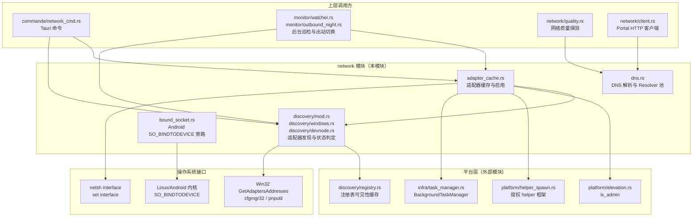
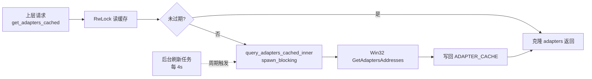
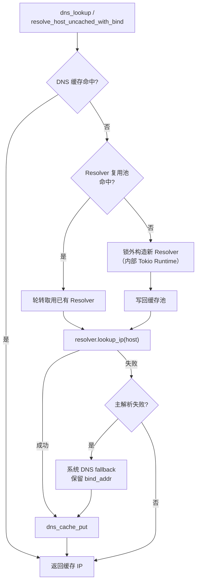
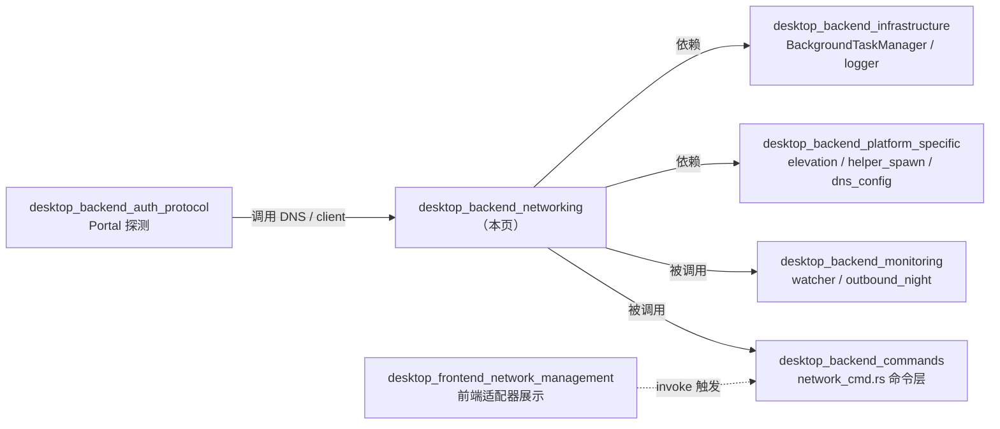
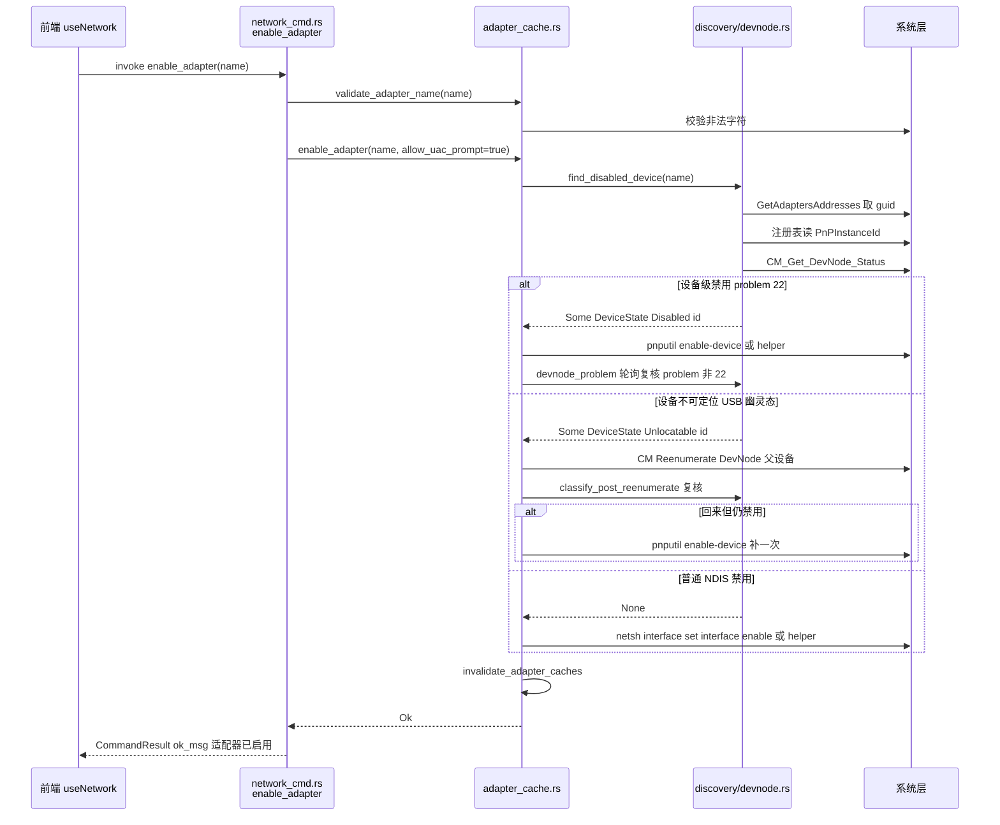

# 桌面后端网络模块（desktop_backend_networking）

## 模块简介

`desktop_backend_networking` 是 Tauri 桌面端（`tauri-app/src-tauri/src/network/`）的**网络基础设施层**，负责为本应用所有上层业务（校园网认证、后台巡检、出站切换、质量探测）提供统一的网络适配器发现、适配器缓存、设备级启用、DNS 解析与旁路连接能力。

本模块的核心职责是**屏蔽操作系统差异**：在 Windows 桌面端，通过 Win32 `GetAdaptersAddresses`、cfgmgr32（PnP 设备树）、注册表三层实现对网卡状态的精确四分类判定与设备级恢复；在 Android 端（共享同一 crate 的目标门控代码），通过 `SO_BINDTODEVICE` 实现全量 VPN 下的物理网卡旁路。模块自身不直接对接前端 UI，而是被 [desktop_backend_commands](desktop_backend_commands.md)、[desktop_backend_monitoring](desktop_backend_monitoring.md) 等模块调用。

### 核心组件一览

| 组件 | 文件 | 职责 |
| --- | --- | --- |
| `get_all_adapters_cached` / `get_adapters_cached` / `get_adapters_cached_async` / `get_adapters_force` | `network/adapter_cache.rs` | 适配器三元组（adapters / details / disabled）的 TTL 缓存读取与强制刷新 |
| `enable_adapter` | `network/adapter_cache.rs` | 按名称启用适配器（设备级禁用分流 → netsh / pnputil / 总线重枚举） |
| `validate_adapter_name` / `wait_for_adapter` / `poll_adapter_ip_quick` / `start_cache_refresh_task` | `network/adapter_cache.rs` | 名称安全校验、等待网卡上线、续租 IP 轮询、后台缓存刷新 |
| `BindCapability`（`Supported` / `Denied` / `Unavailable`） | `network/bound_socket.rs` | Android `SO_BINDTODEVICE` 能力探针与物理网卡旁路 |
| `DeviceState`（`Disabled` / `Unlocatable`） | `network/discovery/devnode.rs` | PnP 设备级禁用判定与总线重枚举 |
| `query_adapters_addresses` | `network/discovery/windows.rs` | Win32 `GetAdaptersAddresses` 调用与适配器状态四分类 |
| `dns_lookup` / `resolve_host_uncached_with_bind` | `network/dns.rs` | 带 bind_addr 的 DNS 解析、Resolver 复用池、系统 DNS fallback |

---

## 架构定位

`network` 模块位于 Rust 后端基础设施层的中段：上承命令层（前端 invoke）与监控层（后台定时任务），下接平台层（Win32 API、提权 helper、注册表）。

---

## 核心子系统详解

### 1. 适配器缓存（adapter_cache.rs）

`adapter_cache.rs` 通过一个全局 `lazy_static!` 的 `RwLock<Option<AdapterCacheEntry>>` 缓存适配器三元组，避免上层每 15s 的周期巡检反复调用阻塞的 Win32 `GetAdaptersAddresses`。

**缓存设计要点：**

- **TTL = 5 秒**：`ADAPTER_CACHE_TTL_SECS = 5`，命中路径仅做 `RwLock` 读 + 按需克隆对应 Vec（避免命中时克隆全部三个 Vec 的历史缺陷 BE-B-04）。
- **后台刷新**：`start_cache_refresh_task` 每 4 秒主动刷新一次（略短于 TTL），刷新在 `spawn_blocking` 中执行阻塞的 Win32 调用，由 `BackgroundTaskManager` 统一管理生命周期。
- **异步快路径**：`get_adapters_cached_async` 在缓存命中时直接返回（仅锁 + clone，非阻塞），未命中才走 `spawn_blocking`。
- **强制失效**：`invalidate_adapter_caches()` 在适配器可见性变更（启用/禁用/重枚举）后统一清空适配器列表缓存 + 注册表两层缓存（`refresh_class_subkey_cache` + `invalidate_show_in_ncpa_cache`）。

**`enable_adapter` 的三层分流**（`adapter_cache.rs` 核心逻辑）：

`enable_adapter(adapter_name, allow_uac_prompt)` 不是单纯调用 `netsh`，而是先做 PnP 设备级检测再分流：

1. **设备级禁用（PnP problem 22）** → `find_disabled_device` 命中 `DeviceState::Disabled` → 走 `pnputil /enable-device` 设备级启用。
2. **设备实例不可定位（USB 幽灵态）** → 命中 `DeviceState::Unlocatable` → 走 `CM_Reenumerate_DevNode` 总线重枚举，再用 `classify_post_reenumerate` 复核，必要时补一次设备级启用。
3. **普通 NDIS admin 层禁用** → 回退 `netsh interface set interface ... enable`。

非管理员场景统一经 `platform::helper_spawn::spawn_elevated_helper`（计划任务代理 → CMSTPLUA 静默提权 → runas 弹 UAC）由 SYSTEM worker 执行。

### 2. 适配器发现与状态四分类（discovery/windows.rs + devnode.rs）

**`query_adapters_addresses`** 调用 Win32 `GetAdaptersAddresses`（`AF_INET` + `GAA_FLAGS`），解析出三类输出：

- `Vec<Adapter>`：所有符合以太网/无线类型的适配器（带 IP、MAC、GUID、if_index、link_speed、status）。
- `Vec<AdapterDetail>`：仅 `Connected` 和 `EnabledNoIp` 状态的详细信息（含子网掩码、网关、DHCP 服务器）。
- `Vec<DisabledAdapter>`：仅 `Disabled` 状态的禁用适配器。

**四分类决策表**（`classify_adapter_status`，纯函数单测覆盖）：

| OperStatus | 有 IP | AdminStatus | 注册表禁用位 | PnP 存活 | 判定结果 |
| --- | --- | --- | --- | --- | --- |
| Up | 是 | — | — | — | `Connected` |
| Up | 否 | — | — | — | `EnabledNoIp` |
| Down/NotPresent | 否 | Down | 任意 | 是 | `Disabled` |
| Down/NotPresent | 否 | Up/查询失败 | 无/任意 | 是 | `Disconnected` |
| Down/NotPresent | 否 | 任意 | 任意 | 否（幽灵） | `Disconnected` |

**关键历史缺陷修复：**

- **缺陷一**：旧实现只在 `OperStatus == NotPresent` 时查 `ConfigFlags` 判禁用，但微软文档写明禁用后 `Down` 或 `NotPresent` 皆可能 → 引入 `GetIfEntry2` 的 `AdminStatus` 判定。
- **缺陷二（六期）**：拔出 USB 网卡后接口行 `AdminStatus` 残留 Down、注册表 `ConfigFlags` 残留 DISABLED 位 → 引入 PnP 设备树存活判定（`read_pnp_instance_id` + `devnode_problem`），残影一律按「未连接」处理。

**`devnode.rs` 的非持久化禁用**：

`disable_device` 使用 `CM_Disable_DevNode`（不传 `CM_DISABLE_PERSIST`），确保重启后设备自动恢复启用——避免 netsh 禁用跨重启残留为 problem 22（2026-10-19 事故实证）。这是夜间出站切换临时下线校园网卡的基础。

### 3. DNS 解析与 Resolver 复用池（dns.rs）

`dns.rs` 提供带 `bind_addr` 的域名解析能力，使不同出口接口的解析结果互不污染（split-horizon DNS 场景）。

**核心机制：**

- **DNS 缓存**：`DNS_CACHE`（DashMap，key = `host@bind_addr`），TTL = 60s，容量上限 64 条，超限时先剔过期项再按时间戳取最旧 N 条删除。
- **Resolver 复用池**：hickory 0.24 同步 Resolver 内部自带 current-thread Tokio Runtime，每次解析新建是主要固定开销。按 `(bind_addr, server 集, 超时)` 为 key 维护小池（`RESOLVER_POOL_SIZE = 4`），池满轮转复用。
- **崩溃红线**：Resolver 内部 Runtime 若在 tokio worker 线程 drop 会 panic（2026-09-28 崩溃根因）→ 退役路径统一经 `retire_resolvers` 移交 `spawn_blocking` drop。
- **系统 DNS fallback**：主解析失败时使用缓存的真实 OS 配置（`read_system_conf`）而非硬编码 Google DNS 8.8.8.8，且保留 `bind_addr` 不丢弃。
- **最优服务器选择**：`get_best_dns_servers` / `get_best_doh_servers` 按 `update_dns_server_latency` 记录的延迟排序，无有效记录时回退到 `223.5.5.5` / `1.12.12.12` / `114.114.114.114`。

### 4. Android SO_BINDTODEVICE 物理网卡旁路（bound_socket.rs）

`bound_socket.rs` 是**桌面零编译、Android 门控**的旁路模块，解决全量 VPN（Clash/UU 等）接管流量时，让 socket 探测与登录请求从物理网络（WiFi）直连校园内网。

**能力探针**：`bind_capability()` 对一次性 socket 尝试绑定 `lo`（恒存在），按 errno 分类并 `OnceLock` 缓存：

- `Ok(())` → `Supported`（内核 ≥5.7 未封堵）
- `EPERM/EACCES` → `Denied`（ROM/SELinux 封堵，旁路不可用）
- 其他错误 → `Unavailable`

**物理网卡选择**：`pick_physical_interface` 排除 VPN tun（`tun*/utun*/ppp*`）、蜂窝（`rmnet*/ccmni*`）、回环（`lo`）、dummy 虚拟口，`wlan0` 优先，其余按枚举序取首个。

**本地旁路代理**：`bypass_proxy_addr()` 在 127.0.0.1 惰性启动单请求 HTTP 转发器——reqwest 发代理请求到本地端口，转发器在旁路 socket 上以 origin-form 重放，HTTP 层（头/重定向/charset）100% 复用 reqwest，仅传输层被替换。

---

## 依赖关系与外部模块

本模块与其他文档页的关系如下：

**关键跨模块依赖：**

- [desktop_backend_commands](desktop_backend_commands.md)：`commands/network_cmd.rs` 通过 `get_adapters_cached` / `get_adapters_force` / `enable_adapter` / `get_adapter_details_cached` 对外暴露 Tauri 命令（`get_adapters`、`enable_adapter`、`get_adapter_details`）。
- [desktop_backend_monitoring](desktop_backend_monitoring.md)：`monitor/outbound_night.rs` 夜间出站切换依赖 devnode.rs 的非持久化设备级禁用临时下线校园网卡；`monitor/watcher.rs` 的启动任务统一管理缓存后台刷新。
- [desktop_backend_platform_specific](desktop_backend_platform_specific.md)：`platform/elevation.rs::is_admin()` 判定提权路径；`platform/helper_spawn.rs::spawn_elevated_helper` 执行非管理员设备级启用与 netsh；`platform/dns_config.rs` 的 `PRIMARY_DNS` / `DOH_SERVERS` 与本模块的 DNS fallback 列表对齐。
- [desktop_backend_infrastructure](desktop_backend_infrastructure.md)：`infra/task_manager.rs::BackgroundTaskManager` 托管 `start_cache_refresh_task` 的生命周期；`log_info!` / `log_debug!` / `log_warn!` 宏统一日志前缀（`adapter` / `network` / `dns`）。
- [desktop_backend_auth_protocol](desktop_backend_auth_protocol.md)：Portal 探测（`monitor/portal_check.rs`）依赖 `network/client.rs` 的 Portal HTTP 客户端，而 client 又依赖 `dns.rs` 的域名解析。

---

## 关键数据流：启用一个被禁用的适配器

---

## 关键设计决策与历史教训

模块在多次事故修复中沉淀了以下设计原则，这些原则对维护者理解代码注释至关重要：

1. **不信命令返回值，只认状态复核**：`pnputil /enable-device` 与 `netsh` 返回成功后，必须轮询 `CM_Get_DevNode_Status` 确认 problem 22 真正解除。USB 设备复核窗口 15 秒（等价物理拔插），非 USB 3 秒。
2. **查询失败 ≠ 未禁用**：`find_disabled_device` 把 `devnode_problem` 查询失败单独分流为 `DeviceState::Unlocatable`，绝不折成 `Ok(None)`（2026-10-21 整夜无法恢复事故的根因）。
3. **非持久化设备级禁用**：夜间出站切换用 `CM_Disable_DevNode`（不传 PERSIST 标志），避免重启后残留为 problem 22。
4. **Resolver 跨线程安全回收**：hickory 同步 Resolver 内部 Tokio Runtime 严禁在 worker 线程 drop，退役必须经 `retire_resolvers` 移交 `spawn_blocking`。
5. **bind_addr 参与 DNS key**：不同出口接口解析结果互不污染，fallback 路径也必须保留 `bind_addr`（历史缺陷曾在 fallback 丢弃导致双适配器场景解析失败）。
6. **适配器名称安全校验**：`validate_adapter_name` 拦截 `& | ; $ ( ) < > " '` 等字符，防止 netsh/pnputil 命令注入。

---

## 构建配置

本模块的外部依赖在 `tauri-app/src-tauri/Cargo.toml` 中声明：

- **DNS 解析**：`hickory-resolver = { version = "0.24", features = ["tokio-runtime"] }`
- **并发缓存**：`dashmap = "6"`、`parking_lot = "0.12"`、`arc-swap = "1"`、`lazy_static = "1.5"`
- **Windows 适配器/PnP**：`windows = { version = "0.58", features = ["Win32_NetworkManagement_IpHelper", "Win32_NetworkManagement_Ndis", "Win32_Networking_WinSock", "Win32_Devices_DeviceAndDriverInstallation", ...] }`、`winreg = "0.52"`
- **Android 旁路（目标门控）**：`[target.'cfg(target_os = "android")'.dependencies]` 下的 `socket2 = "0.6"`、`libc = "0.2"`、`network-interface = "2"`——桌面端零编译、零行为变化。
- **ICMP 探测**：`surge-ping = "0.8"`（供 `network/quality.rs` 使用）。

Android 物理网卡旁路的插件化封装见 [android_plugins_network_bind](android_plugins_network_bind.md)，其 Kotlin 层 `NetworkBindPlugin` 与本模块 `bound_socket.rs` 共同构成 Android 端网络绑定能力。
