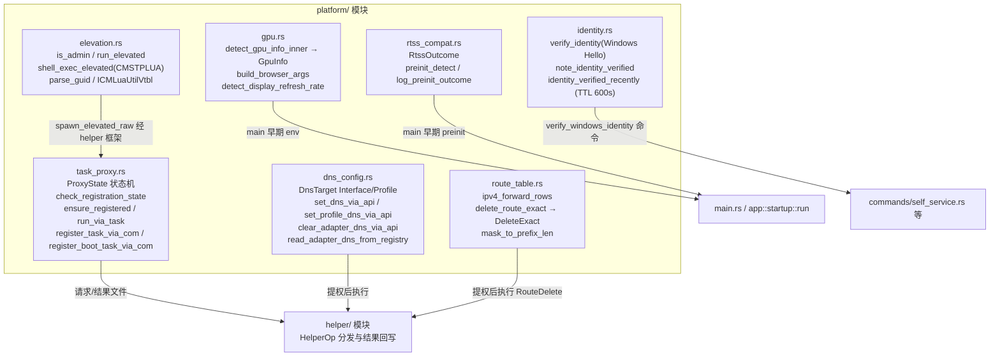
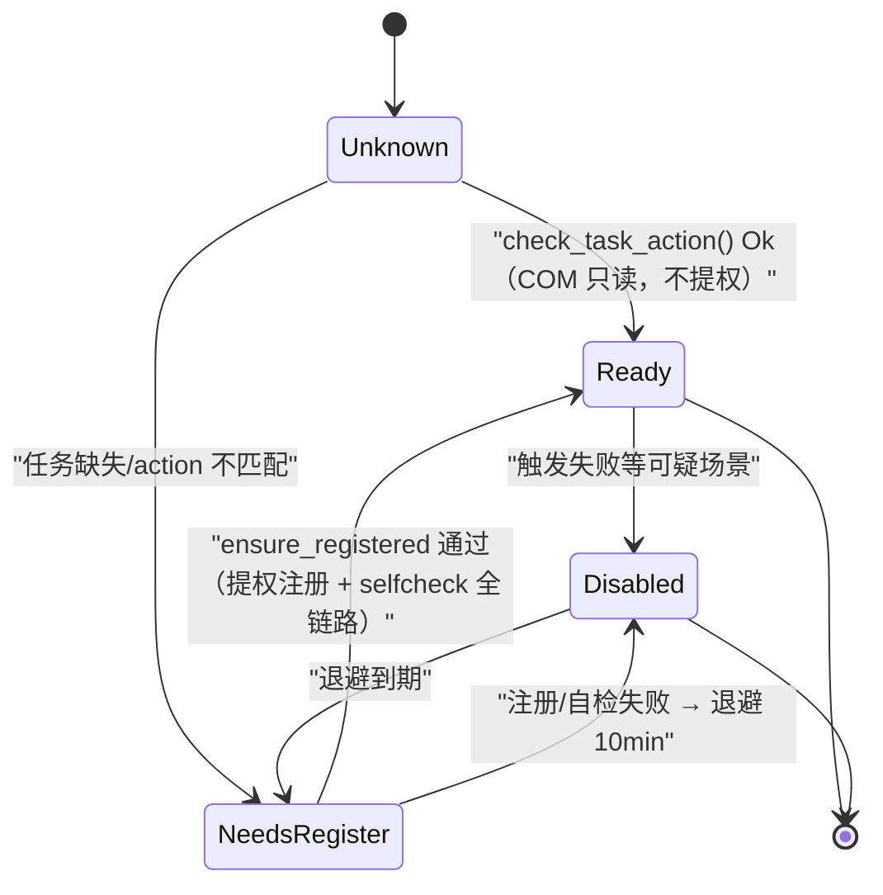
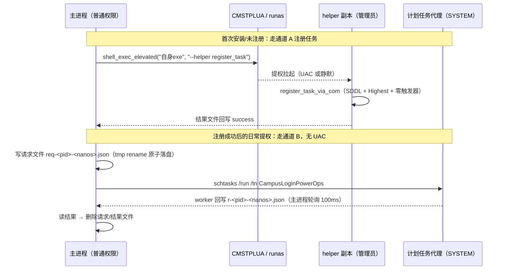
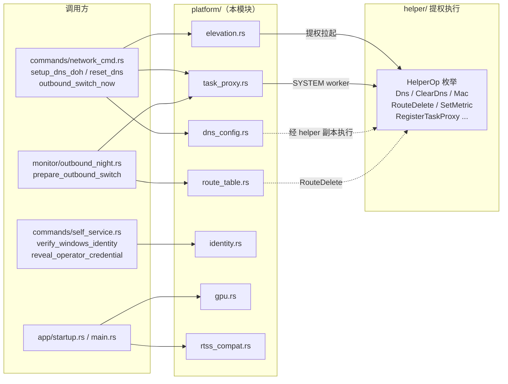

# 平台特定层（desktop_backend_platform_specific）

## 简介

`platform/` 模块是桌面端后端（`tauri-app/src-tauri`）的 **Windows 平台特定能力层**，把散落各处的 Win32 / COM / WinRT / 注册表调用收口在同一目录内，向上层（命令、监控、网络、应用生命周期）提供无平台差异的 API。它围绕四类职责展开：

1. **提权执行链**（`elevation.rs` + `task_proxy.rs`）：在无需反复弹 UAC 的前提下完成改 DNS、改 MAC、启停网卡、删路由等需要管理员/SYSTEM 权限的操作；
2. **网络平台操作**（`dns_config.rs` + `route_table.rs`）：经 IpHelper API 设置/清除适配器级与配置文件级 DNS（含 DoH 模板绑定），以及按四元组精确删除 IPv4 路由；
3. **运行环境适配**（`gpu.rs` + `rtss_compat.rs`）：GPU 分级与 WebView2 启动参数、刷新率探测、RTSS hook 注入风险告知；
4. **身份与安全**（`identity.rs`）：Windows Hello 本地身份确认及验证时效缓存。

所有文件均以 `#[cfg(target_os = "windows")]` 或 Windows-only Win32 crate 实现；跨平台行为由各调用方在其他平台上走分支或不编译本模块路径。上层调用关系详见 [desktop_backend_commands.md](desktop_backend_commands.md)、[desktop_backend_networking.md](desktop_backend_networking.md) 与 [desktop_backend_app_lifecycle.md](desktop_backend_app_lifecycle.md)。

## 模块组成

## 提权执行链

提权是本模块最核心也最复杂的能力。系统维护 **两条并行通道**：

- **通道 A（即时提权）**：主进程普通权限运行，需要管理员时经 CMSTPLUA（静默）或 `runas`（UAC）拉起自身 exe 的 `--helper <op> --result <file>` 副本执行单次操作；
- **通道 B（计划任务代理）**：以 SYSTEM 主体 + `RunLevel=Highest` 注册哑任务 `CampusLoginPowerOps`（action 固定为自身 exe + `--helper-task`），主进程经「写请求文件 + `schtasks /run` + 轮询结果文件」完成操作，**全程无 UAC**。

### 通道状态机

`ProxyState`（`Unknown / Ready / Disabled { until_ms }`）与 `RegistrationProbe`（`Ready / NeedsRegister / Disabled`）是两套面向不同入口的读取视角：提权入口用 `proxy_usable()` 快速分路，命令层用 `check_registration_state()` 决定是否尝试注册。通道可用性缓存 TTL 为 30s（`CHECK_TTL_MS`），注册类失败退避 10min（`REGISTER_RETRY_BACKOFF_MS`），防止反复弹 UAC 形成弹窗风暴。

### 安全设计

注册本身需要管理员，因此代理通道未就绪时仍依赖通道 A 兜底。`task_proxy.rs` 在架构评审中定稿的安全要点：

- **显式 SDDL** `D:P(A;;GRGX;;;BU)(A;;FA;;;BA)(A;;FA;;;SY)`：普通用户（BU）仅可触发（GRGX），不可 `/change`、`/delete`；零触发器（仅按需运行）；
- **action 校验**：每次使用前经只读 COM 查询校验任务 action 指向当前 exe 且参数为 `--helper-task`，防止旧路径被占位后 SYSTEM 执行任意代码；
- **请求/结果收口**：文件名随机（`unique_file_name`，pid + 纳秒），结果目录由 `helper::resolve_result_path` 强制纯文件名（拒绝路径分隔符、`..`、空串），杜绝 SYSTEM 写重定向到任意路径；
- **COM 作用域**：`ComScope` 在构造时 `CoInitializeEx(APARTMENTTHREADED)`、Drop 时配对释放。

### 静默提权（CMSTPLUA）的两个历史缺陷

`elevation.rs::shell_exec_elevated` 经 elevation moniker `Elevation:Administrator!new:{3E5FC7F9-9A51-4367-9063-A120244FBEC7}` 绑定 `ICMLuaUtil` 接口执行 `ShellExec`。模块注释记录了两处曾导致静默提权失效的缺陷，修复后才真正可用：

| 缺陷 | 错误现象 | 根因 |
| --- | --- | --- |
| BIND_OPTS 尺寸过小 | `0x80080017 CO_E_ELEVATION_DISABLED` | elevation moniker 要求 `BIND_OPTS3`（x64 48 字节），`cbStruct` 必须为完整结构体大小且 `dwClassContext=CLSCTX_LOCAL_SERVER`；旧实现传 16 字节 `BIND_OPTS` 被 appinfo 拒绝 |
| `ICMLuaUtilVtbl` slot 错位 | `RPC_X_BAD_STUB_DATA (0x800706F4)` | `ShellExec` 位于 vtable slot 9（UACMe `elvint.h` 权威定义）；旧实现把占位从 6 砍成 4，`shell_exec` 错排到 slot 4（实为 `SetRasEntryProperties`），参数 marshaling 不匹配 |

文件内保留了两个测试：`vtbl_shell_exec_slot_is_9`（用 `offset_of!` 断言 slot，把 vtable 越界 UB 转为签名错误）和默认忽略的 `shell_exec_elevated_smoke`（本机手动验证 BIND_OPTS3 修复）。

## 网络平台操作

### DNS + DoH 设置（dns_config.rs）

本模块通过 `SetInterfaceDnsSettings`（`DNS_INTERFACE_SETTINGS3`）替代 `netsh` 命令行设置 DNS，支持 **接口级**（`DnsTarget::Interface`，flag `DNS_SETTING_NAMESERVER`）与 **配置文件级**（`DnsTarget::Profile`，flag `DNS_SETTING_PROFILE_NAMESERVER`，仅对当前 WiFi 配置文件生效、切 WiFi 自动切换）两种作用域。内置默认服务器为阿里公共 DNS（`223.5.5.5` / `2400:3200::1`）与腾讯 DNSPod（`1.12.12.12` / `2402:4e00::`），`DOH_SERVERS` 表给出每台服务器对应的 DoH 模板 URL。

实现要点：

- **地址族分栈**：`split_families` 按是否含 `':'` 拆分 IPv4/IPv6，两次调用分别带/不带 `DNS_SETTING_IPV6`——Win32 契约要求一次调用只作用于一个栈，混合地址串会被静默丢弃；
- **DoH 绑定**：`doh_bindings` 仅为 NameServer 列表中实际存在且配置了模板的服务器生成 `ServerIndex` 绑定（历史缺陷曾对全量模板生成 `0..3`，越界 + 模板错配）；
- **两阶段填充**：先填满 `doh_settings`（裸指针定型），再构建引用它的 `doh_props`，保证到 `SetInterfaceDnsSettings` 返回前裸指针地址不变；
- **清除语义**：`clear_adapter_dns_via_api` 先清 IPv6（失败仅警告——Win11 未实测确证）再清 IPv4（失败必报错，接口级残留会覆盖 profile DNS）；
- **状态回读**：`read_adapter_dns_from_registry` 读 `HKLM\SYSTEM\CurrentControlSet\Services\Tcpip\Parameters\Interfaces`，并解析 `netsh dns show encryption` 输出还原 DoH 启用状态与模板（修复了 IPv6 条目模板串染问题）。

上层 `useDnsSetup` 前端 hook 与 `setup_dns_doh` / `reset_dns` 命令的编排见 [desktop_frontend_network_management.md](desktop_frontend_network_management.md) 与 [desktop_backend_commands.md](desktop_backend_commands.md)。

### 路由精确删除（route_table.rs）

模块注释记录了 **2026-10-18 用户 WLAN 被断事故**：旧实现用 `route.exe delete` 兜底默认路由，因 Windows 重复/删除判定只按「目的前缀 + 下一跳 + 接口」、**Metric 不参与匹配**，误删了用户自己的 DHCP 默认路由。新实现：

- `ipv4_forward_rows()`：经 `GetIpForwardTable2` 枚举全表（只读，免提权）；
- `delete_route_exact()`：先在内存中按 **四元组（目的前缀, 前缀长度, 下一跳, 接口）+ 跃点** 全等匹配，拷出整行后 `FreeMibTable`，再调 `DeleteIpForwardEntry2`；同网关+接口但跃点不同的用户 DHCP 路由永不匹配；
- 返回 `DeleteExact::Deleted` / `DeleteExact::AlreadyGone`（表内无此行 = 幂等成功）；
- `mask_to_prefix_len` 只接受连续掩码，非连续掩码报错而非猜前缀长度。

新增兜底路由能力已整体删除（同键不同跃点的条目在 Windows 上必然被判重复，`CreateIpForwardEntry2` 返回 `ERROR_OBJECT_ALREADY_EXISTS`）。该能力供夜间出站切换后的历史残留清理，调用链见 [desktop_backend_monitoring.md](desktop_backend_monitoring.md)。

## 运行环境适配

### GPU 分级与 WebView2 参数（gpu.rs）

- `detect_gpu_info_inner()`：经 DXGI `EnumAdapters1` 枚举物理适配器（跳过 `DXGI_ADAPTER_FLAG_SOFTWARE`），按 Vendor ID（`0x10DE` NVIDIA / `0x8086` Intel / `0x1002|0x1022` AMD）与型号关键词分级为 `discrete / high-igpu / mid-igpu / low-igpu / unknown`；结合注册表 `HKCU\Software\Microsoft\DirectX\UserGpuPreferences` 读取的 `gpu_preference`（0 系统默认 / 1 节能核显 / 2 高性能独显）选择最终上报的 `GpuInfo`，供前端按档位选择动画/渲染策略；
- `build_browser_args()`：main 极早期经 `WEBVIEW2_ADDITIONAL_BROWSER_ARGUMENTS` env 注入（必须先于 Tokio runtime 设置，规避 `set_var` 线程安全竞态）。2026-09-03 参数精简后仅保留 `--js-flags=--max-old-space-size=512`——原 11 个参数中多个已被 Chromium 移除或为 Android 专用，删除交还平台默认；
- `detect_display_refresh_rate()`：`EnumDisplaySettingsW(ENUM_CURRENT_SETTINGS)` 读当前刷新率。

### RTSS 兼容检测（rtss_compat.rs）

RTSS（RivaTuner Statistics Server / MSI Afterburner 组件）向 WebView2 子进程注入 `RTSSHooks64.dll`，部分机器触发 `0xc0000005` 崩溃白屏。**写入排除 profile 已实测无效**（RTSS 7.3.7 不应用手放入 Profiles 目录的 cfg），因此只做检测与告知：`preinit_detect()` 在 main 入口（WebView2 环境创建前）探测 `ProgramFiles(x86)/ProgramFiles` 下的 `RivaTuner Statistics Server\Profiles` 目录并暂存 `RtssOutcome`，待 logger 就绪后由 `log_preinit_outcome()` 留痕（已安装则警告并附手动排除步骤）。该早期调用点在 [desktop_backend_app_lifecycle.md](desktop_backend_app_lifecycle.md) 的启动流程中描述。

## Windows Hello 身份确认（identity.rs）

敏感操作（如查看明文凭据 `reveal_operator_credential`）前要求用户完成 Windows Hello 确认，**只支持指纹/面部/Hello PIN（WinRT `UserConsentVerifier`），不回退凭据对话框**。

- **验证路径**：优先走官方 interop `IUserConsentVerifierInterop::RequestVerificationForWindowAsync(hwnd, msg)`（Win11 Build 22000+），把 Consent 对话框绑定到主窗口作为子级 UI 天然置前；interop 不可用（Win10）时兜底为无绑定路径 + 后台线程轮询对话框窗口类名 `"Credential Dialog Xaml Host"` 并 `SetForegroundWindow`（12 次 × 250ms，与 Chromium/gsudo 同款）；
- **非阻塞等待**：`await_winrt_operation` 用 `SetCompleted` 回调 + tokio oneshot 把 `IAsyncOperation` 桥接为 Future；不手动 `CoInitializeEx`（依赖 windows-core 0.58 的 factory_cache 自愈 MTA）；
- **时效缓存**：`note_identity_verified()` / `identity_verified_recently()` 以原子变量记录最近一次通过时刻，TTL 600s（`IDENTITY_VERIFY_TTL_SECS`）。后端在校验敏感操作时直接查缓存，防止 webview 层绕过前端编排；`0` 哨兵表示从未验证，时钟回拨（now < verified_at）一律拒绝（有单测覆盖边界）。

## 与周边模块的关系

- **提权 op 目录**：`HelperOp`（Dns / ClearDns / Mac / EnableAdapter / DisableAdapter / RouteDelete / EnableDevice / ReenumerateDevice / SetMetric / RegisterTaskProxy / RegisterBootTask / RemoveBootTask / SelfCheck）的语义与安全收口见 [desktop_backend_infrastructure.md](desktop_backend_infrastructure.md)（`helper/mod.rs` 与 infra 层同页）；
- **网络监控消费方**：夜间出站切换与适配器禁用/启用的编排消费了 `route_table.rs` 的精确删除与 `task_proxy.rs` 的提权代理，见 [desktop_backend_monitoring.md](desktop_backend_monitoring.md)；
- **命令层暴露**：前端经 `setup_dns_doh`、`reset_dns`、`verify_windows_identity` 等 Tauri 命令间接触达本模块，命令清单见 [desktop_backend_commands.md](desktop_backend_commands.md)；
- **启动时序**：`main.rs` 中的 `--helper-task` / `--helper` 参数拦截、RTSS preinit、GPU env 注入发生在 Tauri Builder 之前，见 [desktop_backend_app_lifecycle.md](desktop_backend_app_lifecycle.md)。

## 关键设计取舍速查

| 主题 | 取舍 | 原因 |
| --- | --- | --- |
| 提权通道 | 计划任务代理优先，CMSTPLUA/runas 兜底 | 日常操作零 UAC；注册类失败 10min 退避防弹窗风暴 |
| 路由删除 | 四元组 + 跃点内存匹配后才调 API | Windows 删除判定不看跃点，误删用户 DHCP 默认路由（2026-10-18 事故） |
| DNS 设置 | IpHelper API 分栈写入 + DoH 两阶段填充 | 替代 netsh 命令行；裸指针定型前不构建引用 |
| 身份确认 | 仅 Windows Hello，TTL 600s 后端复核 | 移除 CredUI 回退路径；防 webview 绕过前端编排 |
| WebView2 参数 | 精简至单条 JS flag + Crashpad env | 原参数多被 Chromium 移除/为 Android 专用，交还平台默认最稳 |
| RTSS | 只检测告知，不写排除 profile | RTSS 7.3.7 实测忽略手放 cfg 文件 |
