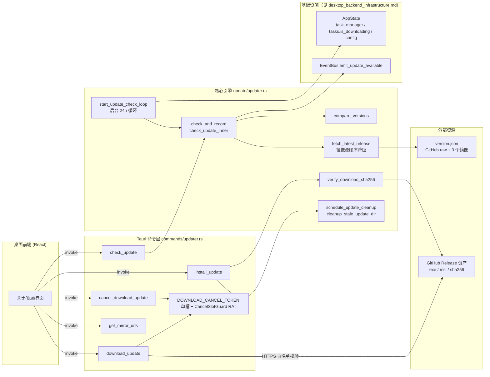
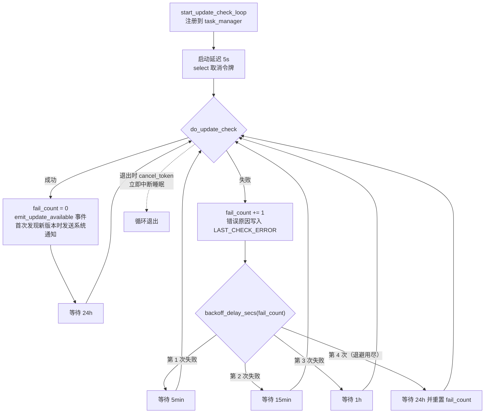
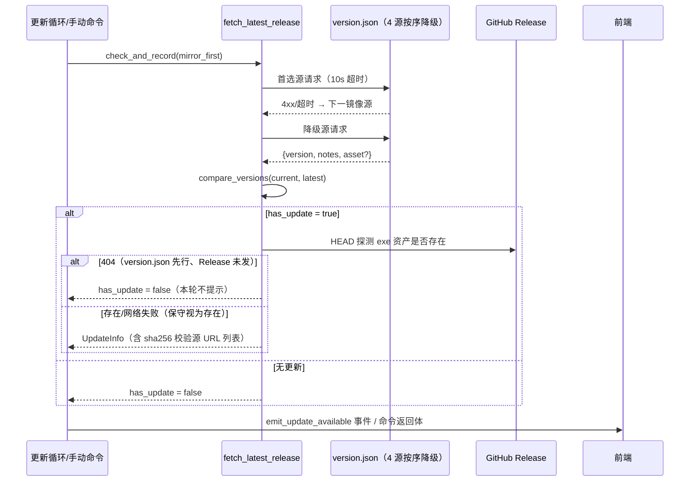
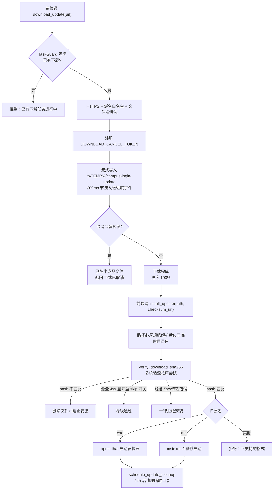
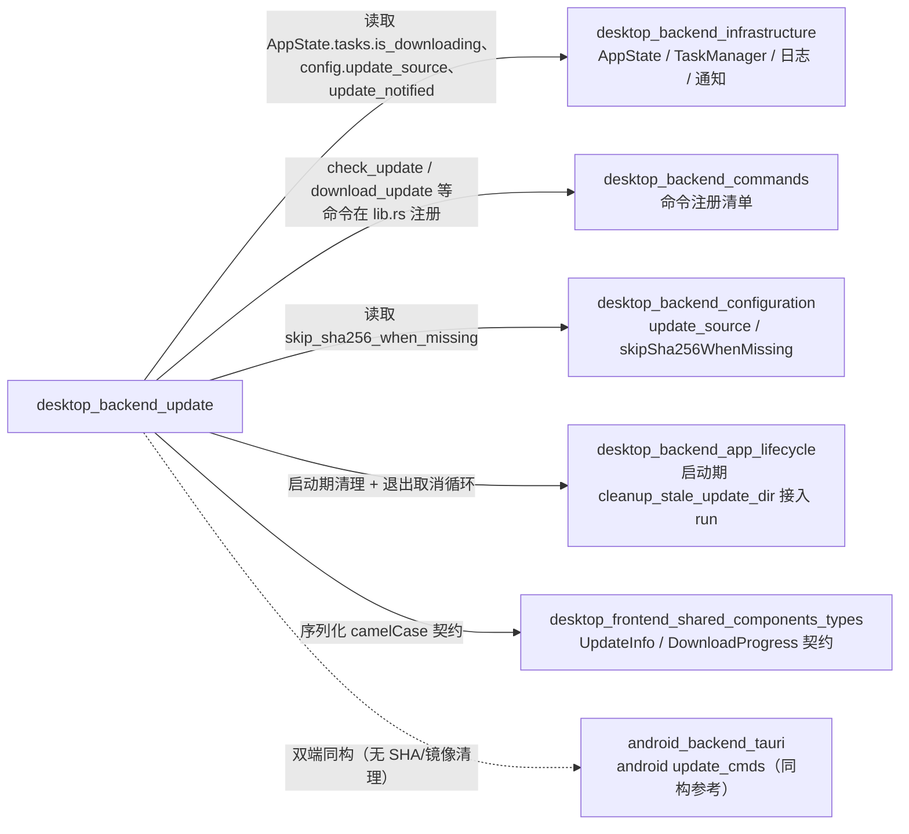

# 桌面后端更新模块（desktop_backend_update）

## 概述

`desktop_backend_update` 是桌面端（Windows 桌面应用）的应用内自动更新模块。它负责：定期与手动检查新版本、从 GitHub Release 与国内镜像源下载安装包、SHA256 完整性校验、启动安装器，以及临时下载目录的生命周期清理。模块分为两层：

- **核心引擎**：`tauri-app/src-tauri/src/update/updater.rs` —— 更新检查循环、版本比较、镜像源降级、SHA256 校验、临时目录清理等纯 Rust 逻辑。
- **Tauri 命令层**：`tauri-app/src-tauri/src/commands/updater.rs` —— 暴露给前端的 `#[tauri::command]` 接口，处理下载互斥、取消令牌、下载域白名单等安全约束。

与安卓端的更新实现（android_backend_tauri.md 中的 `update_cmds.rs`）为双端同构设计：两端都读取同一份根目录下的 [`version.json`](../version.json)（当前版本 `v2.4.3`），但桌面端额外具备镜像源降级、SHA256 校验与临时目录清理能力。

## 架构总览

## 核心组件

### 核心引擎（update/updater.rs）

| 组件 | 职责 |
| --- | --- |
| `start_update_check_loop` | 启动后台自动检查循环：启动延迟 5s 首查，之后每 24h 一次；通过 `task_manager.spawn("update_check_loop", ...)` 注册可取消任务，退出时由 `cancel_token` 中断 |
| `check_and_record` | 统一入口：执行一次检查并将结果写入模块级 `LAST_CHECK_ERROR`（`Mutex<Option<String>>`）与 `LAST_CHECK_TIME_MS`（`AtomicU64`）快照，自动循环与手动命令共用，保证两条路径的前端可见状态一致 |
| `fetch_latest_release` | 按用户配置 `update_source` 对 4 个源（官方 raw + 3 镜像）排序顺序请求 [`version.json`](../version.json)，首选失败按序降级 |
| `compare_versions` | 多段数字版本比较（非截断 3 段），正确识别 hotfix 版本（如 `2.3.0.1` > `2.3.0`）；支持 `v` 前缀与段内非数字后缀 |
| `verify_download_sha256` | 按序尝试 GitHub API digest、raw `.sha256` 文件、镜像 `.sha256` 多校验源；64KB 分块流式计算 SHA256（`spawn_blocking`，内存占用恒定） |
| `decide_checksum_missing` | 校验源全失败时的决策：全部 4xx 且用户显式开启 `skipSha256WhenMissing` → 降级通过；存在 5xx/传输错误 → 一律拒绝安装 |
| `schedule_update_cleanup` / `cleanup_stale_update_dir` | 临时目录两段式生命周期清理（见下文） |

关键常量：

| 常量 | 值 | 含义 |
| --- | --- | --- |
| `GITHUB_REPO` | `ikliml666/Wxxy-CampusLogin` | Release 归属仓库 |
| `AUTO_CHECK_INTERVAL_SECS` | `86400`（24h） | 自动检查正常周期 |
| `BACKOFF_RETRY_SECS` | `[300, 900, 3600]` | 连续失败退避档位：5min → 15min → 1h，用尽后回到 24h |
| `STARTUP_CHECK_DELAY_SECS` | `5` | 启动后首查延迟，避开启动期任务高峰 |
| `UPDATE_TEMP_DIR` | `campus-login-update` | 临时下载目录名（`%TEMP%` 下） |
| `UPDATE_STALE_SECS` | `86400`（24h） | 残留安装包保留时长 |
| `VERSION_MIRRORS` | `ghfast.top` / `gh-proxy.com` / `ghproxy.net` | version.json 镜像源列表 |

### Tauri 命令层（commands/updater.rs）

| 命令 | 职责 |
| --- | --- |
| `check_update` | 手动检查更新：读取配置 `update_source` 决定镜像优先顺序，返回 `UpdateInfo`（含 `lastCheckError` / `lastCheckTime` 快照） |
| `download_update(url)` | 下载安装包：`TaskGuard` 互斥（同时最多一个下载）、仅允许 HTTPS、下载域白名单（GitHub 系 + 6 个镜像域名）、文件名清洗防路径穿越、500MB 大小上限、200ms 节流发送 `DownloadProgress` 事件 |
| `cancel_download_update` | 取消进行中下载：通过 `DOWNLOAD_CANCEL_TOKEN` 单槽取出取消令牌触发；下载侧在连接、chunk 读取、每个 chunk 边界均检查取消并删除半成品文件；无下载时幂等返回 `false` |
| `install_update(file_path, checksum_url)` | 路径规范解析并约束在临时目录内 → 执行 SHA256 校验（不匹配/校验失败即删除文件并阻止安装）→ `.exe` 走 `open::that`，`.msi` 走 `msiexec /i`（隐藏窗口 `0x08000000`）→ 成功后调度临时目录清理 |
| `get_mirror_urls(github_url)` | 将 GitHub Release 下载 URL 展开为 4 条镜像候选（官方 + 3 镜像），供前端让用户切换下载源 |

### 前端数据契约

前端类型定义于 [desktop_frontend_shared_components_types.md](desktop-frontend-shared-components-types.md)（`tauri-app/frontend/src/shared/types.ts`），与后端 Rust 结构体一一对应（camelCase 序列化）：

| 后端类型 | 前端类型 | 关键字段 |
| --- | --- | --- |
| `UpdateInfo` | `UpdateInfo` | `hasUpdate`、`latestVersion`、`releaseNotes`、`assets`、`sha256Checksum`（多校验源 URL 的 JSON 数组字符串）、`lastCheckError`、`lastCheckTime` |
| `DownloadProgress` | `DownloadProgress` | `downloaded`、`total`、`speed`、`percent` |
| `ReleaseAsset` | `assets[]` 元素 | `name`、`url`、`size` |
| `MirrorSource` | `MirrorSource` | `name`、`url`、`description` |

## 关键流程

### 1. 自动检查与失败退避

要点：

- 每轮等待为**单次 `tokio::time::sleep` + `select!` 取消令牌**，不使用步进轮询，每天仅 ~2 次唤醒。
- 同一版本的更新通知只发送一次（`update_notified` 用 CAS 置位）。

### 2. 版本发现与 Release 资产探测

### 3. 下载、校验与安装

## 设计要点与安全约束

- **双 HTTP 客户端隔离**：更新检查/SHA256 校验使用模块级缓存的 `reqwest::Client`（10s 短超时、原生系统代理），刻意**不**复用网络层的 `CLIENT_POOL`（该池强制 `.no_proxy()`，会改变更新下载对系统代理的语义）；下载用独立客户端（连接 30s、总时长 1800s）。
- **取消语义贯穿下载全程**：连接（`send`）、等待 chunk、每 chunk 边界均对 `cancel_token` 做 `select!` 或显式检查，卡死连接上取消能立即生效，不必等到 1800s 总超时；`CancelSlotGuard` RAII 保证任何退出路径（含 panic）都清空取消槽。
- **下载安全边界**：仅 HTTPS；域名白名单硬编码 GitHub 系与已验证可用的镜像；文件名清洗 `/:*?"<>|` 并拒绝含 `..` 的名称；写入前判 500MB 上限。
- **安装安全边界**：安装包路径必须规范解析后以临时目录为前缀（防指向任意文件）；SHA256 校验为强制项（缺省直接拒绝）；不匹配或校验过程失败都会删除文件。
- **临时目录两段式清理**：
  1. `schedule_update_cleanup`：安装成功后 24h 删除整个目录，删除前检查 `is_downloading` 标志避免删掉进行中的下载；
  2. `cleanup_stale_update_dir`：启动期兜底，按文件 mtime 删除超 24h 的 exe/msi/sha256 残留（进行中的下载会刷新 mtime，不受影响），解决进程提前退出导致定时器消亡、目录永久残留的问题。
- **检查状态可见性**：自动检查失败原本仅写日志、前端误判"已是最新"；现在失败原因与最近检查时间通过 `lastCheckError` / `lastCheckTime` 随返回体快照回传，用户手动检查成功时仍能看到此前失败原因。
- **测试覆盖**（`#[cfg(test)] mod tests`）：退避档位表、hotfix 四段版本比较、BSD/shasum 风格校验和提取、`decide_checksum_missing` 的 4xx/5xx/传输错误决策矩阵、`UpdateInfo` camelCase 序列化兼容性。

## 与其他模块的关系

- **desktop_backend_infrastructure.md**：依赖 `AppState` 的 `task_manager`（可取消任务注册）、`tasks.is_downloading`（下载互斥护栏）、`config`（`update_source`、`skip_sha256_when_missing`）、`update_stats.update_notified` 通知去重，以及 `log_info!` / `log_warn!` 宏与 `emit_notification` 通知通道。
- **desktop_backend_app_lifecycle.md**：`run` 启动流程负责接入 `start_update_check_loop` 与启动期 `cleanup_stale_update_dir`；退出流程通过 `task_manager.shutdown()` 向本循环发送取消令牌。
- **desktop_backend_commands.md**：本模块的 6 个 Tauri 命令（`check_update`、`download_update`、`cancel_download_update`、`install_update`、`get_mirror_urls`）在后端命令注册总表中的位置。
- **desktop_backend_configuration.md**：`update_source`（`"github"` 官方优先，其余镜像优先）与 `skipSha256WhenMissing` 两项配置的定义与默认值。
- **desktop_frontend_shared_components_types.md**：前端接收事件与命令返回值的 TypeScript 类型契约。
- **android_backend_tauri.md**（安卓端 `update_cmds.rs`）：双端同构的对照实现，安卓端不涉及 SHA256 校验、镜像降级与临时目录清理。
