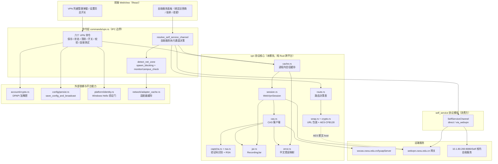
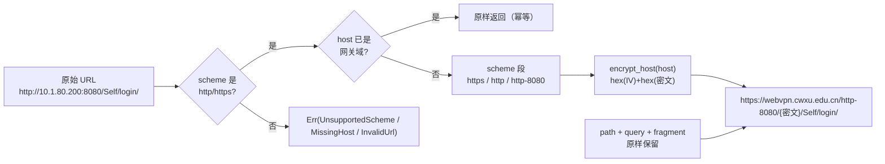
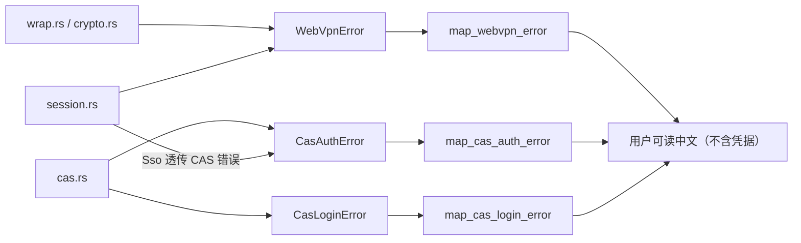
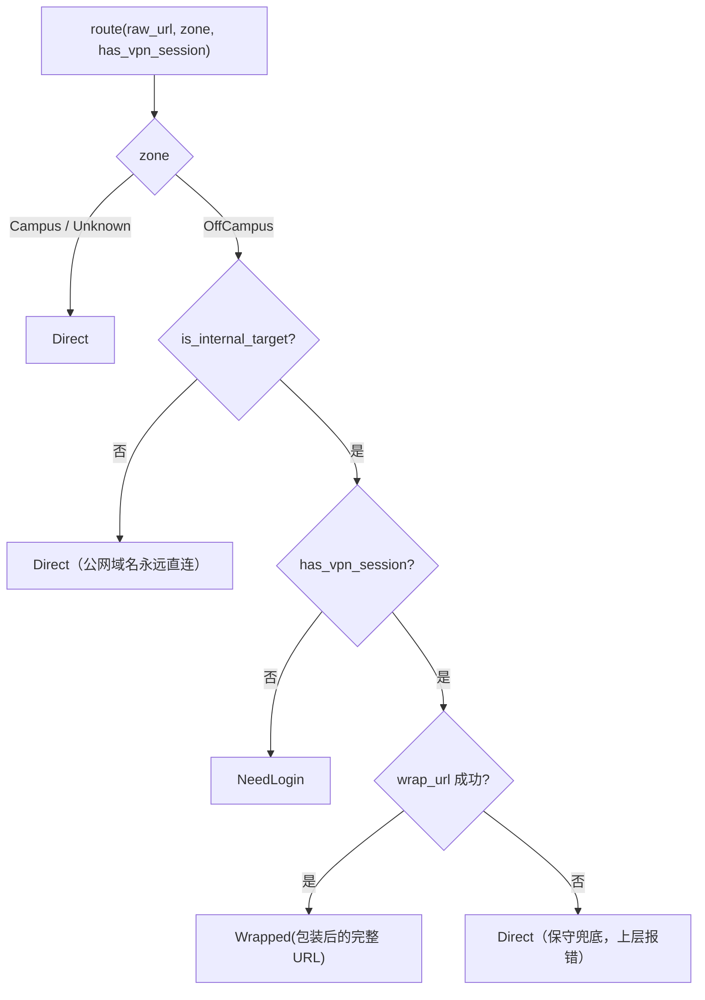
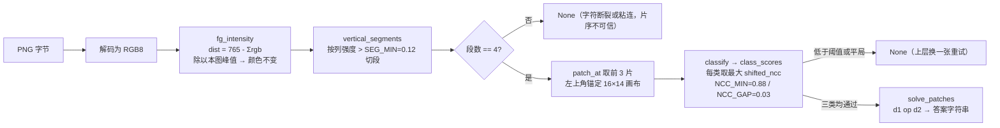
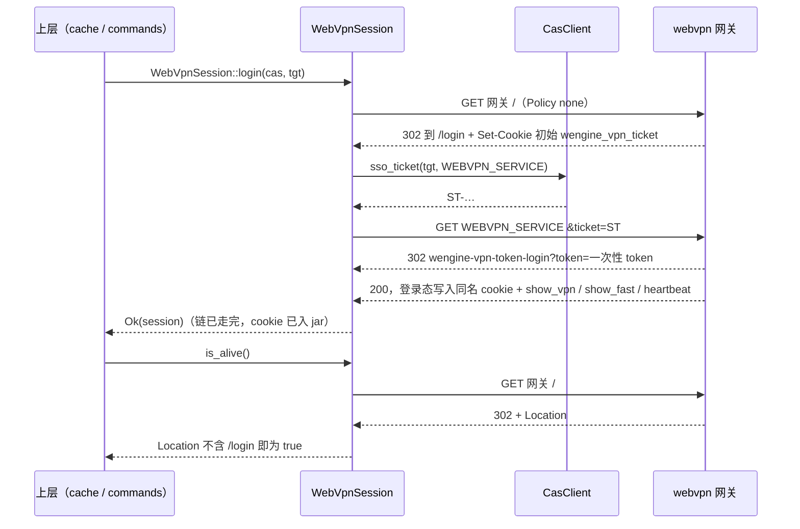
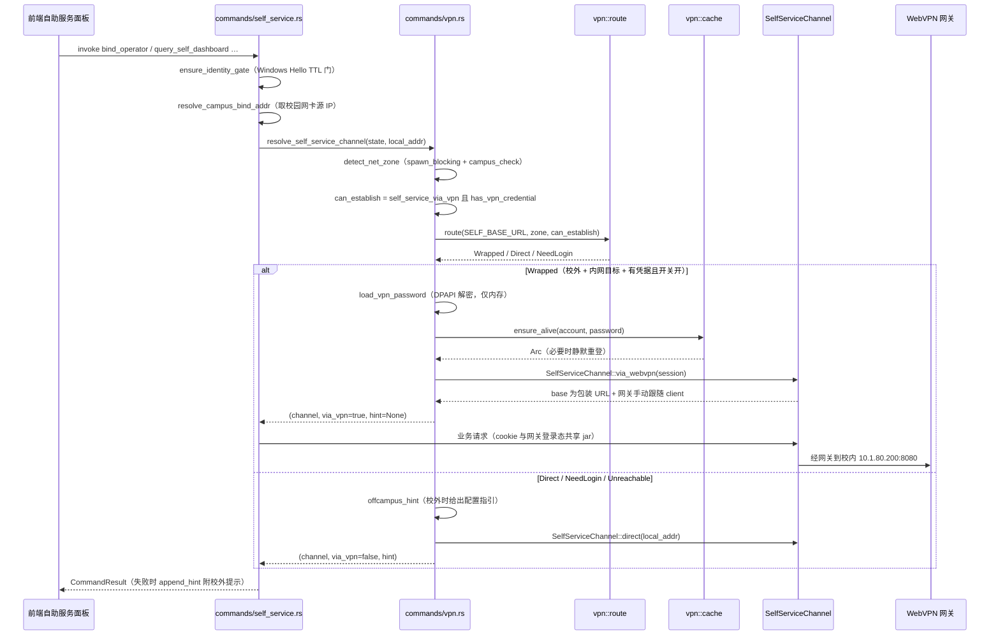
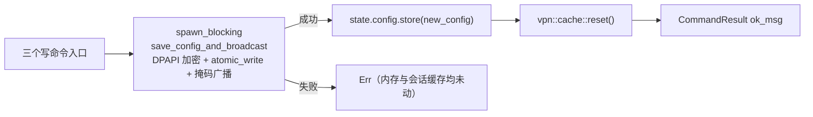
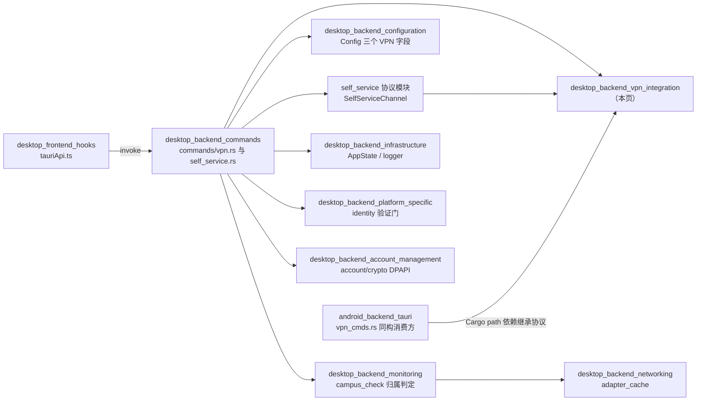

# 桌面端后端 VPN 集成模块（desktop_backend_vpn_integration）

## 1. 模块简介

`desktop_backend_vpn_integration` 是 Tauri 桌面端（`tauri-app/src-tauri/src/vpn/`）的 **深澜（Srun）WebVPN 协议核心**，2026-10-25 从独立仓库 Wxxy-CampusHub 移植而来。它解决的问题只有一个：**当用户不在校园网内时，仍然能够访问只在校内网可达的自助服务系统（`http://10.1.80.200:8080/Self`）**。

实现手段是「包装式 WebVPN」——把校内 URL 的 host 段用 AES-128-CFB128 加密成一段 hex，拼进学校网关 `https://webvpn.cwxu.edu.cn` 的代理路径，并在 CAS 统一身份认证的基础上静默建立网关会话。

模块的关键属性：

- **纯 Rust、零 Tauri 依赖、零 Windows 专属 API**：`vpn/` 整个目录可在 Windows 与 Android 双端编译，依赖全部纯 Rust（`aes` / `cfb-mode` / `hex` / `num-bigint-dig`）。安卓通过 Cargo path 依赖（`android/src-tauri/Cargo.toml` 中的 `campus-login = { path = "../../tauri-app/src-tauri" }`）**自动继承同一份协议代码**，禁止复制到 `android/` 目录。
- **协议代码单点存在**：桌面 crate 是唯一权威源，`lib.rs` 把 `pub mod vpn` 列入「跨平台协议核心」段（与 `account` / `auth` / `config` / `infra` / `network` / `platform` / `self_service` 并列），`commands` / `monitor` / `app` 等桌面专属模块不在此列。
- **算法逆向自真实网关**：包装公式、RSA 参数、CAS 错误码全集、kaptcha 渲染特性均来自实测（代码注释反复引用 `docs/cas-recon/REPORT.md`），并由 golden 向量测试锚定。

### 核心组件一览

| 子文件 | 关键符号 | 职责 |
| --- | --- | --- |
| `vpn/mod.rs` | `WebVpnError` | 协议层统一错误枚举 + 子模块声明与再导出（`route` / `NetZone` / `RouteDecision` / `WebVpnSession` / `wrap_url` / `GATEWAY`） |
| `vpn/crypto.rs` | `encrypt_host`、`decrypt_host`、`KEY` | AES-128-CFB128 host 加解密（固定 16 字节 ASCII 密钥，IV = key） |
| `vpn/wrap.rs` | `wrap_url`、`GATEWAY` | 校内 URL → 网关包装 URL（端口形态、fragment、幂等） |
| `vpn/route.rs` | `route`、`NetZone`、`RouteDecision`、`is_internal_target`、`INTERNAL_HOSTS` | 网络归属 × 目标地址 × 会话状态 → 直连/包装 决策表（纯函数无 IO） |
| `vpn/cas.rs` | `CasClient`、`CasLoginOk`、`CasLoginError`、`CaptchaInfo`、`build_login_body`、`parse_login_response`、`form_encode`、`sso_ticket`、`kaptcha_templates` | CAS 统一身份认证最小集：kaptcha → 账密登录拿 TGT → TGT 换 ST |
| `vpn/captcha.rs` | `solve`、`png_to_patches`、`solve_patches`、`class_scores`、`KaptchaTemplates`、`is_digit`、`is_op` | 算术验证码识别（颜色不变强度图 → 垂直投影切分 → 16×14 画布 → NCC 最近邻） |
| `vpn/rsa.rs` | `rsa_encrypt_hex`、`cas_token_header`、`CAS_RSA_N_HEX` | textbook RSA（Shapiro RSA.js 系无 padding，chunkSize = 126） |
| `vpn/session.rs` | `WebVpnSession`（`login` / `is_alive` / `follow_wrap` / `wrapped_client_manual`）、`login_redirect_url`、`is_login_redirect`、`COOKIE_TICKET` | WebVPN 会话：TGT 静默登录网关 + 探活 + 逐跳 transform 的重定向跟随 |
| `vpn/jar.rs` | `RecordingJar`（`CookieStore` 实现）、`snapshot` / `restore` / `has` | 委托内置 Jar 的记录型 CookieStore（后三者为预留冻结接口） |
| `vpn/cache.rs` | `cached`、`reset`、`ensure_alive`、`login_and_cache`、`store`、`login_new_session` | 进程内会话缓存（`lazy_static` + `parking_lot::RwLock`） |
| `vpn/error.rs` | `CasAuthError`、`map_cas_login_error`、`map_webvpn_error`、`map_cas_auth_error` | 协议错误 → 用户可读中文（不含任何凭据内容） |

> 命令层接入点位于 [desktop_backend_commands](desktop-backend-commands.md) 的 `commands/vpn.rs`：六个 `#[tauri::command]`（`vpn_save_credential` / `vpn_credential_status` / `vpn_clear_credential` / `set_self_service_via_vpn` / `vpn_test_connection` / `vpn_verify_credential`）加两个 `pub(crate)` 辅助函数（`resolve_self_service_channel` / `append_hint`）。本模块只提供协议，**不直接暴露 IPC**。

---

## 2. 架构定位



**依赖方向纪律**（`route.rs` 模块头注明确约定）：上层（`commands/vpn.rs`、`commands/self_service.rs`）自行探测网络归属后，把结果逐变体映射为 `NetZone`（Campus / Unknown / OffCampus 三态同名同义），**本模块不反向依赖应用层**，也不发起任何 campus 探测 IO。

---

## 3. 包装算法：crypto.rs 与 wrap.rs

### 3.1 AES-128-CFB128 host 加密

深澜网关的「路径即目标」设计把真实 host 加密成一段 hex 放进 URL path。`crypto.rs` 是这一算子的单一来源：

- 密钥为硬编码的 16 字节 ASCII 常量 `KEY = b"wrdvpnisthebest!"`，**IV 与 key 同值**（CFB128 全块段）。
- 输出形态为 `hex(IV) + hex(密文)`；前缀 `hex(IV)` 由 `hex::encode(KEY)` **派生计算**得出，注释明确要求调用方禁止硬编码该 hex 字符串。
- CFB 是流式模式：密文长度恒等于明文字节长度，**无 padding**（`cfb_stream_length_no_padding` 测试锁死形态：总长 `32 + 2 × len(host)` 字符）。
- `decrypt_host` 无生产调用方（本端只做 URL 包装加密），作为算法对称实现保留，由测试（golden 向量 / roundtrip / 坏 IV 拒绝）锚定回归：IV 段不等于固定网关 IV → `WebVpnError::InvalidIv`；hex 非法 → `InvalidHex`；非 UTF-8 → `InvalidUtf8`。

### 3.2 URL 包装形态



包装规则要点（均有单测覆盖）：

| 输入形态 | scheme 段 | 说明 |
| --- | --- | --- |
| `https://my.cwxu.edu.cn:443/login` | `/https/` | 默认端口显式给出也省略 |
| `http://10.3.100.110:8080/x` | `/http-8080/` | 非默认端口写作 `{scheme}-{port}` |
| `http://10.3.100.110` | `/http/` + 尾随 `/` | 裸 base 的根 path 得到 `/` |
| `http://10.3.100.110/app#/home` | `/http/` | fragment 原样保留 |
| 已是网关域的包装 URL | 不处理 | 幂等，绝不做二次包装 |
| `ftp://10.3.100.110/file` | — | `WebVpnError::UnsupportedScheme("ftp")` |

`GATEWAY = "https://webvpn.cwxu.edu.cn"` 是网关基址的**唯一定义处**，`wrap.rs` 注释要求「后续批次（会话与路由）统一引用本常量，勿在别处复制」。

### 3.3 协议层错误类型（`WebVpnError`）

`vpn/mod.rs` 定义的 `WebVpnError`（`thiserror`）是包装与会话两层的统一错误面，变体与来源一一对应：

| 变体 | 产生者 | 说明 |
| --- | --- | --- |
| `InvalidUrl(url::ParseError)` | `wrap_url` / `session::follow` | `#[from]` 自动转换，畸形 URL |
| `UnsupportedScheme(String)` | `wrap_url` | 仅支持 http/https |
| `MissingHost` | `wrap_url` | 网关或目标 URL 无 host 组件 |
| `InvalidHex(hex::FromHexError)` | `decrypt_host` | `#[from]` 自动转换 |
| `InvalidIv` | `decrypt_host` | IV 段缺失或不等于固定网关 IV（`#[allow(dead_code)]`，仅由测试锚定的对称实现构造） |
| `InvalidUtf8(FromUtf8Error)` | `decrypt_host` | 解密结果非合法 UTF-8 |
| `Network(reqwest::Error)` | `WebVpnSession` | 会话层网络错误（登录 302 链 / 探活请求失败），`#[from]` |
| `Sso(CasAuthError)` | `WebVpnSession::login` | CAS 换票失败（TGT 失效 / 网络 / 解析），原样透传本地 CAS 错误链 |

`CasAuthError`（`error.rs`）是 CAS 层的三变体错误面：`Rsa(String)` / `Http(reqwest::Error)` / `Parse(String)`。移植时 `Sso` 变体由上游的 `campus_auth::CampusAuthError` 改为**本地** `CasAuthError`，教务/门户会话专属变体已裁剪。

三个映射函数把技术错误转成用户可读中文，且**保证不含任何凭据内容**（有单测断言）：`map_cas_login_error`（见 §5.3 表）、`map_webvpn_error`（`WebVPN 网关连接失败：…` / `WebVPN 单点登录失败：…` / 兜底 `WebVPN 会话建立失败：{other}`）、`map_cas_auth_error`（统一前缀 `CAS 请求失败：`）。



---

## 4. 路由决策：route.rs

`route(raw_url, zone, has_vpn_session)` 是全模块唯一的「走法」判定源，被 `commands/vpn.rs::resolve_self_service_channel` 调用，从而避免命令层与协议层出现两套互相矛盾的分支。



### 4.1 决策表

| zone | 目标 | 有 WebVPN 会话 | 决策 |
| --- | --- | --- | --- |
| Campus / Unknown | 任意 | 任意 | `Direct` |
| OffCampus | 公网域名（非内网目标） | 任意 | `Direct` |
| OffCampus | 内网目标 | true | `Wrapped(wrap_url 结果)` |
| OffCampus | 内网目标 | false | `NeedLogin` |

### 4.2 四条设计取舍

1. **Unknown 按直连处理**：归属不明时不拦截用户（校内是主场景，误拦成本高于误放）。直连失败由上层以中文报错兜底；**刻意不做「先直连失败再自动改走 WebVPN」的二次尝试**——读路径可承受一次失败重试，但写路径（绑定 / 改密 / 注销）的二次尝试触碰资金安全红线，宁可不自动化。
2. **公网域名永远 Direct**：门户 `my.cwxu.edu.cn`、CAS `wxcas.cwxu.edu.cn` 是学校的公网入口，校外本就可达；WebVPN 包装公网域名的收益为 0，反而引入网关 cookie 域隔离与 service 白名单复杂度，故不进包装范围。
3. **内网判据保守**（`is_internal_target`）：host 是 IP 字面量且首段为 `10`（10/8），或命中显式表 `INTERNAL_HOSTS = ["10.1.80.200"]`（列出只为显式钉住当前唯一目标——自助服务 `SELF_BASE_URL` 的 host，防将来改判据时漏掉），或 host 等于网关域（使已包装 URL 走幂等通道，上层因此拿到 `Wrapped(原样)`）。`.cwxu.edu.cn` 通配等更宽判据留待有实锤服务再放。注意 `192.168` / `172.16` 私网**不算**内网目标——它们不是本校服务。scheme 不参与内网判定（host 即事实），不可包装的 scheme 在 `route` 层兜底直连。
4. **`Unreachable` 是预留枚举位**：`route` 只做静态决策，「无可用路径」类判定（如网关不可达）需要网络观测，属上层职责。`unreachable_is_never_produced_by_route` 用全组合扫描锁死这一不变式；`commands/vpn.rs` 的 `match` 已就绪匹配该分支。

> `route` 是纯函数、无 IO，因此决策表可在无网络环境下做全组合单测；`is_internal_target` 对畸形输入（`"::not a url::"`）不 panic，返回 `false`。

### 4.3 `NetZone` 从何而来（上层职责）

`route` 不探测网络，归属由命令层的 `commands/vpn.rs::detect_net_zone` 提供，两侧映射一一对应：

| 上层探测结果 | `NetZone` | 说明 |
| --- | --- | --- |
| `check_campus_network(...).on_campus == true` | `Campus` | 逐卡「名称 → 网段 → 网关 → Portal」任一腿命中 |
| `check_campus_network(...).on_campus == false` | `OffCampus` | 网关与 Portal 都失败才判非校园 |
| `get_adapters_cached()` 失败 / `spawn_blocking` 任务 join 失败 | `Unknown` | 探测拿不到输入时按 Unknown，与决策表一致：走直连、不做二次尝试 |

由于校园网判定是**同步阻塞实现**（netsh、ICMP、Win32 适配器枚举），`detect_net_zone` 把整段探测放进 `tauri::async_runtime::spawn_blocking`，绝不在 async worker 上阻塞。安卓侧 `detect_net_zone` 结构等价，探测源换成 `campus_detect::probe_campus_with_ssid`（见 [android_backend_tauri](android-backend-tauri.md)）。

---

## 5. CAS 统一身份认证：cas.rs + rsa.rs + captcha.rs

### 5.1 协议常量与登录时序

```mermaid
sequenceDiagram
    participant CL as CasClient
    participant GW as wxcas lyuapServer
    participant TP as captcha 识别器

    CL->>GW: GET /kaptcha
    GW-->>CL: JSON kaptchaType / uid / content（data:image/png;base64）
    CL->>TP: base64 解码后的 PNG
    TP-->>CL: 算术答案或 None
    Note over CL,TP: 不达阈值就换一张，绝不硬猜
    CL->>CL: cas_token_header(now_ms) 即 RSA("lyasp" + 毫秒)
    CL->>GW: POST /v1/tickets 头 token + 七字段表单
    GW-->>CL: 顶层 JSON {tgt, ticket}
    CL->>GW: POST /v1/tickets/{tgt} body service=WEBVPN_SERVICE
    GW-->>CL: 纯文本 ST-…
```

| 常量 | 取值 | 用途 |
| --- | --- | --- |
| `CAS_BASE` | `https://wxcas.cwxu.edu.cn/lyuapServer` | CAS 服务基址 |
| `PORTAL_SERVICE` | `https://my.cwxu.edu.cn/shiro-cas` | 登录时注册的 service（门户） |
| `WEBVPN_SERVICE` | `https://webvpn.cwxu.edu.cn/login?cas_login=true` | WebVPN 网关在 CAS 端注册的 service（换票用） |

关键协议事实（注释中标注为实测结论）：

- **CAS 服务端不种任何登录 cookie**（jar 实测登录后为空），会话复用全靠客户端保存 `CasLoginOk.tgt`，因此 TGT **必须由调用方持久化**。
- `sso_ticket` 每次现换：ST 一次性且绑定 service，不做缓存。响应非 `ST-` 前缀（含错误页 / JSON）即报 `CasAuthError::Parse`。
- 请求头 `token` = `cas_token_header(now_ms)`，毫秒时间戳在 `login` 方法内取当前时刻。
- Referer（带编码后的 service）与 Origin 头按浏览器行为补齐；UA 为真实 Chrome 串（深澜按 UA 出响应，不额外模拟）。
- 2026-10-25 起服务端**强制校验验证码**（空 id/code 登录恒 `CODEFALSE`），故 kaptcha 流程与自动识别器为必需路径。
- `login` 请求体里的 `service` **硬编码为 `PORTAL_SERVICE`**（门户），而不是 WebVPN service：本流程只需要拿到 TGT，具体应用的 ST 由 `sso_ticket(tgt, service)` 现换。因此换 WebVPN 票时传 `WEBVPN_SERVICE`，与登录注册的 service 不同属预期行为。

### 5.2 登录请求体与 form 编码

`parse_kaptcha` 把 `GET {CAS_BASE}/kaptcha` 的响应体（私有结构 `KaptchaResp`：`kaptchaType` / `uid` / `content`）解成 `CaptchaInfo { uid, content }`；`kaptchaType` 以 `_kaptcha_type` 显式命名表示**当前不消费**（题面恒为算术图），解析失败报 `CasAuthError::Parse`。`content` 形如 `data:image/png;base64,…`，`solved_captcha` 剥掉该前缀后 base64 解码交给 `captcha::solve`；剥前缀失败或解码失败均 `continue` 换一张，不中断整体流程。

`build_login_body` 是纯函数（供离线单测），产出 7 个字段：`username / password(密文) / service / loginType(空) / id=验证码uid / code=验证码答案 / otpcode(空)`。

`form_encode` 的规则被测试逐字锁定：字母数字与 `* - . _` 保留、空格转 `+`、其余 `%XX`。特别地，service 中的 `&` 必须编码为 `%26`，否则会破坏 form 结构。

### 5.3 错误码映射

`map_error_code` 覆盖 REPORT 记录的全集 16 码，其中 4 码专属映射、其余归 `Unknown(原样码)`：

| 服务端码 | `CasLoginError` 变体 | 中文文案（`map_cas_login_error`） |
| --- | --- | --- |
| `NOUSER` | `WrongUserOrPwd` | CAS 登录失败：账号或密码错误（请检查保存的 VPN 凭据） |
| `CODEFALSE` | `WrongCaptcha` | CAS 登录失败：验证码校验未通过（识别答案被服务端拒绝，请重试） |
| `USERLOCK` | `UserLocked` | CAS 登录失败：账号已被锁定 |
| `TWOVERIFY` | `NeedTwoVerify(data 原文)` | CAS 登录失败：需要二次验证（附服务端 data） |
| 其余 12 码（`PASSERROR` / `ISMODIFYPASS` / …） | `Unknown(raw)` | CAS 登录失败：{原样码} |
| 识别层穷尽（从未发起登录） | `CaptchaUnsolvable(n)` | CAS 验证码自动识别失败（连续 n 张未识别，请稍后重试） |
| 传输层失败 | `Network(raw)` | CAS 登录网络错误：{raw} |

`parse_login_response` 同时兼容三种成功形态：顶层 `{tgt, ticket}`（实测形态）、`data` 包裹、以及 `data` 为纯字符串时把它当 ticket（cas.js 兼容）。`ticket` 字段当前流程不消费，由 `#[allow(dead_code)]` 保留并被 parse 测试锚定。

### 5.4 RSA 密码加密（rsa.rs）

| 参数 | 取值 | 说明 |
| --- | --- | --- |
| 公钥指数 e | `0x010001`（65537） | textbook RSA，**无 padding** |
| 模数 n | `CAS_RSA_N_HEX`（258 hex 含前导 `00`） | 1024 位，源自 `docs/cas-recon/cas.js` 的 MOD |
| chunkSize | 126 字节 | = 2 × biHighIndex(n) |
| 组块方式 | 块尾补 `0x00` 至 126 字节后整块反转 | 等价 JS 的 latin1 + little-endian 组块 |
| 输出 | `write!(out, "{c:x}")` 逐块直接拼接 | hex 小写、**不补前导零** |

非 ASCII 明文被显式拒绝（`CasAuthError::Rsa`）：JS `charCodeAt` 的 UTF-16 码元语义与 latin1 字节流不等价，静默继续会产出与线上不一致的密文。密码（< 126 字节，现实必然）与 token（`"lyasp"` + 毫秒 = 18 字节）恒为单块。

### 5.5 算术验证码识别（captcha.rs）

题面形态固定为「左操作数 运算符(+/-/*) 右操作数 =」，PNG 100×25，`=` 恒为第 4 片（忽略），片序 = `[d1, op, d2]`。识别流水线：



该识别器建立在三个实测结论之上（模块头注，100 张样本逐字符标定）：

1. **渲染位置完全确定**——每个槽位字符 bbox 逐位一致（数字恒 `y=5..18`、左操作数右对齐 `x1=10`、右操作数 `x1=60`；`*` 恒 `(26,33,5,13)`；`+` 恒 `(27,39,6,18)`），无噪点、无旋转、无扭曲、单字体。因此画布**锚定原生 bbox 形状**（16×14 补零，非等比缩放）——早期 24×24 等比缩放会把类内形变放大到与类间差异同量级，是正确率仅 52.9% 的根因。
2. **颜色必须线性归一化**——字符随机着色（300 张里出现 275 种主色），`dist = 765 - Σrgb` 与字符颜色成线性比例，除以本图峰值即颜色无关；早期绝对阈值 + 亮度判定会丢浅彩字符与 `*` 的细对角臂。
3. **阈值一刀切分离**——类内 min 0.931 / 跨类 max(3↔8) 0.839，故 `NCC_MIN = 0.88`，`NCC_GAP = 0.03` 兜平局。`classify` 先把同类多模板聚合为「每类一个最大分」再跨类比较，否则同类模板之间 0.95 vs 1.00 的正常差异会被平局判定误杀（实测导致 100% 拒绝）。`shifted_ncc` 做 ±1px 位移补偿，仅抗一像素级渲染抖动。

**安全红线：宁缺勿猜。** 一切不确定路径返回 `None`（上层刷新重试），因为错答案会消耗 CAS 连续错误计数。`png_to_patches` 在段数 ≠ 4 时直接拒绝（错位片可能「自信地」匹配出错误答案，比 `None` 危险）；`is_digit` / `is_op` 作为过滤函数把数字槽与运算符槽隔离；`solve_patches` 的 `_ => return None` 分支保证不放行未知运算符；数字取值用 `to_digit(10)` 而非 `as i32`（后者会取 ASCII 码：`'8' → 56`）。重试穷尽由上层转手动输入。

模板集 `templates/kaptcha-templates.json`（约 330KB）经 `include_str!` **编译期内嵌**，由 `static TEMPLATES: OnceLock<KaptchaTemplates>` 保证进程内只解析一次（`cas.rs::kaptcha_templates()`）。

### 5.6 两级重试预算

`login_with_captcha(username, password_rsa_hex, templates, max_attempts)` 内部是**两层**循环，两层都用同一个入参数值（调用侧传 `3`，故最坏情形拉 9 张验证码、发起 3 次登录）：

| 层级 | 实现 | 上限 | 穷尽后的语义 |
| --- | --- | --- | --- |
| 内层：只解不出（识别层失败） | `solved_captcha(templates, 3)`：取 kaptcha → 剥 `data:image/png;base64,` 前缀 → base64 解码 → `solve` | 3 张 | 返回 `None`，`login_with_captcha` 立即回 `CaptchaUnsolvable(max_attempts)`——**从未发起登录请求**，不消耗服务端错误计数 |
| 外层：解出但被服务端拒（`CODEFALSE`） | `login_with_captcha` 主循环：`WrongCaptcha` → `continue` 换一张再提 | `max_attempts` 轮 | 返回**最后一轮**的 `WrongCaptcha`；若期间出现非 `CODEFALSE` 错误（`NOUSER` / `USERLOCK` / `TWOVERIFY` / `Network`）则**立即上抛**，不再重试 |

`solved_captcha` 的 `continue` 覆盖三种「这张作废」的情形：`kaptcha()` 请求失败、`content` 前缀不匹配、base64 解码失败——均计入内层预算而非报错，与「识别不达阈值」同等对待。

---

## 6. WebVPN 会话层：session.rs + jar.rs

### 6.1 登录与探活



四个要点：

- **手动跟随重定向**（`reqwest::redirect::Policy::none()`）：深澜 302 链中存在响应 body 中断的跳（hyper `IncompleteMessage`，`cas.rs` 的 sso_follow 同款教训），默认策略会整链失败；手动跟随只要 Location 与 Set-Cookie 即可继续，因此每跳都「尽力读 body」并忽略结果（body 读失败不影响 Set-Cookie 已入 jar）。
- **登录成功与否不在 `login` 内判定**：网关的登录态 cookie 与初始 cookie **同名**（`COOKIE_TICKET = "wengine_vpn_ticketwebvpn_cwxu_edu_cn"`），jar 层无法区分「初始值」与「登录态」，故 `login` 只保证 302 链走完、cookie 已入 jar，最终判定交给 `is_alive`。
- **`is_login_redirect(status, location)` 是唯一活性判据**（纯函数单测覆盖）：3xx 且 Location 含 `/login` 视为未登录；已登录的落点是 WebVPN 代理路径 `/https/<hex>/…`（hex 字符集不含 `/`，无误匹配面）。302 无 Location、5xx、4xx 一律按「未弹回」处理——失效的兜底在业务请求侧，宁可触发一次多余重登。
- **`login_redirect_url`** 用 `&` 追加 ticket（`WEBVPN_SERVICE` 自带 `?cas_login=true`），ticket 经 `url::form_urlencoded` 防御性编码。

### 6.2 逐跳 transform：follow / follow_wrap

`follow(start, transform)` 是私有实现，公共入口 `follow_wrap` 固定注入 `wrap_url`（幂等包装；包装失败原样直连）。语义要点：

- 相对 Location 先 `Url::join` 成绝对 URL 再 transform（`wrap_url` 需要绝对 URL）；
- 入口与每一跳 Location 各 transform 一次，因此 transform 必须幂等；`follow_applies_transform_per_hop_with_relative_locations` 用本地 TCP 桩服务锁死「transform 调用 2 次、两跳请求行均为 transform 后 URL」；
- `MAX_HOPS = 10`（webvpn.js 用 6 跳，这里留余量）；
- 落点 URL 的 query 原样保留（token 提取方不受包装影响）。

这是 M4「SSO 桥 / WebVPN 链路」的路由接入点：自助服务的登录 verify 以 302 Location 区分成功/失败，包装形态下 Location（`/http-8080/<hex>/Self/...` 或相对路径）仍含 `/Self/dashboard`、`/Self/login` 字样，既有判定无需修改。

`wrapped_client_manual()` 把会话的 reqwest Client 交给业务层使用——**cookie 与网关登录态共享同一 jar**，这是 WebVPN 通道免二次登录的关键。

### 6.3 RecordingJar

reqwest 0.12 的 Client 无法读回内部 `CookieStore`（私有类型），故 `jar.rs` 自实现 `reqwest::cookie::CookieStore`（`set_cookies` / `cookies` 两方法，0.12.28 均为 `&self`），**委托内置 `reqwest::cookie::Jar` 并旁路记录 (名, 值)**：

- `set_cookies` 先把待写头收集为 `Vec`（避免借用冲突），再各自记账与委托。取第一个 `;` 前的键值对、按第一个 `=` 切分（值可含 `=`，如 base64 形态的 `rememberMe`）；(名, 值) 模型不含域信息，同名后到覆盖先到（与浏览器单域语义一致）。
- `cookies` 直接委托内置 Jar，请求真正携带的逻辑完全交给 reqwest。
- `snapshot` / `restore` / `has` 与 `RESTORE_URL = "https://my.cwxu.edu.cn/"` 是 M1 会话恢复的**预留冻结接口**（全部 `#[allow(dead_code)]`）：批 3 的取舍是「WebVPN 会话不落盘、失效重登」，理由见 §6.4。
- Clone 语义：`WebVpnSession` 与 `CasClient` 均为廉价 clone（`reqwest::Client` 与 `Arc<RecordingJar>` 皆引用计数），clone 与原实例**共享同一 cookie jar**。

### 6.4 Cookie 持久化取舍（为什么会话不落盘）

| 考虑点 | 结论 |
| --- | --- |
| 恢复价值 | WebVPN 登录态 cookie 由网关一次性 token 换发，持久化恢复价值低 |
| 重登成本 | 静默重登 = 一次换票 + 一次 302 链，**无验证码、无用户交互**，成本低（前提：TGT 由调用方持久化，桌面已有 DPAPI 方案） |
| 扩展代价 | 多域恢复须把 `RecordingJar` 的 (名, 值) 快照模型扩成 (名, 值, 域) 三元组，牵动 M1 门户 `session.json` 格式与 `restore` 的单域回填语义，破坏面大于收益 |

会话失效由 `is_alive` 或业务响应暴露，上层凭 TGT 重新 `WebVpnSession::login` 完成静默重登。

---

## 7. 会话缓存：cache.rs

进程内单例 `VPN_SESSION: RwLock<Option<Arc<WebVpnSession>>>`，是「自动共存路由」的性能与正确性支撑。

| 函数 | 语义 |
| --- | --- |
| `cached()` | 取当前缓存会话克隆，**不校验活性**——活性判断是 async 网络调用，不得持锁跨 await（模块头注明示的锁纪律） |
| `reset()` | 清空缓存：保存/清除凭据、切换总开关、会话失效时调用 |
| `ensure_alive(account, password)` | 缓存命中且探活通过 → 直接复用；否则 `reset` 后 `login_and_cache` 静默重登一次 |
| `login_and_cache(...)` | 建立全新会话并写入缓存，返回 `Arc` |
| `store(session)` | 把外部建立的会话写入缓存（连接测试走完整链路成功后复用其登录态，免去紧接着的业务请求再登一次） |
| `login_new_session(...)` | 一次性建立全新会话、**不入缓存**：`CasClient::new` → `rsa_encrypt_hex` → `login_with_captcha(templates, 3)` → `WebVpnSession::login`，错误经中文映射函数转换 |

`login_with_captcha(templates, 3)` 的重试语义对齐 Hub `auth.rs` 的 `should_retry`：**WrongCaptcha 是可重试错误**（换一张再提，而非直接失败）；重试穷尽仍 `CODEFALSE` 时返回最后一轮的 `WrongCaptcha`，识别层从未成功则返回 `CaptchaUnsolvable(max_attempts)`（表示**从未发起登录请求**）。

> `account` / `password` 是 CAS 明文凭据，由调用方从加密存储解出，**仅内存传递，任何日志不得出现明文凭据**。

---

## 8. 端到端数据流：校外自助服务请求

命令层只做「决策 → 通道」的落地映射，不参与策略制定：



`resolve_self_service_channel` 返回三元组 `(channel, via_vpn, hint)`：第二项供日志标记是否走了 WebVPN（日志里账号一律经 `self_service::mask_account` 打码），第三项是校外直连时的配置指引，由 `append_hint` 用中文分号拼到失败文案尾部（`contains` 去重，提示不重复出现）。

**语义映射要点**：传给 `route` 的 `has_vpn_session` 在命令层语义是「具备建立 WebVPN 会话的条件」（总开关开 **且** 已存凭据），而非「当前已有活会话」——因为 `ensure_alive` 会静默重登把条件变成事实。因此 `NeedLogin` 只可能来自「内网目标 + 无法建会话」，此时**故意降级为直连**：让上层报到内网失败的**真实错误**，再附「保存 WebVPN 凭据 / 开启总开关」的指引，而不是替用户编造「请先登录」。

### 8.1 六个 VPN 命令的行为契约

| 命令 | 身份验证门 | 关键行为 |
| --- | --- | --- |
| `vpn_save_credential` | `ensure_identity_gate` | 账号/密码 trim 后非空校验 → `account::crypto::encrypt` DPAPI 加密 → 写入 `vpn_account` / `vpn_password_enc` → **自动开启** `self_service_via_vpn` → 落盘 + 更新内存 + `reset` 会话 → 日志只出打码账号 |
| `vpn_credential_status` | 无（查询类） | 返回 `{ saved, accountMasked, viaVpn }` 三项，密码（含密文）不出站 |
| `vpn_clear_credential` | 无（桌面侧差异） | 清空两个凭据字段并把开关置回关闭 → 落盘 + `reset` |
| `set_self_service_via_vpn` | 无 | 幂等短路（值未变直接返回「已处于开启/关闭状态」）；仅控制校外自动回退，校内始终直连 |
| `vpn_verify_credential` | 无（凭据来自弹窗输入） | 用**待保存**的账密走 `run_full_chain`，**不落盘**——通过后由前端再调 `vpn_save_credential`，避免把错误密码存进配置 |
| `vpn_test_connection` | 无 | 用**已保存**凭据走 `run_full_chain`，成功后会话入缓存供业务复用 |

`run_full_chain` 的三步中文结果：`① CAS 统一身份认证成功；② WebVPN 网关登录成功；③ 网关会话有效`。任一步失败即返回带步骤前缀的错误（① 客户端创建 / 密码加密 / CAS 认证，② 网关登录，③ 探活「网关返回登录页，请稍后重试」）。

### 8.2 配置落盘纪律

`persist_config_and_reset_session` 统一了「改 VPN 相关配置」的收尾：**先落盘再改内存**——落盘失败时命令报错且运行态不变（与 `save_config` 同则，详见 [desktop_backend_configuration](desktop-backend-configuration.md)）。落盘经 `spawn_blocking(crate::config::persist::save_config_and_broadcast)`，该出口在持久化成功后以**掩码**配置（`masked_for_display`）包裹 `{ config }` 广播 `config-changed` 事件。



### 8.3 凭据字段与掩码约定（config/model.rs）

| 字段（serde 名） | 类型 | 默认 | 语义 |
| --- | --- | --- | --- |
| `vpnAccount` | `String` | `""` | WebVPN 登录账号（学号，明文；与校园网登录 `user` 允许不同） |
| `vpnPasswordEnc` | `String` | `""` | CAS 登录密码的 **DPAPI 密文**，内存态与磁盘态同值 |
| `selfServiceViaVpn` | `bool` | `true`（`default_true`） | 自助服务校外自动回退总开关，2026-10-25 起默认开启；关闭则永远直连 |

`Config::mask_in_place` 在 `password` 之外**同样把 `vpn_password_enc` 替换为 `PASSWORD_MASK`**，注释给出的理由是：密文本机可解（DPAPI），出站即把「可离线尝试」的攻击面交给 webview，而前端 VPN 弹窗只需要 `saved` 布尔与掩码账号。所有把 `Config` 发往前端的路径必须经 `masked_for_display()` 这一唯一出口（不得手工逐字段打码）。

---

## 9. 与周边模块的关系



| 关联方 | 交互内容 |
| --- | --- |
| [desktop_backend_commands](desktop-backend-commands.md) | `commands/vpn.rs` 是本模块唯一的 IPC 门面；六个命令在 `app/startup.rs` 的 `invoke_handler` 中注册，紧随 `self_service` 八个命令之后 |
| [desktop_backend_configuration](desktop-backend-configuration.md) | `vpnAccount` / `vpnPasswordEnc` / `selfServiceViaVpn` 三字段的 serde 名是双端契约；`default_true` 决定开关默认值，`mask_in_place` 决定出站掩码 |
| [desktop_backend_account_management](desktop-backend-account-management.md) | `account::crypto::encrypt` / `decrypt` 提供 Windows DPAPI（含 `DPAPI_ENTROPY` 附加熵，旧无熵密文兼容读取后自然升级） |
| [desktop_backend_monitoring](desktop-backend-monitoring.md) | `monitor/campus_check::check_campus_network(&config, &adapters).on_campus` 是 `detect_net_zone` 的判定来源（逐卡「名称 → 网段 → 网关 → Portal」成本顺序短路） |
| [desktop_backend_networking](desktop-backend-networking.md) | `network::get_adapters_cached()` 为归属探测提供适配器快照；探测失败（拿不到适配器信息等）→ `NetZone::Unknown` → 直连 |
| [desktop_backend_platform_specific](desktop-backend-platform-specific.md) | `platform::identity::identity_verified_recently` 支撑 `ensure_identity_gate`：保存凭据这类改状态操作须在 Windows Hello 验证 TTL 内 |
| [desktop_backend_infrastructure](desktop-backend-infrastructure.md) | `AppState.config`（`load` / `store` / `load_full`）、`CommandResult` 统一返回体、`log_info!` / `log_warn!` 宏（本模块日志前缀统一为 `vpn`，自助服务侧为 `self`） |
| [android_backend_tauri](android-backend-tauri.md) | `android/src-tauri/src/vpn_cmds.rs` 与 `commands/vpn.rs` 严格同构；差异仅在凭据加密器（桌面 DPAPI / 安卓 AndroidKeyStore，见 [android_plugins_keystore](android-plugins-keystore.md)）与验证门（安卓改状态命令一律设生物识别门） |
| [desktop_frontend_hooks](desktop-frontend-hooks.md) | 前端经 `hooks/tauriApi.ts` 的 `vpnSaveCredential` / `vpnCredentialStatus` / `vpnClearCredential` / `setSelfServiceViaVpn` / `vpnTestConnection` / `vpnVerifyCredential` 调用本模块；设置页与账号页见 [desktop_frontend_settings](desktop-frontend-settings.md)、[desktop_frontend_account_management](desktop-frontend-account-management.md) |
| [desktop_backend_auth_protocol](desktop-backend-auth-protocol.md) | Portal 登录协议与 VPN 协议是**两条独立链路**（前者走校园网 Portal，后者走 WebVPN 网关）；二者的共同点是 HTTP 响应体一律经 `auth::protocol::read_bounded_body_async` 限长读取（`self_service` 消费），避免无上限读体 |

**同构但不同源的一处逻辑**：安卓侧 `resolve_self_service_channel` 使用显式 `want_vpn` 三段与条件，桌面侧则统一改走 `vpn::route::route` 决策表（桌面版本更晚收敛，注释明确「决策统一走 `route` 决策表（单一决策源），命令层只做『决策 → 通道』的落地映射」）。

---

## 10. 测试与验证策略

本模块测试密度显著高于一般业务代码——协议逆向结论只能靠回归锁住。

| 测试位置 | 类型 | 锚定内容 |
| --- | --- | --- |
| `crypto.rs::golden_vectors` | 离线 | 6 条 `hex(IV)+hex(密文)` 完整向量（前两条为本校活样本 `my.cwxu.edu.cn` / `wxcas.cwxu.edu.cn`，其余为社区通行的深澜算法向量 + 本项目预测回归基线 `10.3.100.110`），同时校验加解密双向与 IV 派生前缀 |
| `crypto.rs::roundtrip` / `cfb_stream_length_no_padding` / `decrypt_rejects_bad_iv` / `decrypt_rejects_bad_hex` | 离线 | 往返一致（含中文 host）、密文长度 = 明文长度、坏 IV 与坏 hex 拒绝 |
| `wrap.rs`（7 个测试） | 离线 | path/query/fragment 保留、端口三形态、根 path 尾斜杠、网关域幂等、拒 ftp、拒畸形 URL |
| `route.rs`（10 个测试） | 离线 | 决策表全分支、`SELF_HEX` / `HEX_103` 包装 golden（含 `http-8080` scheme 段）、已包装 URL 原样 `Wrapped`、`is_internal_target` 判据边界、非 http/https 内网目标回落直连、`Unreachable` 永不产生 |
| `cas.rs`（4 个测试） | 离线 | 七字段 form 编码形态锁（`&` 必须转 `%26`）、成功响应三种兼容形态、16 错误码映射 |
| `error.rs` | 离线 | 中文文案存在性 + 不含凭据 |
| `session.rs`（单测 + 2 个 `tokio::test`） | 半离线 | `COOKIE_TICKET` 名称防手滑改名、`login_redirect_url` 追加与编码、`is_login_redirect` 边界；`follow` 用 `stub_sequence`（本地 `TcpListener` 桩按序回放响应并记录请求首行）验证逐跳 transform 与非 3xx 即停 |
| `commands/vpn.rs`（3 个测试） | 离线 | `append_hint` 幂等、无 hint 时原样返回、`offcampus_hint` 四种组合语义 |
| `tests/captcha_solve.rs` | 集成 | `solve_synthetic_roundtrip`（合成彩色图，离线，验证颜色不变性与三种拒绝路径）；`build_templates`（`#[ignore]`，从样本 + `labels.json` 按 70/30 划分生成模板 JSON，每类最多 10 张）；`captcha_solve_eval`（**门槛：正确率 ≥ 98% 且自信错误 = 0**） |

`build_templates` 的注释记录了一条重要经验：**不用「类内均值」合成模板**——样本间存在 1px 级渲染抖动，均值会把同类 NCC 从 ~0.99 拉到阈值边缘（实测正确率从 ~100% 跌到 54%），「多模板取最大值」才是该目标的正确策略。同时它按 13 类（`0-9` + `-` + `*`）统计覆盖，缺样本类的字符识别将返回 `None`，由上层兜底。

---

## 11. 构建与依赖配置

协议层依赖全部为**纯 Rust**，在 `tauri-app/src-tauri/Cargo.toml`（第 51–63 行）集中声明并带注释说明用途：

```toml
# WebVPN 网关协议（src/vpn/，移植自 Wxxy-CampusHub 2026-10-25）：
# AES-128-CFB128 host 加密 + URL 包装 + CAS 统一认证 + 会话/路由层。
# 全部纯 Rust，Windows/Android 双端可编译
aes = "0.8"
cfb-mode = "0.8"       # CFB128（全块段）：流式模式无 padding，密文长度 = 明文长度
hex = "0.4"
thiserror = "2"
num-bigint-dig = "0.8" # CAS 登录密码 textbook RSA（Shapiro RSA.js 系无 padding）
image = { version = "0.25", default-features = false, features = ["png"] } # kaptcha PNG 解码
num-traits = "0.2"
```

配合既有依赖：`reqwest`（`default-features = false` + `rustls-tls` / `cookies` / `json` / `http2` / `charset`，**rustls 而非 openssl**，因此安卓交叉编译同样可用）、`url = "2"`、`base64 = "0.22"`、`serde_json`、`lazy_static`、`parking_lot`。

| 构建关注点 | 位置 | 说明 |
| --- | --- | --- |
| 模板资源内嵌 | `vpn/captcha.rs` → `include_str!("../../templates/kaptcha-templates.json")` | 编译期嵌入，运行时不查磁盘；注释定性为「构建脚本产物，格式应恒合法」，故解析失败直接 `expect` |
| 模板生成器 | `tauri-app/src-tauri/tests/captcha_solve.rs::build_templates`（`#[ignore]`） | 由 `tests/captcha-samples/` + `labels.json` 产出模板文件 |
| 单点源码纪律 | `android/src-tauri/Cargo.toml` → `campus-login = { path = "../../tauri-app/src-tauri" }` | 安卓继承协议、禁止复制；`lib.rs` 头注同样标注「跨平台协议核心：安卓端（path 依赖）唯一可见面，保持无桌面依赖」 |
| `image` 依赖裁剪 | `default-features = false` + `features = ["png"]` | 只需 PNG 解码，避免全格式集合膨胀二进制 |
| 双端 release profile | `tauri-app/src-tauri/Cargo.toml`（`lto = "thin"`, `codegen-units = 16`, `strip = true`）、`android/src-tauri/Cargo.toml`（`lto = "fat"`, `codegen-units = 1`, `strip = true`） | 桌面 profile 不随 path 依赖生效，安卓 workspace 根须自行声明 |
| 双端均不用 `panic = "abort"` | 两个 Cargo.toml 的 `[profile.release]` 注释 | 工作线程 panic 降级为单任务失败，避免第三方 panic 直接终止进程 |

更多构建/打包细节见 [build_deployment_configuration](build-deployment-configuration.md)、[build_deployment_configuration_desktop_build](build-deployment-configuration-desktop-build.md) 与 [build_deployment_configuration_android_build](build-deployment-configuration-android-build.md)。

---

## 12. 关键设计决策汇总

1. **决策单源**：路由策略只存在于 `route::route` 一张纯函数决策表，命令层只做「决策 → 通道」映射。新增走法必须在决策表里加行，而不是在 `match` 外面加 `if`。
2. **Unknown 不拦截、不自动二次尝试**：写路径（绑定、改密、注销）的自动重试触碰资金安全红线，宁可不自动化；失败时以中文报错 + 配置指引兜底。
3. **识别器宁缺勿猜**：`captcha::solve` 的一切失败路径返回 `None`，`classify` 用双阈值（绝对分 + 类间间隙）拒绝，因为「自信的错误」会消耗 CAS 连续错误计数并可能锁账号；集成测试把「自信错误 = 0」设为断言级红线。
4. **会话不落盘、失效静默重登**：TGT 由上层持久化，WebVPN cookie 只在内存；重登无验证码、无交互，成本远低于把 `RecordingJar` 扩成多域模型的破坏面。`snapshot` / `restore` / `has` 作为冻结接口保留但不接入。
5. **锁纪律**：`cache::cached()` 只克隆 `Arc` 不做活性判断——活性判断是 async 网络调用，持锁跨 await 会让所有并发请求排在一把 `RwLock` 上。
6. **先落盘再改内存**：VPN 配置三字段的写入命令统一经 `persist_config_and_reset_session`，落盘失败则运行态与会话缓存一律不动，杜绝「保存成功但重启回退」。
7. **凭据只在内存中明文存在**：磁盘 / 内存 / IPC 三态均保持密文或掩码（`vpn_password_enc` 内存态也是 DPAPI 密文，使用时才解密；出站一律 `PASSWORD_MASK`；日志一律 `mask_account`）。
8. **协议常量单一来源**：`GATEWAY`、`KEY`、`CAS_RSA_N_HEX`、`COOKIE_TICKET`、`INTERNAL_HOSTS`、`SELF_BASE_URL` 各只定义一次，其余位置引用；`hex(IV)` 前缀必须由 `encrypt_host` 派生计算而非硬编码字符串。
9. **手动跟随重定向是硬约束**：WebVPN 网关与自助服务两处协议都「以 302 Location 区分成功/失败与会话失效」，任何改回自动跟随的改动都会摧毁判定依据；链中 body 中断的跳也只有在手动跟随时才能容忍。
10. **安卓经 path 依赖继承协议**：`vpn/` 目录不得引入桌面专属依赖（Tauri、Windows API），否则安卓构建即失败；新增协议能力应同时验证两个 target。

---

## 13. 维护提示与常见排查

| 症状 | 定位路径 | 依据 |
| --- | --- | --- |
| 校外自助服务全部失败、日志出现「自助服务路由: OffCampus → 直连」 | 先看命令返回的提示项：`已关闭「校外经 WebVPN 访问」` 说明 `selfServiceViaVpn` 为 false；`保存 WebVPN 凭据后可在校外访问自助服务` 说明凭据缺失 | `offcampus_hint` 两分支；`can_establish` 需两者同时成立才会走包装 |
| 报「① CAS 验证码自动识别失败（连续 3 张未识别）」 | 服务端 kaptcha 渲染特性变更（字体/抖动/噪点），需重新采样并跑 `build_templates` 生成模板，再跑 `captcha_solve_eval` 验证 ≥98% | `CasLoginError::CaptchaUnsolvable` 表示**从未发起登录**，问题在识别层不在账号 |
| 报「① CAS 登录失败：账号或密码错误」 | 凭据本身错误（VPN 账号可与校园网登录 `user` 不同）；`vpn_save_credential` 前应先用 `vpn_verify_credential` 走通链路 | 保存前置校验设计（§8.1） |
| 报「② WebVPN 网关登录失败：WebVPN SSO failed」 | TGT 已失效或 CAS 换票响应非 `ST-` 前缀（服务端改版） | `WebVpnError::Sso` 透传 `CasAuthError`；重登会重新 CAS 登录取新 TGT |
| 报「③ 网关会话探活失败：网关返回登录页」 | 链已走完但登录态未生效（网关侧风控/session 上限），或探活落点判定被服务端改名 | `is_login_redirect` 匹配 Location 中的 `/login` 子串 |
| 业务请求报「登录会话失效，请重试」 | `SelfServiceChannel` 的 302 判定命中；WebVPN 通道的 client 不可重建（丢 cookie = 丢登录态），需上层整体重登 | `self_service::fresh_session_client` 的通道区分注释 |
| 改了 `KEY` 或 `GATEWAY` 后 `route.rs` / `crypto.rs` 大量测试失败 | 属预期：`HEX_103` / `SELF_HEX` / `HEX_MY` 是 golden 常量，须随算法同步更新 | 测试注释标明 golden 来源为活样本与实测 |

**改动前必读的三条硬约束**：

1. 不要在 `wrap_url` / `encrypt_host` 之外复制网关基址、密钥或 `hex(IV)` 前缀字面量——`crypto.rs` 注释与 `wrap.rs` 注释分别把这两项定为单一来源。
2. 不要把任何 reqwest Client 的 redirect policy 改回自动跟随（`session.rs` 的 `http_manual` 与 `self_service::build_session_client` 两处都是 `Policy::none()`）。
3. 不要把 `vpn_password_enc` 明文写进日志或返回给前端——出站走 `masked_for_display()`，日志走 `mask_account()`（仅打码账号，密码从不参与日志格式化）。
