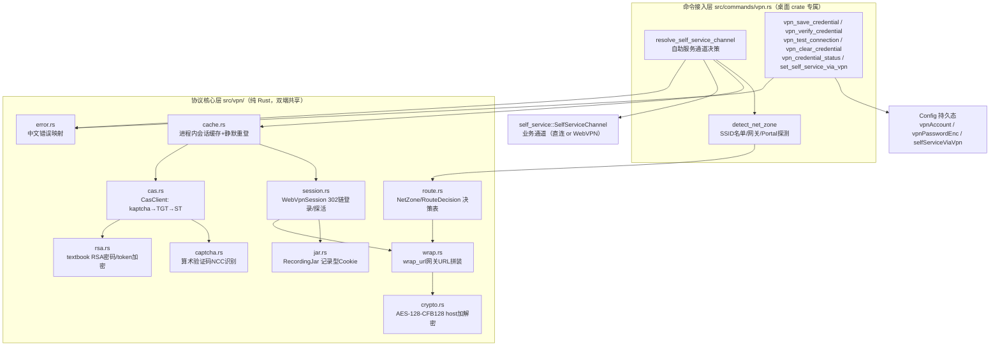
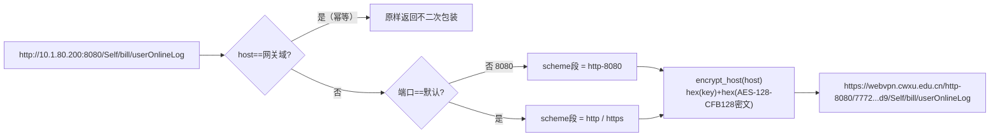
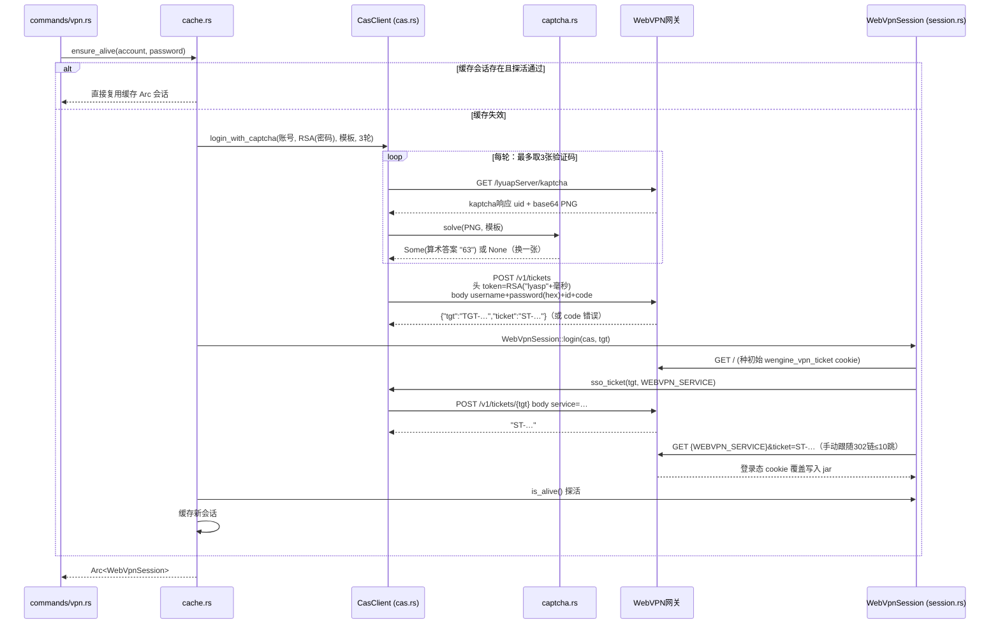
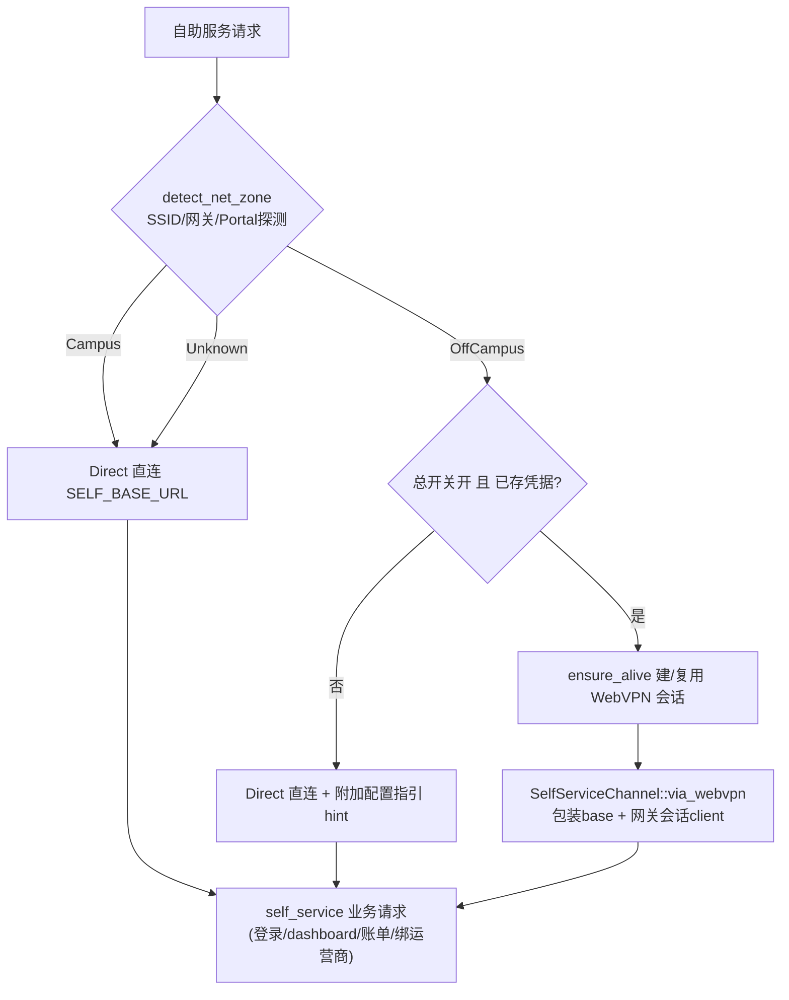
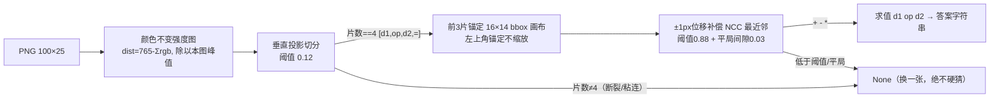
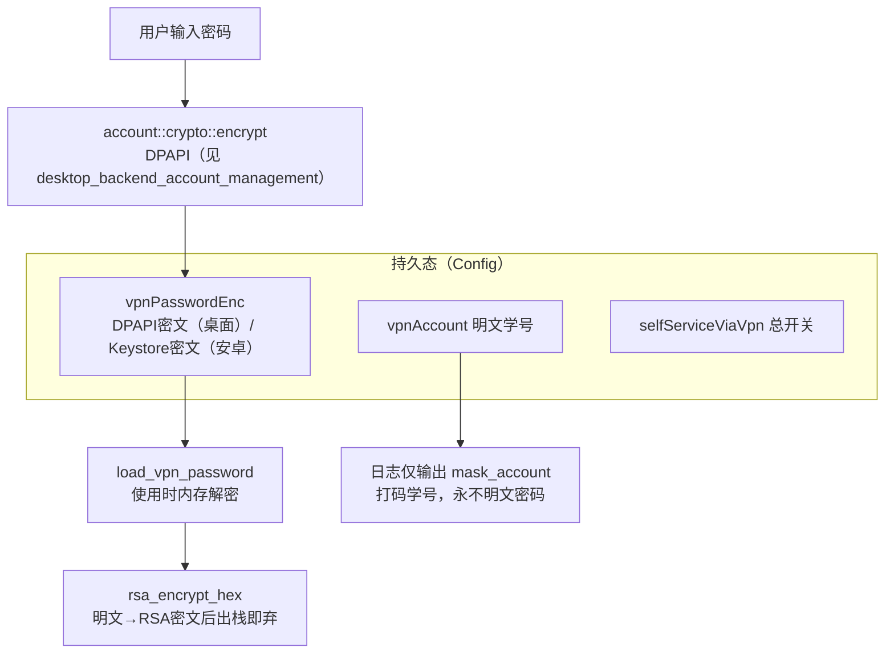
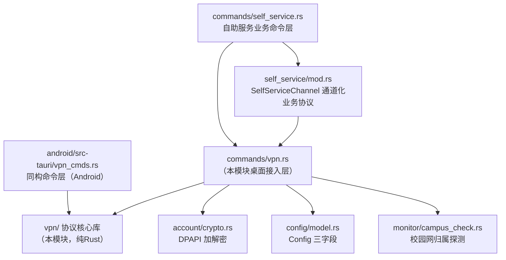
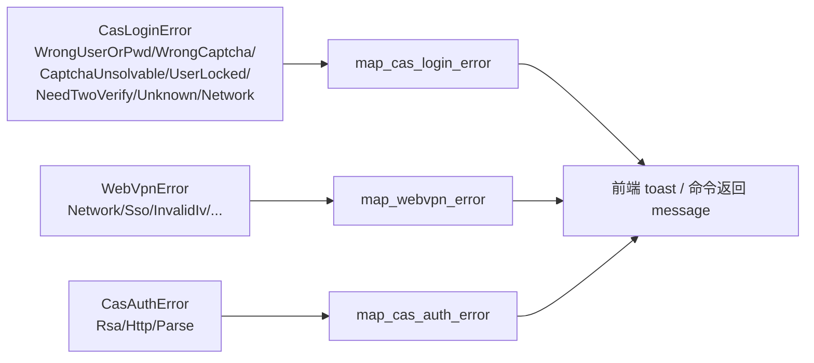

# WebVPN 集成模块（desktop_backend_vpn_integration）

## 简介

`desktop_backend_vpn_integration` 是桌面端后端（`tauri-app/src-tauri`）实现的**深澜（Srun）WebVPN 网关协议栈**，解决一个核心问题：**当用户处于校外网络时，如何仍能访问仅限校园内网可达的「自助服务系统」（`http://10.1.80.200:8080/Self`）**。

该模块整体移植自外部仓库 `Wxxy-CampusHub`（2026-10-25），全部为纯 Rust 实现（无 Tauri 运行时依赖、无 Windows 专属 API），因此以 lib crate 形式被 Android 端通过 Cargo path 依赖自动继承（见 [android_backend_tauri.md](../android_backend_tauri.md)），实现协议代码单点维护。

模块由两条主线构成：

1. **协议核心层**（`src/vpn/`）：AES-128-CFB128 host 加密、URL 包装、CAS 统一身份认证（含 kaptcha 算术验证码自动识别）、WebVPN 网关会话、进程内会话缓存、路由决策表；
2. **命令接入层**（`src/commands/vpn.rs`）：Tauri 命令（凭据保存/校验/测试/清除、总开关）与「自助服务执行通道决策」（校内直连 / 校外自动包装回退）。

## 模块组成



### 协议核心层文件一览

| 文件 | 职责 |
|---|---|
| `vpn/mod.rs` | 模块入口：re-export `WebVpnError`、`route`、`NetZone`、`RouteDecision`、`WebVpnSession`、`wrap_url`、`GATEWAY` |
| `vpn/crypto.rs` | AES-128-CFB128 流式 host 加解密；key=IV=`"wrdvpnisthebest!"`；golden 向量测试锚定 |
| `vpn/wrap.rs` | `wrap_url(raw, GATEWAY)`：`{gateway}/{scheme[-port]}/{hex(IV)+hex(密文)}/{path?query}`；对网关域输入幂等原样返回 |
| `vpn/route.rs` | 纯函数路由决策表：网络归属 × 目标地址 × 会话状态 → Direct/Wrapped/NeedLogin |
| `vpn/cas.rs` | CAS REST v1 客户端：`GET /kaptcha`、`POST /v1/tickets`（账密+验证码拿 TGT）、`POST /v1/tickets/{tgt}`（换 ST） |
| `vpn/captcha.rs` | kaptcha 算术题自动识别：颜色不变强度图 → 垂直投影切分 → 16×14 bbox 画布 → NCC 最近邻（阈值 0.88） |
| `vpn/rsa.rs` | textbook RSA（e=65537，n=1024 位固化 modulus）：密码密文与 `token` 头（`RSA("lyasp"+毫秒)`） |
| `vpn/session.rs` | `WebVpnSession`：CAS TGT 静默登录网关（手动跟随 302 链）、`is_alive()` 探活（Location 含 `/login` 即失效） |
| `vpn/cache.rs` | `VPN_SESSION` 全局 `RwLock<Option<Arc<WebVpnSession>>>`：`ensure_alive` 惰性建/复用/静默重登 |
| `vpn/jar.rs` | `RecordingJar`：委托 reqwest 内置 Jar 并记录 (名, 值)；`snapshot/restore/has` 为预留冻结接口 |
| `vpn/error.rs` | `CasAuthError` 及 `map_cas_login_error` / `map_webvpn_error` / `map_cas_auth_error` 中文文案（不含凭据） |

### 命令接入层（`commands/vpn.rs`）

| 命令 | 作用 |
|---|---|
| `vpn_save_credential` | 账号密码 → DPAPI 加密写入 `config.vpn_account` / `vpn_password_enc`，同时自动开启 `self_service_via_vpn` 总开关并重置缓存会话 |
| `vpn_verify_credential` | **不落盘**校验弹窗输入：走完整链路（CAS→网关→探活），通过后由前端再调 save |
| `vpn_test_connection` | 用已存凭据走完整链路，message 带分步结果；成功会话入缓存 |
| `vpn_clear_credential` | 清空凭据并关闭总开关 |
| `vpn_credential_status` | 返回 `{saved, accountMasked, viaVpn}` |
| `set_self_service_via_vpn` | 校外自动回退总开关（校内始终直连） |
| `resolve_self_service_channel` | 非命令、供 self_service 命令层调用的通道决策核心 |
| `append_hint` | 校外直连失败时附加「可在设置中开启/保存凭据」指引（防重复追加） |

## 核心架构

### 1. WebVPN URL 包装算法

校内 URL 到网关包装 URL 的映射是整个协议的基石（逆向自 `webvpn.cwxu.edu.cn` 活样本）：

```
{GATEWAY}/{scheme}[-{port}]/{hex(IV)+hex(AES-128-CFB128(host))}/{原path?query#fragment}
```



关键性质：
- CFB128 为流式模式，**密文长度恒等于明文长度**（无 padding）；
- `hex(IV)` 前缀由 key 派生计算，**禁止调用方硬编码**该 hex；
- 非默认端口 scheme 段写作 `{scheme}-{port}`（如 `/http-8080/`）；
- 仅支持 http/https；path/query/fragment 原样保留。

### 2. 会话建立全链路



设计取舍：**WebVPN 登录态 cookie 不落盘、内存持有、失效静默重登**。因为 CAS 服务端不种登录 cookie（TGT 由客户端凭凭据重新登录即可换），静默重登 = 一次换票 + 一次 302 链，无验证码、无用户交互，成本低；多域 cookie 持久化会牵动 jar 模型破坏面大于收益。

### 3. 路由决策表（route.rs）

`route(raw_url, zone, has_vpn_session)` 纯函数决策：

| 网络归属 | 目标类型 | 有建会话条件 | 决策 |
|---|---|---|---|
| Campus / Unknown | 任意 | 任意 | `Direct` |
| OffCampus | 公网域名（非内网目标） | 任意 | `Direct` |
| OffCampus | 内网目标 | true | `Wrapped(包装URL)` |
| OffCampus | 内网目标 | false | `NeedLogin` |



内网判据（保守）：host 为 IP 字面量且 ∈ 10/8，或命中 `INTERNAL_HOSTS`（当前唯一钉住 `10.1.80.200`）；网关域 URL 视为内网目标（配合 wrap 幂等，不二次包装）。`Unknown` 按直连处理——归属不明时不拦截用户（校内为主场景，误拦成本高于误放），**不做「先直连失败再自动改走 WebVPN」的二次尝试**（写路径触碰资金安全红线）。

### 4. 验证码自动识别流水线（captcha.rs）

该校 Kaptcha 渲染位置完全确定（100 张样本标定），因此采用确定性模板匹配而非机器学习：



绝不硬猜：错答案会消耗 CAS 连续错误计数（CODEFALSE 可重试换一张，但硬猜会直接累锁定风险）。模板 JSON（`templates/kaptcha-templates.json`，约 330KB）编译期 `include_str!` 内嵌，`OnceLock` 进程内一次解析。

## 凭据安全模型



- `vpn_password_enc` **内存态与落盘态均为密文**，仅在 `ensure_alive`/测试链路使用时解密为内存明文；
- 与校园网登录 `user/password` 相互独立：VPN 凭据允许是不同账号（统一身份认证账号）；
- Android 侧同名字段语义为「平台加密器密文」（AndroidKeyStore，经 [android_plugins_keystore.md](../android_plugins_keystore.md) 插件），两侧密文互不可解、字段同契约（见 [android_backend_tauri.md](../android_backend_tauri.md) 的 `vpn_cmds.rs`）；
- 保存/清除/切换总开关后统一调 `reset_vpn_session()` 失效缓存，配置落盘先于内存更新（落盘失败则运行态不变）。

## 与其他模块的关系



- 与 [desktop_backend_account_management.md](desktop_backend_account_management.md)：复用 `account::crypto` 的 DPAPI 加解密（`dpapi.encrypt` / `dpapi.decrypt`）持久化 VPN 密码；
- 与 [desktop_backend_configuration.md](desktop_backend_configuration.md)：向 `Config` 贡献 `vpnAccount` / `vpnPasswordEnc` / `selfServiceViaVpn` 三个字段（`config/model.rs`）；
- 与 [desktop_backend_commands.md](desktop_backend_commands.md)：`commands/vpn.rs` 的 7 个命令经 `lib.rs` 注册进 Tauri invoke 表，与 `self_service.rs` 命令层共享 `resolve_self_service_channel` / `append_hint`；
- 与 [desktop_backend_networking.md](desktop_backend_networking.md) / [desktop_backend_monitoring.md](desktop_backend_monitoring.md)：`detect_net_zone` 复用 `network::get_adapters_cached` 与 `monitor::campus_check::check_campus_network` 的既有校园网探测（SSID 名单 + 网关/Portal ICMP/TCP），不在本模块重复实现归属判定；
- 与 [android_backend_tauri.md](../android_backend_tauri.md)：协议库经 `android/src-tauri/Cargo.toml` 的 `campus-login = { path = "../../tauri-app/src-tauri" }` 单点共享；安卓侧仅实现同构命令层（`vpn_cmds.rs`）与 Keystore 加密桥，**禁止复制协议代码到 android/**。

## 依赖与构建

关键第三方依赖（声明于 `tauri-app/src-tauri/Cargo.toml`）：

| 依赖 | 用途 |
|---|---|
| `aes` + `cfb-mode` | AES-128-CFB128 host 加密（流式无 padding） |
| `num-bigint-dig` + `num-traits` | CAS textbook RSA 密码/token 加密 |
| `image`（仅 png feature） | kaptcha PNG 解码 |
| `hex` | hex(IV)/hex(密文) 编解码 |
| `thiserror` | `WebVpnError` / `CasAuthError` 错误派生 |
| `reqwest`（rustls-tls + cookies） | CAS/网关 HTTP 客户端 |
| `url` | URL 解析与包装拼装 |

模板内嵌：`templates/kaptcha-templates.json` 由 `include_str!` 编译期打进二进制，无运行时外部文件依赖。

## 错误处理与用户文案

`error.rs` 统一把协议错误映射为**不含凭据内容**的中文文案：



校外直连失败时，`append_hint` 再附加一条配置指引（「已关闭校外经 WebVPN 访问，可在设置中开启」或「保存 WebVPN 凭据后可在校外访问自助服务」），且防重复追加。

## 测试锚点

本模块大量依靠 golden 向量与纯函数单测锁定逆向协议的正确性：

- `crypto.rs`：6 条 golden 向量（含 `my.cwxu.edu.cn` / `wxcas.cwxu.edu.cn` 本校活样本）+ roundtrip + CFB 长度断言 + 坏 IV/坏 hex 拒绝；
- `wrap.rs`：path/query/端口形态/fragment/根路径尾斜杠/网关域幂等/ftp 拒绝；
- `route.rs`：决策表全组合（Campus/Unknown/OffCampus × 内网/公网 × 有/无会话）+ 内网判据 + `Unreachable` 预留位不产生；
- `cas.rs`：`build_login_body` 七字段 form 编码锁 + `parse_login_response` 三种成功形态 + 错误码映射；
- `session.rs`：`is_login_redirect` 判定（已登录代理页 vs 弹回 `/login`）+ `follow` 逐跳 transform 的本地 TCP 桩测试；
- `error.rs`：中文文案不含凭据断言。
