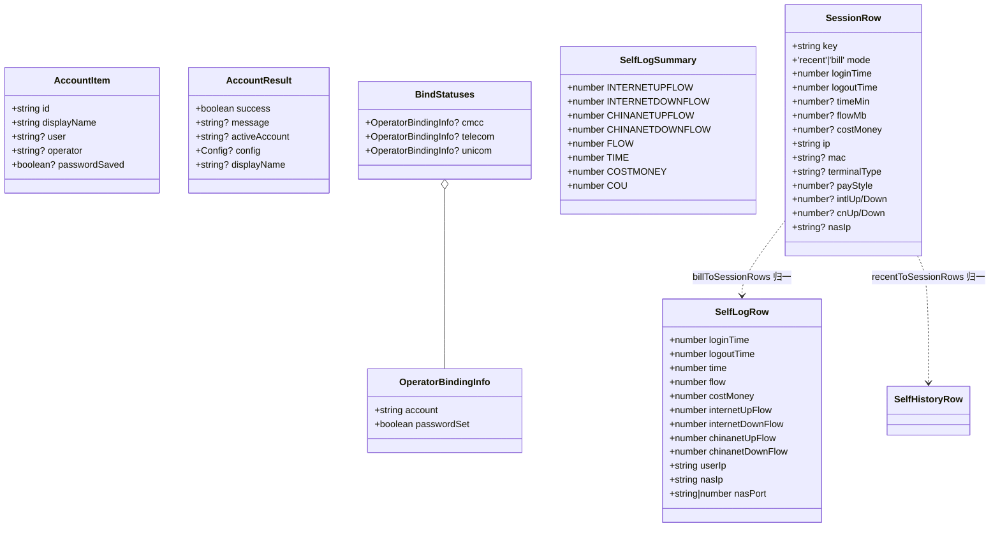
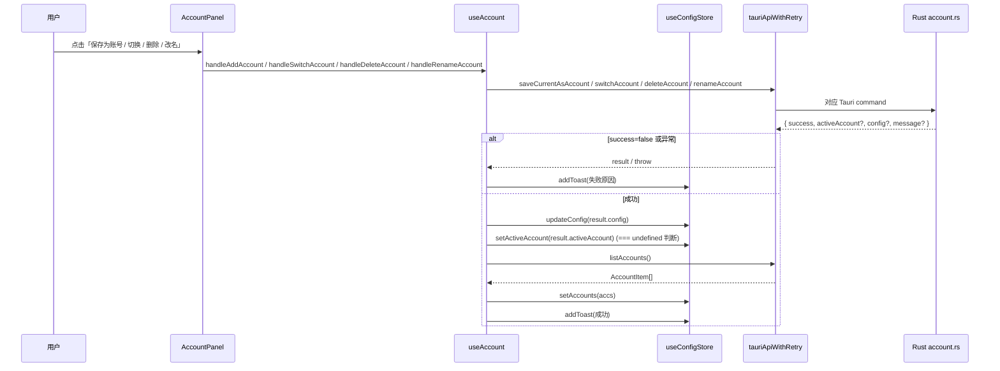
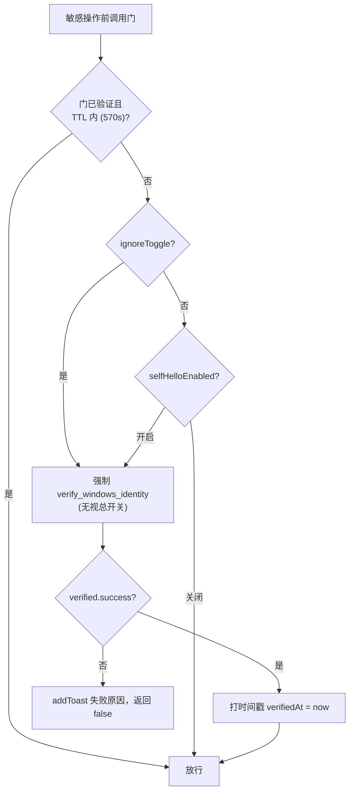
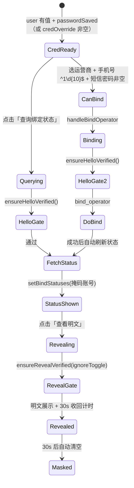
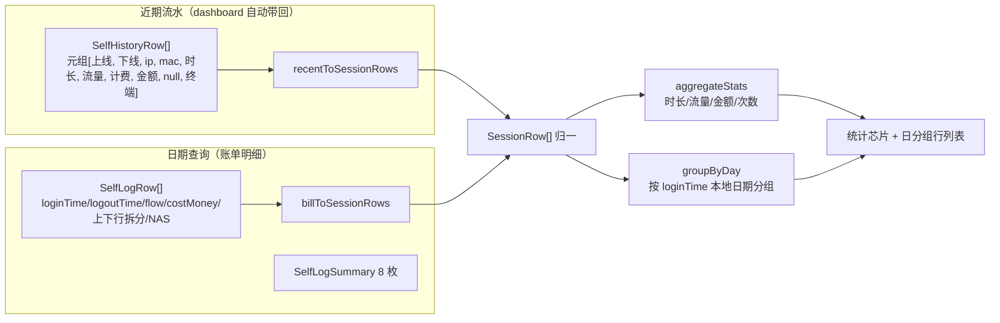
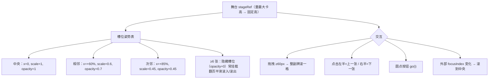
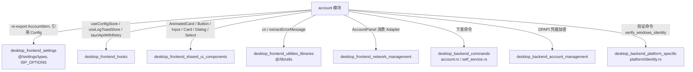

# 桌面端账号管理模块（desktop_frontend_account_management）

## 模块定位与职责

本模块是 Tauri 桌面应用（`tauri-app/frontend`）中「账号管理」面板的前端实现，路径为 `tauri-app/frontend/src/account/`。它覆盖两类业务：

1. **多账号档案管理**：账号列表渲染、新增（保存当前登录信息为账号）、删除、切换、内联改名（仅改显示名，账号 id 稳定不变）。
2. **运营商绑定与自助服务**：校园网运营商（移动 `cmcc` / 电信 `telecom` / 联通 `unicom`）账号绑定、绑定状态查询（掩码展示）、明文密码揭示、自助服务面板（在线设备卡、近期上网记录、按日期查询的账单明细、自助改密），以及贯穿敏感操作的 Windows Hello（`verify_windows_identity`）验证门。

所有后端命令经统一封装层 `tauriApiWithRetry`（见 [桌面前端 Hooks](desktop-frontend-hooks.md)）下发到 Rust 侧账号/自助服务命令（见 [桌面后端账号管理](desktop-backend-account-management.md) 与 [桌面后端命令](desktop-backend-commands.md)）。

---

## 架构总览

```mermaid
flowchart TD
    subgraph Panel["面板层（纯渲染 + 持少量本地态）"]
        AP["AccountPanel.tsx<br/>账号列表/切换/改名 UI"]
        LID["LoginInfoDialog.tsx<br/>新增/编辑登录信息弹窗"]
        ORC["SelfOnlineRecords.tsx<br/>上网记录融合卡（近期+账单）"]
        ODC["SelfOnlineCards.tsx<br/>在线设备卡 + Coverflow 堆叠"]
    end

    subgraph Logic["逻辑/Hook 层"]
        UA["useAccount.ts<br/>账号 CRUD 操作"]
        UOB["useOperatorBind.ts<br/>绑定流（绑定/查询/揭示/改密）"]
        GATE["selfServiceState.ts<br/>Hello 门 / 自助会话门"]
    end

    subgraph Shared["共享类型与工具"]
        TYPES["types.ts<br/>AccountResult 等"]
        SST["selfServiceTypes.ts<br/>SelfLogRow/Summary + 格式化"]
        VAL["validators.ts<br/>显示名校验"]
        OCHIP["operatorChip.ts<br/>运营商品牌色 class"]
    end

    subgraph Ext["外部依赖"]
        STORE["useConfigStore<br/>useLogToastStore"]
        API["tauriApiWithRetry"]
        BE["Rust 命令层<br/>account.rs / self_service.rs"]
    end

    AP --> UA
    AP --> UOB
    AP --> ODC
    AP --> OCHIP
    AP --> LID
    LID --> VAL
    UOB --> GATE
    UA --> TYPES
    ORC --> SST
    ODC --> SST
    UA --> STORE
    UOB --> STORE
    GATE --> STORE
    UA --> API
    UOB --> API
    GATE --> API
    ORC --> API
    API --> BE
```

---

## 组件清单与职责

| 文件 | 关键导出 | 职责 |
| --- | --- | --- |
| `AccountPanel.tsx` | `AccountPanel`（memo） | 账号卡片列表（Coverflow narrow 变体）、切换/删除/改名按钮、打开新增绑定弹窗；自订阅 `config` 避免外壳级联重渲染 |
| `LoginInfoDialog.tsx` | `LoginInfoDialog`、`LoginInfoFormValues` | `create` 模式收 账号名+学号+密码+运营商走 `create_account`；`edit` 模式预填并保留旧密码；含改密/清密入口 |
| `useAccount.ts` | `useAccount` | 封装 `list_accounts / save_current_as_account / delete_account / switch_account / rename_account`，并发去重 + 错误 toast + 列表刷新 |
| `useOperatorBind.ts` | `useOperatorBind`、`OperatorBindingInfo`、`BindStatuses`、`BIND_OPERATOR_NONE` | 绑定状态机、Hello 门调用、绑定/查询/揭示/改密、30s 明文收回计时、StrictMode `mountedRef` 保护 |
| `selfServiceState.ts` | `useHelloGate`、`useSelfServiceVerify`、`resetSelfSessionGate` | 两个独立的 Windows Hello 会话门，TTL 570s，对齐后端 600s 验证窗 |
| `selfServiceTypes.ts` | `SelfLogRow`、`SelfLogSummary`、`formatEpoch`、`formatMac`、`fmtMoney`、`formatFlowMb`、`formatUseTimeMinutes`、`formatTerminalType`、`localDateStr`、`toInt` | 自助服务逆向协议类型与格式化工具（原站 JS 口径） |
| `SelfOnlineRecords.tsx` | `SelfOnlineRecords`、`recentToSessionRows`、`billToSessionRows`、`aggregateStats`、`groupByDay`、`SessionRow` | 双源（近期流水 + 账单明细）融合为单表会话行，按登录日分组 |
| `SelfOnlineCards.tsx` | `OnlineDeviceCard`、`OnlineDeviceCardStack`（`coverflow` / `narrow`） | 单设备卡；堆叠卡支持拖拽、点击半区、圆点切换、外部 `focusIndex` |
| `operatorChip.ts` | `operatorChipClass` | 运营商后缀（`@cmcc` 天蓝 / `@telecom` 蓝 / `@unicom` 橙）→ Tailwind class |
| `validators.ts` | `isValidDisplayName`、`DISPLAY_NAME_MAX_LEN` | 与后端 `validate_display_name` 单点对齐：trim 后 1..=32 字符、不含控制字符 |
| `types.ts` | `AccountResult`、`SwitchAccountResult`、`DeleteAccountResult`、`SaveAccountResult`、`AccountItem`（re-export） | 账号命令统一返回类型 |

---

## 数据模型（与后端协议对齐）

- `AccountItem` 复用 [桌面前端设置](desktop-frontend-settings.md) 的 `@/settings/types` 定义，`id` 是账号文件名 stem（稳定），`displayName` 可编辑。
- `SelfLogRow / SelfLogSummary` 字段键逆向自自助服务页面 JS（2026-09-05/06），原始 JSON 透传，大小写敏感（汇总键大写）。
- `SessionRow` 是近期流水（`SelfHistoryRow` 元组）与账单行（`SelfLogRow`）的前端归一形态，由 `mode` 区分补充字段。

---

## 关键流程

### 1. 账号操作（新增 / 删除 / 切换 / 改名）

**并发与历史缺陷要点**（见 `useAccount.ts`）：

- **切换账号去重**：模块级 `switchInFlight` 单 promise 复用，防止组件 busy 锁之外的重复 `switchAccount` 交错执行；`finally` 中仅当 `switchInFlight === exec` 时清空引用，避免误清新任务。
- **活跃账号更新口径**：统一用 `result.activeAccount !== undefined` 判断，而非真值判断（后端可能返回空串），避免页面高亮不切换。
- **删除活跃账号**：必须应用返回的 `activeAccount/config`（修复「UI 仍显示已删除账号名、重启后配置指向已删除账号」的历史缺陷）。

### 2. Windows Hello 双验证门

两个门**完全独立**（互不共享模块级时间戳）：

| 门 | 模块级变量 | 用途 | 行为 |
| --- | --- | --- | --- |
| `useHelloGate` | `helloGateVerifiedAt` | 运营商绑定、查询绑定状态、改密 | 首次操作即验证；`ignoreToggle: true`（查看明文密码）无视总开关强制真实验证 |
| `useSelfServiceVerify` | `selfSessionVerifiedAt` | 自助服务面板操作（刷新/踢下线/上网记录查询） | 默认切入面板验证一次后 TTL 内共用；`config.selfReverifyEachAction = true` 时每次都验；`config.selfHelloEnabled = false` 整体放行 |

- TTL 常量 `VERIFY_TTL_MS = 570_000`（570s），对齐后端 `IDENTITY_VERIFY_TTL_SECS = 600s`，留 30s 时钟余量，避免前端缓存永真而后端过期导致功能死锁。
- `gateFresh` 同时拒绝时钟回拨（`elapsed >= 0`），与后端 `is_within_ttl`（拒绝 `now < verified_at`）方向一致。
- `resetSelfSessionGate()` 在自助面板卸载时把 `selfSessionVerifiedAt = 0`，下次切入面板重新验证。

### 3. 运营商绑定 / 查询 / 揭示流（`useOperatorBind`）

**安全与边界要点**：

- **明文揭示 30s 自动收回**：`revealedPassword` 变化触发 `setTimeout(30_000)`，卸载由 cleanup 清理；期间再次揭示/收起由依赖变化重置计时。
- **凭据门槛（`credReady`）**：默认取登录信息（`user.trim() && passwordSaved`）；手动填写模式（`credOverride`）取手动账号+密码非空，仅本次使用不保存。
- **手动填写**：`handleBindOperator` / `fetchBindStatus` / `handleReveal` 的凭据与就绪判定均改取 `credOverride`。
- **绑定成功**：清空 `bindSms`、自动刷新绑定状态区；**改密成功**：通过 `saveConfigDirect({ password: newPassword }, false)` 把本地登录密码同步为新密码，否则自动登录会用旧密码失败；返回 `true` 供弹窗关闭/清错。
- **StrictMode 保护**：`mountedRef` 在二次 setup 恢复 true，避免 dev 模式下 async handler 的 setState 被丢弃。

### 4. 上网记录双源融合（`SelfOnlineRecords`）

- **展示模式**：`logRows !== null`（查询过）→ 账单明细态，显示后端 8 枚汇总 + `BillSessionRow`（上下行拆分/NAS）；否则近期流水态，客户端聚合 4 枚芯片 + `RecentSessionRow`（MAC/终端/计费方式）。
- **会话行时间区间**：`HH:MM:SS – HH:MM:SS`，未注销以「在线」徽标收尾；跨日会话注销侧补 `MM-DD` 前缀避免日期归属歧义。
- **格式化口径与原站一致**：时长秒→分钟用 `Math.floor`（90 秒显示 1 分钟而非 2）；流量 `(下行+上行)/1024` 保留 3 位；金额保留服务端原始精度（`0.50` 不被 `toInt` 截成 `0`）。

### 5. 在线设备卡 Coverflow 堆叠（`SelfOnlineCards`）

- **两个变体**：`coverflow`（在线设备卡，卡宽 = 舞台 46% 百分比）与 `narrow`（账号管理堆叠卡，`min-width: 213px`、以 `left:50% + translateX(-50% + 偏移)` 居中）。
- **单卡**：`count < 2` 时拖拽/点击换页全部失效，居中定格。
- **列表变短**（如注销成功）：`useEffect` 夹住当前 `index` 在 `[0, count-1]`。
- 舞台高度由 `ResizeObserver` 量取所有已挂载卡最大自然高度，避免翻页高度跳动。

---

## 依赖关系

**关键外部契约**：

- `tauriApiWithRetry`（[桌面前端 Hooks](desktop-frontend-hooks.md)）提供 `listAccounts / saveCurrentAsAccount / deleteAccount / switchAccount / renameAccount / verifyWindowsIdentity / getBindStatus / bindOperator / revealOperatorCredential / changeSelfPassword` 等命令封装。
- `useConfigStore` 提供 `accounts / activeAccount / setAccounts / setActiveAccount / updateConfig / saveConfigDirect / syncPasswordSaved` 与 `config.selfHelloEnabled / selfReverifyEachAction / deviceAliases`。
- 后端命令落点见 [桌面后端命令](desktop-backend-commands.md) 的 `commands/account.rs`（`create_account / save_current_as_account / delete_account / switch_account / rename_account / list_accounts`）与 `commands/self_service.rs`（`bind_operator / query_bind_status / reveal_operator_credential / change_self_password / query_self_dashboard / query_self_online_log / self_offline_session / verify_windows_identity`）。
- 显示名校验的后端单点为 `commands/account.rs::validate_display_name`（前端 `isValidDisplayName` 仅作快速反馈，禁止单方面放宽/收紧）。

---

## 测试

模块测试位于同目录的两个 vitest 套件：

| 测试文件 | 覆盖 | 要点 |
| --- | --- | --- |
| `AccountPanel.helloGate.test.tsx` | Hello 门行为 | 首次查询即验证；通过后后续查询/查看明文共用不再二次验证；验证失败不执行操作且下次仍需验证；经 `vi.resetModules` 动态 import 重置模块级门状态 |
| `AccountPanel.rename.test.tsx` | 账号列表 + 改名流 | 按 `displayName` 渲染、`key=id`、`isActive` 按 id 判断；改名走真实 `useAccount` → `rename_account({ accountId, displayName })` 并刷新列表；Esc 取消不发请求；空显示名不发请求并 toast 校验失败 |

- 测试通过 `vi.mock('@/hooks/tauriApi')` 模拟后端命令，并从 `document.body` 查找 Radix portal 挂载的弹窗按钮。
- 测试基础设施（`vitest.config.ts`、`@testing-library/react`）见 [构建与部署配置](build-deployment-configuration.md)。

---

## 与其他模块的关系

- **账号列表数据来源**：应用初始化时由 `get_init_data` 一次性带出 `accounts`（`AccountItem[]`）与 `activeAccount`，见 [桌面前端设置](desktop-frontend-settings.md) 的 `InitData`。
- **凭据加密**：账号保存的密码在 Rust 侧用 DPAPI 加密落盘（`dpapi.encrypt / decrypt`），前端不接触明文存储，见 [桌面后端账号管理](desktop-backend-account-management.md)。
- **身份验证**：`verify_windows_identity` 在 Rust 侧维护「最近验证时间戳」与 TTL 判定，见 [桌面后端平台相关](desktop-backend-platform-specific.md) 的 `platform/identity.rs`（`identity_verified_recently / note_identity_verified`）。
- **同类移动端实现**：本模块与 [Android 前端账号管理](android-frontend-account-management.md) 共享大部分类型/格式化口径，但 Android 端把「Hello 门」替换为生物识别（`verify_biometric_identity`），且面板形态为 `SelfOnlineStack` 卡片堆叠。

---

## 关键设计约束速查

1. **显示名校验口径**必须与后端 `validate_display_name` 一致（trim 后 1..=32 字符、Unicode 码点计数、不含控制字符含 C1 区 U+0080–U+009F）。
2. **Hello 门 TTL = 570s**，对齐后端 600s 验证窗；**明文揭示无视总开关强制验证**。
3. **切换账号必须 `!== undefined` 判断活跃账号**，禁止真值判断。
4. **明文揭示 30s 自动收回**，卸载 cleanup 清理计时。
5. **StrictMode**：所有 async handler 的 setState 必须经 `mountedRef` 守卫。
6. **自助面板卸载**必须调用 `resetSelfSessionGate()`，下次切入重新验证。
