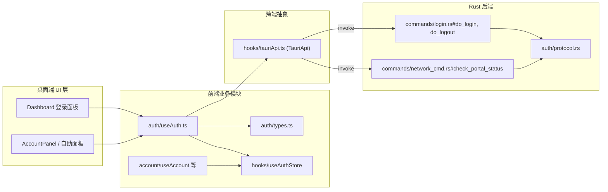
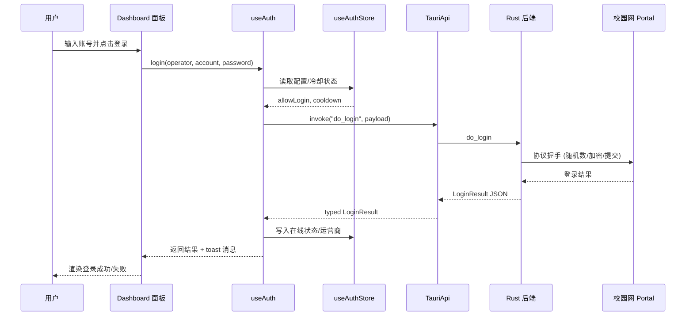

# 桌面端前端认证模块（desktop_frontend_auth）

## 概述

`desktop_frontend_auth` 是桌面端（Tauri）前端的认证业务模块，负责将用户在登录面板上的交互（输入账号、点击登录/登出、查看门户状态等）转换为对 Rust 后端命令的调用，并把后端返回的登录结果、门户状态转换结果暴露给 React UI 与全局状态层使用。该模块位于 `tauri-app/frontend/src/auth/` 目录下，与全局状态、监控模块、账户管理模块协同，共同构成桌面端校园网登录的前端闭环。

本模块在职责上保持"薄"：真正的登录协议、门户探测、重试与冷却逻辑全部由后端实现，前端只负责参数组装、调用编排、结果类型对齐与测试保障。后端实现细节请参阅 [desktop_backend_auth_protocol](desktop-backend-auth-protocol.md) 与 [desktop_backend_commands](desktop-backend-commands.md)。

## 模块组成

| 文件 | 核心导出 | 职责 |
| --- | --- | --- |
| `tauri-app/frontend/src/auth/types.ts` | `CommandResult`、`LoginResult`、`PortalStatusResult` | 定义登录命令、登出命令、门户状态探测命令在前端一侧使用的结构化返回类型 |
| `tauri-app/frontend/src/auth/useAuth.ts` | `useAuth` | React Hook：封装对后端 `do_login` / `do_logout` / `check_portal_status` 等命令的调用，供 Dashboard 面板消费 |
| `tauri-app/frontend/src/auth/DashboardPanel.selfCards.test.tsx` | `renderPanel`、`eyeBtns`、`noop` | Dashboard 面板关于"自助卡片"（在线设备、在线记录等）展示行为的组件测试 |

### 类型层（types.ts）

- `CommandResult`：通用命令执行结果，用于 `do_logout` 等仅需"成功/失败 + 消息"语义的命令。
- `LoginResult`：`do_login` 的返回结构，包含是否成功、运营商标识、可读消息以及后续 Dashboard/自助面板所需的上下文信息。
- `PortalStatusResult`：`check_portal_status` 的返回结构，描述当前门户可达性、是否已在线、当前出口 IP / 运营商等，是登录前"探活"与监控模块判断网络是否处于校园网环境的依据。

这三个类型与后端 Rust 命令的返回值一一对应（后端返回的是 JSON 对象），前端通过 Zod/手写类型描述对齐，避免在 UI 层出现 any 类型。

### Hook 层（useAuth.ts）

`useAuth` 是面向 Dashboard 登录面板的组合式 Hook，主要工作包括：

1. 从全局 Store（见 [desktop_frontend_hooks](desktop-frontend-hooks.md) 中的 `useAuthStore`）读取当前账号、运营商绑定、配置中的自动登录冷却等状态。
2. 通过 `TauriApi` 抽象层调用后端命令（`do_login`、`do_logout`、`check_portal_status`），并对返回值按 `LoginResult` / `CommandResult` / `PortalStatusResult` 类型解析。
3. 在调用前后更新全局 UI 状态（loading、toast 提示、按钮禁用等），并把登录成功后的账号上下文写入 Store，供 Account、Monitor 等模块消费。
4. 处理超时、失败重试与用户取消等异常路径，把后端错误消息通过 [desktop_frontend_shared_components_types](desktop-frontend-shared-components-types.md) 中定义的 `ToastMessage` 通道呈现给用户。

> `useAuth` 不直接持有登录协议状态（如 nonce、加密参数），那些参数由后端在 `do_login` 内部完成，详见 [desktop_backend_auth_protocol](desktop-backend-auth-protocol.md)。

### 测试层（DashboardPanel.selfCards.test.tsx）

该测试文件使用 Vitest + React Testing Library（配置见 `tauri-app/frontend/vitest.config.ts` 的 jsdom 环境与 `src/test-setup.ts`）对 Dashboard 面板中的"自助卡片"区域做组件级断言：

- `renderPanel`：以 mock 的 `TauriApi`、账户数据渲染 Dashboard 面板。
- `eyeBtns`：定位自助卡片上的"显示/隐藏敏感字段"（如运营商密码）按钮集合。
- `noop`：作为未使用的回调注入，保持 props 完整。

测试重点验证：当 `useAuth` 返回指定的 `LoginResult` 后，自助卡片能否正确展开在线设备列表、能否切换敏感字段可见性。这类组件测试配合 `tauri-mock.js`（见 [desktop_frontend_entrypoint_mocks](desktop-frontend-entrypoint-mocks.md) 中的 `invoke`/`emitEvent`）可在无 Tauri 运行时的环境下跑通。

## 在整体架构中的位置

上图展示了本模块与周边模块的关系：`useAuth` 是前端 UI 与后端认证命令之间的编排层；`types.ts` 是跨语言契约的前端一侧；`useAuthStore` 负责把登录结果沉淀为全局可观察状态；后端协议实现与本模块通过 `TauriApi` 的 `invoke` 通道解耦。

## 登录数据流

## 依赖与协作关系

- **全局状态**：依赖 [desktop_frontend_hooks](desktop-frontend-hooks.md) 中的 `useAuthStore`（门户状态缓存、校园网检测 `detectCampusNetwork`、`queryPortalStatus`）与 `TauriApi`（命令调用与事件监听）。
- **账户管理**：登录成功后写入的活动账号由 [desktop_frontend_account_management](desktop-frontend-account-management.md) 中的 `useAccount` 消费；自助面板（在线设备、账单）的数据来源为后端 `query_self_dashboard` 等命令。
- **监控**：登录状态是 [desktop_frontend_monitoring](desktop-frontend-monitoring.md) 中 `useMonitor` 调度周期性门户检查、自动重连的输入；监控模块同样复用 `PortalStatusResult` 类型语义。
- **共享 UI**：登录按钮、输入框、toast 等复用 [desktop_frontend_shared_ui_components](desktop-frontend-shared-ui-components.md) 与 [desktop_frontend_shared_components_types](desktop-frontend-shared-components-types.md) 中定义的组件与类型。
- **后端契约**：命令名、参数与返回结构对齐 [desktop_backend_commands](desktop-backend-commands.md)（`do_login`、`do_logout`、`check_portal_status`）与 [desktop_backend_auth_protocol](desktop-backend-auth-protocol.md)。

## 构建与测试

- 前端工程位于 `tauri-app/frontend/`，由 `tauri-app/frontend/package.json` 中的脚本驱动：`dev`（vite 开发服务器）、`build`（产物构建）、`test`/`test:watch`（Vitest 运行组件测试，含 `DashboardPanel.selfCards.test.tsx`）。
- Vitest 配置见 `tauri-app/frontend/vitest.config.ts`：jsdom 环境、`@` 路径别名指向 `src`、`setupFiles` 为 `src/test-setup.ts`。
- 命令通道在开发/测试环境可通过 `tauri-app/frontend/tauri-mock.js`（见 [desktop_frontend_entrypoint_mocks](desktop-frontend-entrypoint-mocks.md)）中的 `invoke` mock 替换为本地桩，无需启动真实 Tauri 运行时。

## 与 Android 端的差异

Android 端存在对应的 [android_frontend_auth](android-frontend-auth.md) 模块（`android/frontend/src/auth/`），其 `useAuth` Hook 与 `DashboardPanel` 在 API 形态上与桌面端保持一致，但面向移动端的布局与交互存在差异。本页仅覆盖桌面端（`tauri-app/`）实现。
