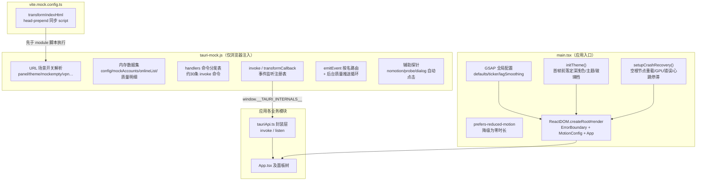
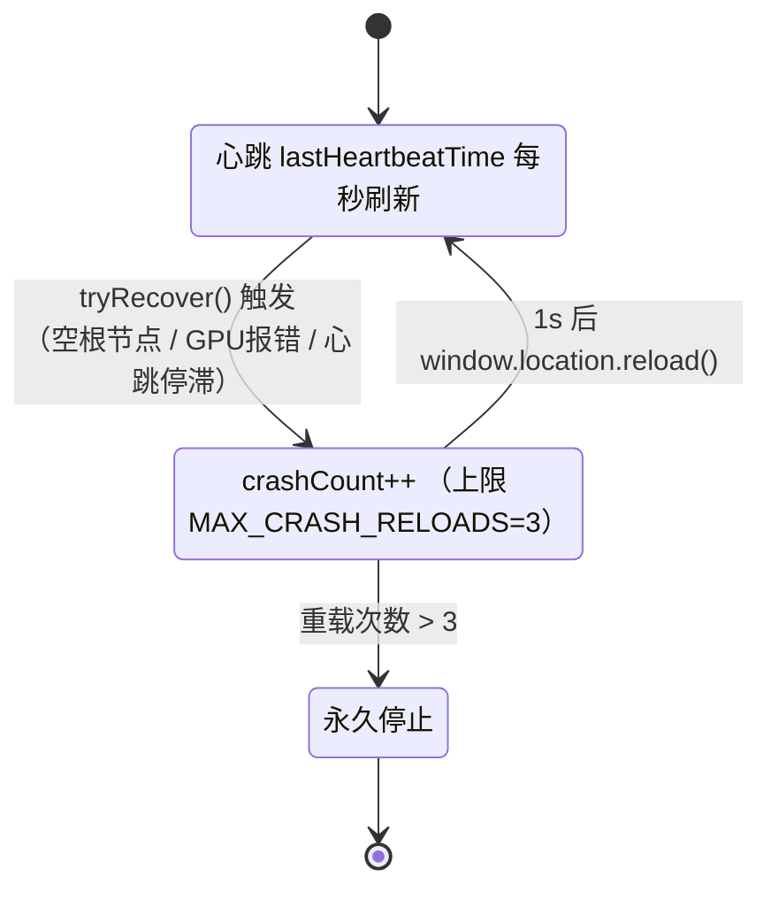
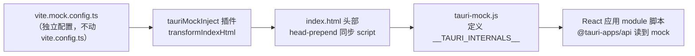
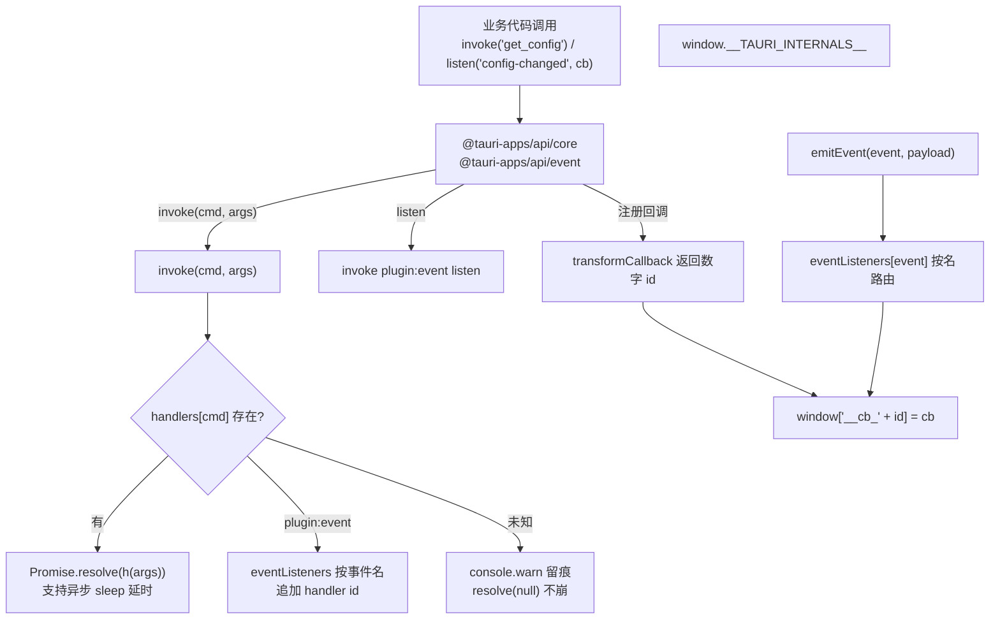
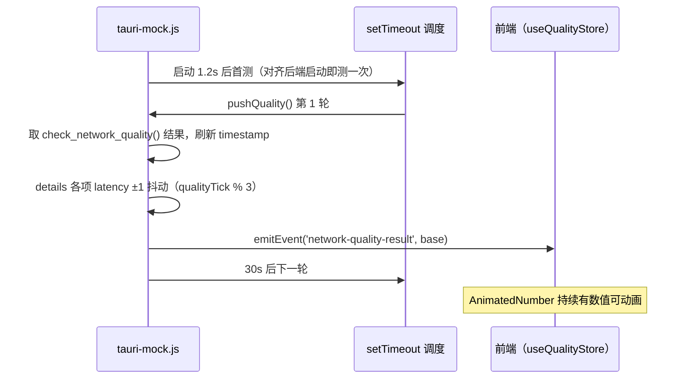
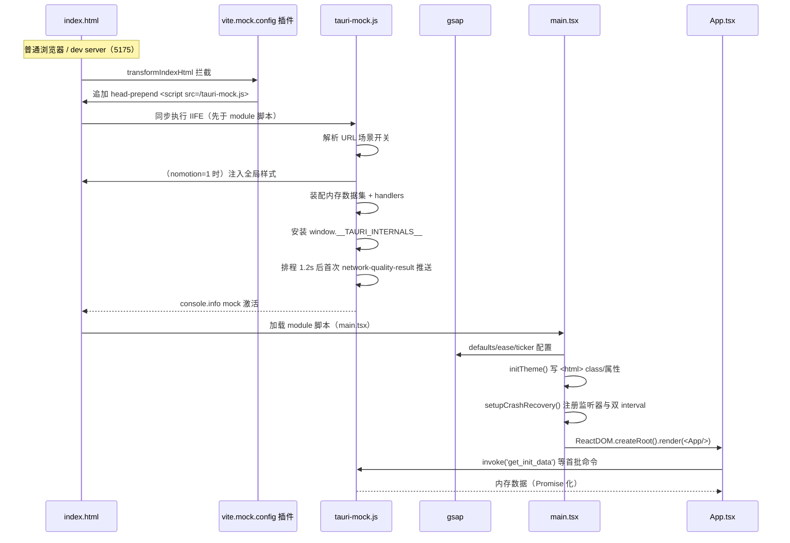

# 桌面端前端入口与浏览器 Mock 环境

## 简介

本模块包含桌面端（Tauri + WebView）React 前端的**应用入口装配层**与**浏览器 Mock 测试基础设施**，共两个核心文件：

- `tauri-app/frontend/src/main.tsx` —— 应用入口：在渲染 `<App />` 之前完成 GSAP 全局配置、首帧主题落定（`initTheme`）与 GPU 崩溃自愈（`setupCrashRecovery`）；
- `tauri-app/frontend/tauri-mock.js` —— 浏览器 Mock：在普通浏览器中把 `window.__TAURI_INTERNALS__` 替换为内存实现，使整个 React 应用**脱离 Rust 后端**直接在浏览器/dev 服务器中运行，用于 UI 走查、headless 截图与开发调试。

两者配合 `tauri-app/frontend/vite.mock.config.ts`（注入用 vite 配置），构成"真窗口 Tauri 构建"与"浏览器 Mock 运行"两条完全隔离的启动路径——Mock 文件**只在 mock 配置下注入，不进入生产构建产物**。

---

## 模块架构总览



---

## 一、`main.tsx`：入口装配

### 1. 职责

`main.tsx` 是打包入口（由 `index.html` 的 `<script type="module" src="/src/main.tsx">` 引用），只做**渲染前的全局准备与装配**，不含业务逻辑。执行顺序严格按文件行序：

1. **库与样式导入**：`React`、`ReactDOM/client`、`framer-motion` 的 `LazyMotion/domMax/MotionConfig`、`gsap`、`./App`、`./index.css`、`./i18n`（i18next 初始化）；共享组件按文件直接导入 `@/shared/ErrorBoundary`，避免经 barrel 静态引入懒加载面板（FE-A-04 分包约束）。
2. **GSAP 全局配置**：
   - `gsap.defaults({ ease: 'expo.out' })`；
   - `gsap.config({ autoSleep: 5, nullTargetWarn: false })`（不全局强制 `force3D`——各处 tween 已显式声明，全局强制会妨碍合成层回收）；
   - `gsap.ticker.lagSmoothing(500, 33)`。
   - 若系统 `prefers-reduced-motion: reduce`，则全局 `duration: 0` 并关闭 lagSmoothing。
3. **`initTheme()` 同步执行**（在 `render` 之前调用）。
4. **`setupCrashRecovery()` 同步执行**（在 `render` 之前调用）。
5. **按环境选择包装器**：DEV 下包 `<React.StrictMode>`，生产用 `React.Fragment`，然后渲染：

```
<AppWrapper>
  <ErrorBoundary>
    <LazyMotion features={domMax} strict>
      <MotionConfig reducedMotion="user">
        <App />
      </MotionConfig>
    </LazyMotion>
  </ErrorBoundary>
</AppWrapper>
```

### 2. `initTheme()` —— 首帧主题落定

读取 `localStorage`（经 `safeStorage` 容错包装）三个键，在 React 渲染前直接改写 `<html>` 元素，避免"先默认后跳转"的闪烁：

| localStorage 键 | 逻辑 | 落定结果 |
| --- | --- | --- |
| `campus-light-mode` | 等于 `'1'` → 浅色；否则深色 | `dark` class 与 `data-light="1"` 属性互斥设置 |
| `campus-theme` | 命中 `VALID_THEMES` 且非 `default` | 追加 `theme-<name>` class |
| `campus-glass-level` | 命中 `VALID_GLASS_LEVELS`（`off/standard/ultra`） | `data-glass` 属性，缺省 `ultra` |

> `VALID_THEMES` / `VALID_GLASS_LEVELS` 定义在 `tauri-app/frontend/src/settings/constants.ts`，主题与玻璃档的业务语义详见 [desktop_frontend_settings.md](desktop-frontend-settings.md)。`safeStorage` 的异常回退（localStorage 被禁时降级到内存 Map）见 [desktop_frontend_utilities_libraries.md](desktop-frontend-utilities-libraries.md)。

### 3. `setupCrashRecovery()` —— GPU/渲染崩溃自愈



`setupCrashRecovery()` 注册四类监测：

1. **空根节点检测**：`visibilitychange` 回到 `visible` 时，若 `#root` 没有子节点（WebView 白屏），触发 `tryRecover()`。
2. **GPU/WebGL 错误捕获**：`window.error` 监听，消息含 `GPU`/`WebGL`/`SharedArrayBuffer` 即判定 GPU 崩溃并恢复。
3. **渲染心跳双 interval 机制**：
   - 每 1s：页面可见时刷新 `lastHeartbeatTime`。关键设计——**若 `isRenderLoopAlive()` 返回 false（rAF 停滞）则跳过心跳更新**；因为 GPU 崩溃时渲染进程 JS 仍存活，纯 interval 心跳不会停，必须靠 rAF 停滞来暴露该场景（历史缺陷注释）。
   - 每 2s：页面可见时计算 `elapsed = now - lastHeartbeatTime`，超过 **10s**（FE-A-11 放宽，避免低端机长 GC 误判）即判定渲染链失活，触发 `tryRecover()`。
4. **页面可见性与 GSAP 联动**：切后台时 `gsap.globalTimeline.pause()`，回前台 `resume()`，避免后台时钟漂移。

`tryRecover()` 上限 3 次重载（`MAX_CRASH_RELOADS = 3`），超限仅打日志不再自动恢复，防止崩溃-重载死循环。`isRenderLoopAlive()` 的"按需 2 帧 rAF 短探测"实现与功耗考量（避免常驻 rAF 阻止 Chromium BeginFrame 休眠）详见 [desktop_frontend_utilities_libraries.md](desktop-frontend-utilities-libraries.md)。

外层 `ErrorBoundary` 组件兜底未捕获渲染异常，其文档见 [desktop_frontend_shared_components_types.md](desktop-frontend-shared-components-types.md)。

---

## 二、`tauri-mock.js`：浏览器 Mock 环境

### 1. 定位与注入路径

`tauri-mock.js` 是一个 IIFE（立即执行函数），在 React 应用模块脚本执行**之前**同步注入 `<head>`，直接覆写 `window.__TAURI_INTERNALS__`。注入机制：



要点：

- **不改动 git 跟踪的 `vite.config.ts` / `index.html`**；基础配置被继承（react 插件、`@` alias、5173 端口等），mock 配置额外把 server 端口改为 **5175**、`cacheDir` 外移到系统 TEMP（绕开本机防护软件对 `node_modules/.vite` 的写盘拦截）。
- **让位逻辑**：`if (window.__TAURI_INTERNALS__) return` —— 在真 Tauri 窗口或重复注入时直接退出，真实环境不受影响。
- **不进构建产物**：`vite build` 不引用 `vite.mock.config.ts`，生产包内无此脚本。
- 启动命令形如 `npx vite --config vite.mock.config.ts`（本机还需带 `ESBUILD_BINARY_PATH` 环境变量绕过 esbuild 二进制拦截，配置注释中有记录）。

构建/脚本全貌（`dev`/`build`/`preview`/`test` 等）见 [build_deployment_configuration.md](build-deployment-configuration.md)。

### 2. `__TAURI_INTERNALS__` 三件套



- **`invoke(cmd, args)`**：查 `handlers` 分发表；命中则 `Promise.resolve(h(args))`（可返回 Promise 模拟网络延时）；`plugin:event|listen` 按 **事件名 → 回调 id 数组** 建表注册（`args.handler` 为 `transformCallback` 返回的数字）；未知命令只 `console.warn` 不抛错，便于开发时发现缺漏。
- **`transformCallback(cb)`**：递增 `eventSeq` 发号，把回调存到 `window['__cb_' + id]`。
- **`emitEvent(event, payload)`**：取该事件名下的 id 列表逐个回调 `cb({event, id, payload})`——刻意**按名路由而非全局广播**，对齐真后端语义（否则其他事件的回调会收到结构不符的 payload 而崩）；单个监听器异常被 try/catch 吞掉，不阻断其余监听者。
- **`metadata`**：返回 `currentWindow/currentWebview` 均为 `{label: 'mock'}`，供依赖窗口句柄的代码取到稳定值。

### 3. 内存数据集与命令覆盖

Mock 内置一份与真后端同构的内存状态，覆盖前端绝大部分面板的首次渲染：

| 数据集 | 内容 | 对应真后端 |
| --- | --- | --- |
| `config` | 模拟配置（user/operator/主题默认面板/设备别名等），`password: '***'` 掩码 | `commands/config_cmd.rs` |
| `mockAccounts` | 3 个 `AccountItem`（主账号/宿舍台式机/实验室笔记本） | `commands/account.rs` |
| `onlineList` | 5 条在线设备会话（含 sessionId，支持注销移除） | `commands/self_service.rs` |
| `loginHistory` / `billRows` / `billSummary` | 自助在线记录与账单汇总 | `commands/self_service.rs` |
| `mockAdapters` | 3 张网卡（有线/WLAN/有线2）+ 详细信息 | `commands/network_cmd.rs` |
| 质量明细 | `check_network_quality` 返回含 19 项 `details`（gateway/DNS/DoH/HTTP/游戏/system-dns）的完整 `NetworkQuality` | `commands/network_cmd.rs` |

`handlers` 已实现约 30 条命令，按域分组：

- **初始化/配置**：`get_init_data`（一次性返回 config + 适配器 + 账号 + 后台状态 + 版本号 `2.4.2-mock`）、`get_config`、`save_config`（掩码字段 `'***'` 保留旧值，语义同真后端）。
- **账号管理**：`list_accounts` / `get_active_account` / `create_account` / `switch_account` / `save_current_as_account` / `delete_account` / `rename_account`。
- **自助服务**：`query_self_dashboard` / `self_offline_session`（800ms 延时后真的从 `onlineList` 移除该会话）/ `query_self_online_log` / `change_self_password` / `verify_windows_identity`（Windows Hello 600ms）。
- **WebVPN**：`vpn_credential_status` / `vpn_verify_credential` / `vpn_save_credential` / `vpn_clear_credential` / `set_self_service_via_vpn` / `vpn_test_connection`。
- **运营商绑定**：`query_bind_status` / `bind_operator`。
- **网络/质量**：`check_campus_status` / `check_portal_status` / `get_adapters` / `get_current_outbound_name` / `check_network_quality` / `start_latency_test` / `stop_latency_test` / `check_dns_doh_status`（3 张卡不同 DNS 来源/DoH 状态）。
- **系统/窗口**：`show_window` / `minimize_window` / `close_window` / `notify_window_ready` / `cancel_auto_exit` / `open_external` / `get_logs` / `check_update` / `start_background_check` / `stop_background_check` / `get_background_status` / `render_heartbeat`。

**关键同构细节**（刻意对齐真后端契约，否则前端 store 不刷新）：

- `save_config` / `save_current_as_account` / `switch_account` / `delete_account` / `rename_account` / `start_latency_test` / `stop_latency_test` 在改完内存状态后，用 `setTimeout(…, 0)` 异步 `emitEvent('config-changed', {config})` 广播全量配置——真后端落盘后也广播此事件。
- `invoke` 对命令结果统一走 `ok(data, message)` 包装：`{success: true, message, data}`；失败路径返回 `{success: false, message, data: null}`。

真后端命令全集与 payload 契约见 [desktop_backend_commands.md](desktop-backend-commands.md)；前端封装层 `TauriApi`/`createEventListener` 的调用方式见 [desktop_frontend_hooks.md](desktop-frontend-hooks.md)。

### 4. URL 查询参数场景开关

Mock 把大量 UI 场景做成 URL query 开关，便于 headless 截图与走查快速切换：

| 参数 | 效果 | 验证目标 |
| --- | --- | --- |
| `?panel=<id>` | 覆盖 `config.defaultPanel` 启动面板 | 各面板首屏 |
| `?theme=light\|dark` | 覆盖 `themeMode` | 浅色截图（缺省 `system`） |
| `?mockempty=1` | 账号列表返回空 | 账号空态样式 |
| `?mocksingle=1` | 只留 1 个账号 | 单卡居中/禁用拖拽 |
| `?active=<账号id>` | 预设激活账号 | 总览堆叠卡聚焦激活卡 |
| `?vpnsaved=1` | VPN 视为已保存凭据 | 已保存/未保存两分支 |
| `?vpnfail=1` | `vpn_verify_credential` 校验失败（1200ms 后） | 失败弹窗不关闭 |
| `?bound=none\|cmcc\|telecom\|unicom` | 运营商绑定状态场景 | 三运营商绑定/未绑 |
| `?bindfail=1` | `bind_operator` 直接失败 | 绑定失败路径 |
| `?nomotion=1` | 注入全局样式把 animation/transition 时长清零 | headless 截图动画停在起点偏暗 |
| `?probe=1` | 几何探针：每 250ms 量 pager 槽位与舞台中心差 `dx`，写入 `<html data-pager-probe>` | pager 居中几何回归 |
| `?dialog=create\|edit\|bind` | 4s 后一次性自动点击对应入口按钮 | 对话框打开态截图 |

### 5. 后台推送循环



该循环让 [desktop_frontend_monitoring.md](desktop-frontend-monitoring.md) 的质量面板在 Mock 下也能看到数字跳动与 `AnimatedNumber` 动画效果，还原真实运行体感。

---

## 三、端到端启动时序



---

## 四、与其他模块的关系

- **下游业务模块**：`main.tsx` 渲染 `App.tsx`，后者装配全部面板（认证总览、账号、自助、网络、监控、质量、设置、日志），详见 [desktop_frontend_auth.md](desktop-frontend-auth.md)、[desktop_frontend_account_management.md](desktop-frontend-account-management.md)、[desktop_frontend_network_management.md](desktop-frontend-network-management.md)、[desktop_frontend_monitoring.md](desktop-frontend-monitoring.md)、[desktop_frontend_settings.md](desktop-frontend-settings.md)。
- **API 封装层**：所有 `invoke`/`listen` 经 [desktop_frontend_hooks.md](desktop-frontend-hooks.md) 的 `tauriApi.ts` 收口；Mock 的命令名与 payload 严格对齐该层类型。
- **真后端契约**：Mock 复刻的命令对应 [desktop_backend_commands.md](desktop-backend-commands.md) 的 Rust 命令实现；改后端契约时须同步检查 `handlers` 同构性。
- **工具函数**：`safeStorage`、`isRenderLoopAlive`、`extractErrorMessage` 见 [desktop_frontend_utilities_libraries.md](desktop-frontend-utilities-libraries.md)；`ErrorBoundary`、共享类型见 [desktop_frontend_shared_components_types.md](desktop-frontend-shared-components-types.md)。
- **构建配置**：vite/tsconfig/端口/分包与测试脚本见 [build_deployment_configuration.md](build-deployment-configuration.md)。
- **Android 端对应物**：Android 前端有同构的 `android/frontend/src/main.tsx` 与 `android/frontend/tauri-mock.js`（本模块为桌面端专属），见 [android_frontend_entrypoint_mocks.md](android-frontend-entrypoint-mocks.md)。

---

## 五、维护注意事项

1. **新增后端命令时**：前端 `tauriApi` 调用后，浏览器走查会在控制台看到 `[tauri-mock] 未实现的命令: <cmd>` 警告——按同名补一条 `handlers[cmd]`，并保持返回形状与 Rust 侧一致。
2. **新增后端广播事件时**：若前端有 `on<Event>` 监听，Mock 侧需 `emitEvent('<event-name>', payload)` 模拟，否则该面板在浏览器下无数据刷新。
3. **`config-changed` 广播**：任何会改配置落盘的 Mock 命令都必须在改完内存后异步补发此事件，否则 Zustand `useConfigStore` 不更新（历史踩坑）。
4. **崩溃恢复阈值**：心跳判定 10s 是为低端机放宽的（FE-A-11），勿调回 5s；`isRenderLoopAlive()` 的 4s 探测窗口与 10s 阈值耦合，改动需同步评估功耗。
5. **Mock 安全性**：`tauri-mock.js` 任何路径错误都会导致真 Tauri 环境误加载——靠"先查 `__TAURI_INTERNALS__` 让位"与"仅 mock 配置注入"双保险；生产构建由 `vite build`（不引用 mock 配置）保证不含此文件。
