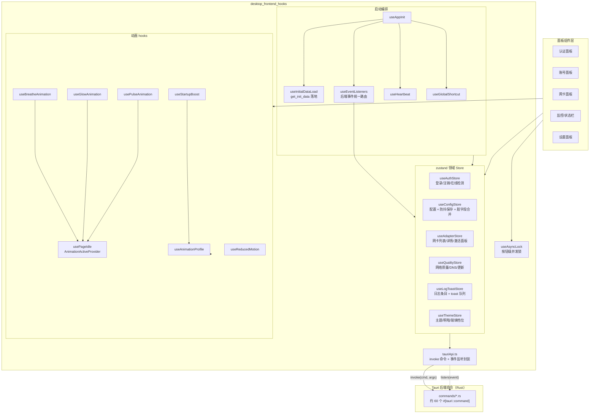
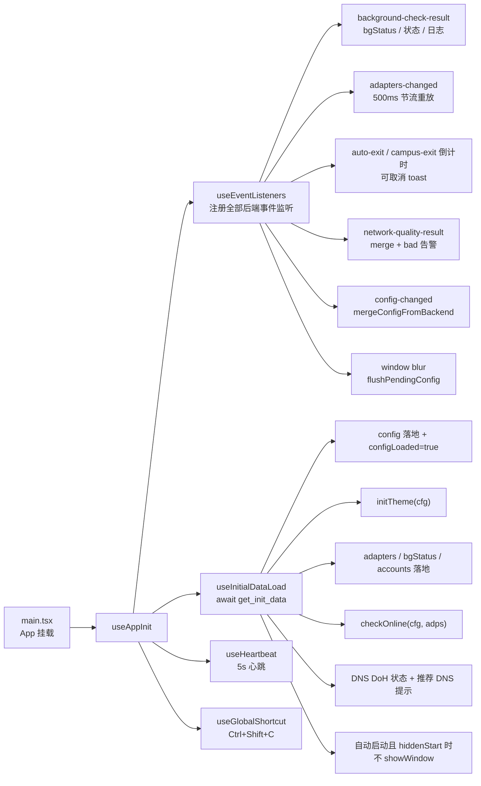
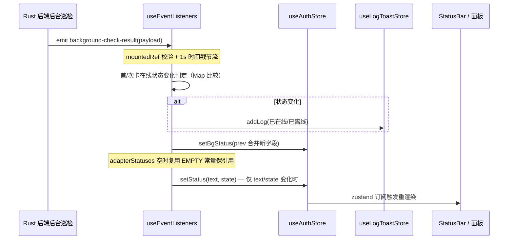
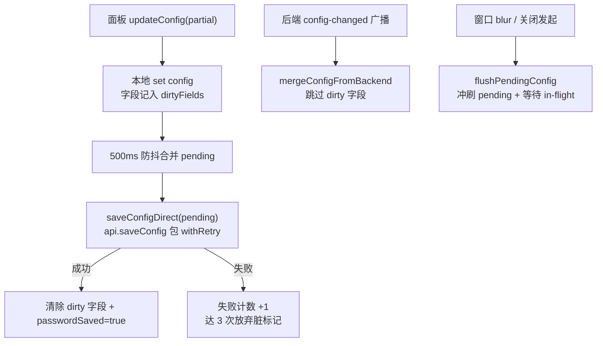

# 桌面前端 Hooks 层（desktop_frontend_hooks）

## 简介

`desktop_frontend_hooks` 是桌面端前端（`tauri-app/frontend/src/hooks/`）的 React Hooks 与全局状态层，承担三类职责：

1. **后端桥接**：`tauriApi.ts` 以强类型方式封装全部 Tauri `invoke` 命令与事件监听，是前端所有 Rust 后端调用的唯一出入口；
2. **领域状态（zustand stores）**：认证、配置、网卡、网络质量、日志/通知、主题六个 store 集中管理前端全局状态，并处理状态合并、防抖保存、并发锁、节流等工程细节；
3. **应用装配与动画**：`useAppInit` 负责启动编排（初始数据加载、事件监听、心跳、全局快捷键），其余 hooks 提供动画档位、空闲暂停、入场编排等通用能力。

该层对上为各面板组件（认证、账号、网络、监控、设置）提供稳定的数据与动作接口；对下通过 `@tauri-apps/api` 的 `invoke` / `listen` 与 Rust 后端交互。Android 端存在结构相似的对应模块，详见 [android_frontend_hooks.md](android-frontend-hooks.md)。

---

## 架构总览

---

## 组件详解

### 1. 后端桥接层：`tauriApi.ts`

- **`TauriApi` 接口**：聚合了约 60 个命令方法（登录/注销、账号 CRUD、配置导入导出、网卡、DHCP 续租、出站切换、质量检测、DNS DoH、更新、窗口、日志等）与 20 余个事件订阅方法（`onBackgroundCheckResult`、`onAutoLoginResult`、`onAdaptersChanged`、`onConfigChanged`、`onDownloadProgress` 等）。
- **`createEventListener<T>(eventName)`**：通用事件订阅工厂。处理了 Tauri `listen` 的异步特性——卸载函数可能在 `listen` Promise resolve 之前被调用，此时返回的清理函数会在 Promise resolve 后再调用 `unlisten`，避免监听器泄漏；注册失败仅在 DEV 环境打日志并返回 no-op。
- **`withRetry(fn, maxRetries=2, baseDelay=500)`**：指数退避重试（延迟 = `500 * 2^attempt + 随机 0~200ms`），仅当错误信息包含 `timeout / network / fetch / connection` 时重试。
- **`tauriApiWithRetry`**：默认透传原始 `tauriApi`，**仅 `saveConfig` 包了重试**——配置保存是一次性关键操作无兜底；高频命令（`checkPortalStatus`、`checkNetworkQuality`）不包重试，避免放大流量。
- **`openExternal`**：带安全校验的链接打开——仅允许 `http(s)://`、URL 长度 ≤ 2048、可被 `new URL` 解析；先 invoke `open_external`，失败回退 `@tauri-apps/plugin-shell`。

类型依赖来自 `@/auth`、`@/network`、`@/monitor`、`@/account`、`@/settings`、`@/shared` 各域，详见对应文档：[desktop_frontend_auth.md](desktop-frontend-auth.md)、[desktop_frontend_network_management.md](desktop-frontend-network-management.md)、[desktop_frontend_monitoring.md](desktop-frontend-monitoring.md)、[desktop_frontend_account_management.md](desktop-frontend-account-management.md)、[desktop_frontend_settings.md](desktop-frontend-settings.md)、[desktop_frontend_shared_components_types.md](desktop-frontend-shared-components-types.md)。

### 2. 领域 Store

#### `useAuthStore`（认证领域）

管理 `isLoggingIn / isLoggingOut / status / bgStatus` 与 `doLogin / doLogout / checkOnline / setStatus / setBgStatus`。关键工程点：

- **`withTimeout(promise, 60000, msg)`**：登录/注销 invoke 加 60s 超时，防止后端 Portal HTTP 挂起导致按钮永久禁用；`finally` 清理定时器。
- **`checkOnline` 串行锁**：模块级 `_checkOnlineLockFlag` 在函数体（而非 `setTimeout(500)`）settle 时释放，锁持有时间与执行时间一致；
- **检测短路链**：`enableNetworkNameCheck` 开启时先 `detectCampusNetwork()`，不在校园网直接置 `offline` 返回；再 `pickAdapterIp` 解析网卡 IP（无 IP 时 `refreshAdaptersForIp` 强制重探）；最后 `queryPortalStatus` 判定在线；
- **`buildCampusBgStatusPatch`**：优先用逐卡 `adapters[].onCampus` 判定，旧后端回退 wifi/wired 整类聚合；
- **`setStatusStable`**：text/state 未变时不更新对象，保持 StatusBar 订阅引用稳定；
- **登录后质量探测节流**：`QUALITY_MANUAL_THROTTLE_MS = 60_000`，与后端 `run_quality_check` 全局节流对齐，最近 60s 内已有质量结果则跳过手动全量探测；
- **登录成功跳过立即复查**：避免 Portal 会话未传播时二次查询返回 offline 造成状态闪烁。

#### `useConfigStore`（配置领域）

管理 `config / configLoaded / passwordSaved / accounts / activeAccount / language`：

- **`updateConfig` 防抖保存**：本地立即更新 UI（乐观），字段名记入 `dirtyFields`，500ms 防抖后合并发送 `save_config`；密码为 `PASSWORD_MASK` 时保留待发密码；
- **`mergeConfigFromBackend`**：后端 `config-changed` 回传时跳过 dirty 字段，防止旧快照覆盖本地新值；
- **脏字段连续失败上限 `DIRTY_FAILURE_LIMIT = 3`**：某字段连续 3 次保存失败后放弃脏标记，允许后端回传重新同步，避免 UI 与后端永久脱节；
- **`hasPendingConfig() / flushPendingConfig()`**：判断/冲刷防抖 pending 与 in-flight 保存——窗口关闭（blur 兜底、Alt+F4 等）时调用方据此等待保存完成再关窗；flush 发出的保存纳入返回 Promise，`PASSWORD_MASK` 密码字段从本次请求中剔除。

#### `useAdapterStore`（网卡领域）

- `adapters / adapterDetails / activePanel / isRefreshingAdapters`；
- **`refreshAdapterData({force, triggerCheck})`**：收敛了原三处重复的刷新实现——并行 `getAdapters(force)` + `getAdapterDetails()` 写回 store，可选触发后台检测；
- **`refreshAdapters`**：模块级锁 + 最短 500ms 展示（`Promise.all([work, delay])`），避免执行超时时锁提前释放导致重入。

#### `useQualityStore`（网络质量领域）

- `networkQuality / dnsDohStatus / updateAvailable / latestVersion / refreshRate` 等；
- **`lastQualityResultTime` 模块级时间戳**：`setNetworkQuality` 收到任意来源结果（后台循环事件/手动刷新/登录后探测）即刷新，供 `useAuthStore` 登录后节流判断；
- **`refreshQuality`**：锁串行 + `enableNetworkQuality === false` 直接跳过。

#### `useLogToastStore`（日志与通知领域）

- **日志**：`addLog` 对连续相同消息折叠为 `×N` 计数；超过 `MAX_LOG_ENTRIES` 截断；
- **Toast 队列**：上限 `MAX_TOASTS = 4`，超限淘汰最旧的并清理其定时器；`isDuplicateTitle` 同题去重（专用事件 + 系统通知双通道防刷屏）；非前台时普通 toast 直接丢弃（带操作按钮的 toast 例外）；
- `removeToastsByPrefix`：取消类 toast（自动退出/校园退出）整组清理。

#### `useThemeStore`（主题领域）

- `themeName / isLightMode / customThemeColor / glassLevel`，初始值从 `safeStorage` 读取（玻璃档位默认 `ultra`）；
- **模块级 `subscribe` 副作用**：状态变化时同步 DOM——切换 `dark` class、`data-glass` 属性、主题 class；自定义色用 `hexToHsl` 派生 `--primary/--ring/--accent` CSS 变量（`setProperty` 覆盖而非 `cssText +=` 累积）。

### 3. 启动编排

- **`useInitialDataLoad`**：单次异步初始化。`get_init_data` 失败时降级 `DEFAULT_CONFIG` 并记错误日志；StrictMode 下 cleanup→setup 二次执行时恢复 `mountedRef = true`，防止异步回调整体被丢弃。`configLoaded` 信号供依赖配置的启动逻辑（自助服务自动验证等）等待。
- **`useEventListeners`**：在一个 `useEffect` 内集中注册约 15 个事件订阅，统一处理 `mountedRef` 校验、时间戳节流（后台检测 1s、上线日志 5s、网卡变化 500ms trailing）、引用稳定化（`EMPTY_ADAPTER_STATUSES` 复用、JSON 比较跳过详情重复）。**刻意不注册 `onCloseRequested`**——Tauri core 检测到 JS 关闭监听存在会无条件 `prevent_close`，曾导致关闭按钮失效。
- **`useHeartbeat`**：5s 间隔调用 `render_heartbeat`；窗口 hidden 时暂停；**渲染链失活时跳过**（`isRenderLoopAlive()` 判定 GPU 崩溃/rAF 停滞，让后端按心跳丢失重载 WebView，见 [desktop_backend_app_lifecycle.md](desktop-backend-app-lifecycle.md) 的 webview 恢复逻辑）。
- **`useGlobalShortcut`**：`Ctrl+Shift+C` 取消自动退出；忽略 INPUT/TEXTAREA/contentEditable 目标，避免复制操作误触发。

### 4. 通用工具 Hooks

| Hook | 职责 |
|---|---|
| `useAsyncLock(fn, cooldownMs=1500)` | 返回 `[isRunning, execute]`；锁串行执行 + cooldown 后释放；StrictMode 二次 setup 恢复 `mountedRef`（有专门测试 `useAsyncLock.test.tsx` 的 `Probe` 覆盖） |
| `useReducedMotion` | 响应 `prefers-reduced-motion`，兼容旧 WebView 的 `addListener` |
| `usePageIdle` / `AnimationActiveProvider` / `useAnimationActive` | 页面空闲 2s（轮询判定）+ 可见 + 聚焦三条件组合动画活性；Provider 顶层只注册一次监听器（原每实例 8~9 个监听器 → ~88 个的性能修复） |
| `useAnimationProfile` | 当前固定返回最高档 `HIGH_PROFILE`（v2.4.0 删除分档），保留接口形状；`refreshRate` 驱动 easing 曲线（`getEasingConfig`） |
| `useBreatheAnimation` / `useGlowAnimation` / `usePulseAnimation` | GSAP 驱动的循环动画；**回调 ref** 使条件渲染元素卸载重建后 tween 自动重建；空闲时 `tween.pause()`，活跃时 `resume()` |
| `useStartupBoost` | 应用入场编排：titleBar/statusBar/title/dockNav/rightPanel 交错进场；GPU 层预热（`will-change`）与冷却；dockNav 只做 transform 不做 opacity（避免 backdrop root 导致玻璃膜发黑）；reduced-motion 直接落终态 |

---

## 关键数据流

### 后端事件 → 前端状态（background-check-result 为例）

### 配置保存闭环（防抖 → 落盘 → 回传合并）

---

## 与后端的对应关系

`tauriApi.ts` 的每个方法对应一个 Rust 命令，关键映射：

| 前端方法 | 后端命令 | 后端模块 |
|---|---|---|
| `getInitData / getConfig / saveConfig / exportConfig / importConfig` | `get_init_data / get_config / save_config / export_config / import_config` | [desktop_backend_commands.md](desktop-backend-commands.md)（system / config_cmd） |
| `doLogin / doLogout` | `do_login / do_logout` | commands/login.rs |
| `checkCampusStatus / checkPortalStatus` | `check_campus_status / check_portal_status` | commands/network_cmd.rs |
| `listAccounts / createAccount / switchAccount ...` | 同名 | commands/account.rs |
| `startBackgroundCheck / getBackgroundStatus` | 同名 | commands/background.rs |
| `renderHeartbeat / notifyWindowReady` | 同名 | commands/system.rs |
| `checkUpdate / downloadUpdate / installUpdate` | 同名 | commands/updater.rs |
| 事件 `background-check-result` 等 emit | 后端巡检/更新循环 | [desktop_backend_monitoring.md](desktop-backend-monitoring.md)、[desktop_backend_update.md](desktop-backend-update.md) |

事件名（如 `adapters-changed`、`config-changed`、`auto-exit-countdown`、`network-quality-result`）由后端 `AppHandle.emit` 发出，前端 `createEventListener` 订阅。

---

## 工程要点与已知设计约束

1. **StrictMode 兼容**：dev 下 effect 会 setup→cleanup→setup，所有一次性订阅/hook 都在二次 setup 恢复 `mountedRef = true`，否则监听器/锁静默失效（`useAsyncLock.test.tsx` 专门覆盖此场景）。
2. **引用稳定化**：StatusBar 等按引用订阅状态，后台检测未变时跳过 `setStatus`、空网卡状态复用同一数组常量、详情 JSON 比较跳过——避免每次巡检触发整卡重渲染。
3. **并发锁全部改为 settle 释放**：`checkOnline`、`refreshAdapters`、`refreshQuality` 的锁都在 Promise 真正完成时释放（最短展示时间另算），替代旧的 `setTimeout(固定值)` 释放。
4. **高频调用不重试**：`withRetry` 只用于 `saveConfig`；高频 `checkPortalStatus` / `checkNetworkQuality` 依赖后端周期循环兜底，指数退避会放大流量。
5. **窗口关闭链路**：不注册 `onCloseRequested`（Tauri 2.11 会强制 `prevent_close`），改由关闭发起方就地 flush、`window blur` 事件兜底 flush。
6. **构建与测试**：依赖见 `tauri-app/frontend/package.json`（`zustand@^5`、`gsap@^3.15`、`i18next@^26`、`@tauri-apps/api@^2`）；单元测试通过 `npm test`（vitest，见 `tauri-app/frontend` 的 `test` 脚本与 `vitest.config.ts`），目前本模块仅 `useAsyncLock.test.tsx` 一个测试文件。
