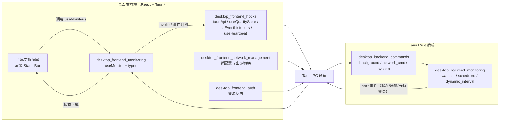
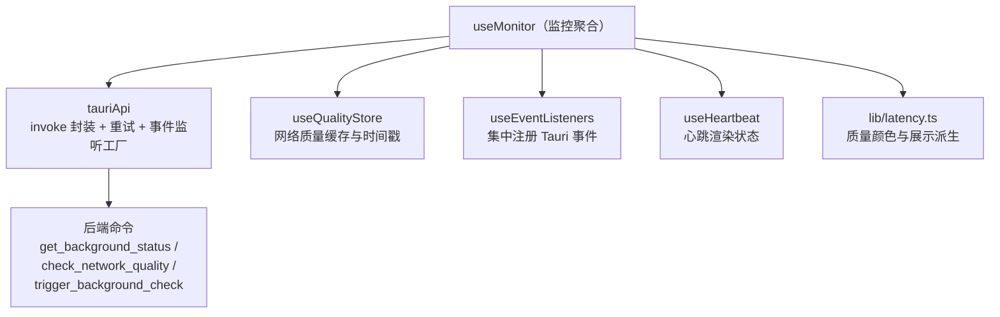
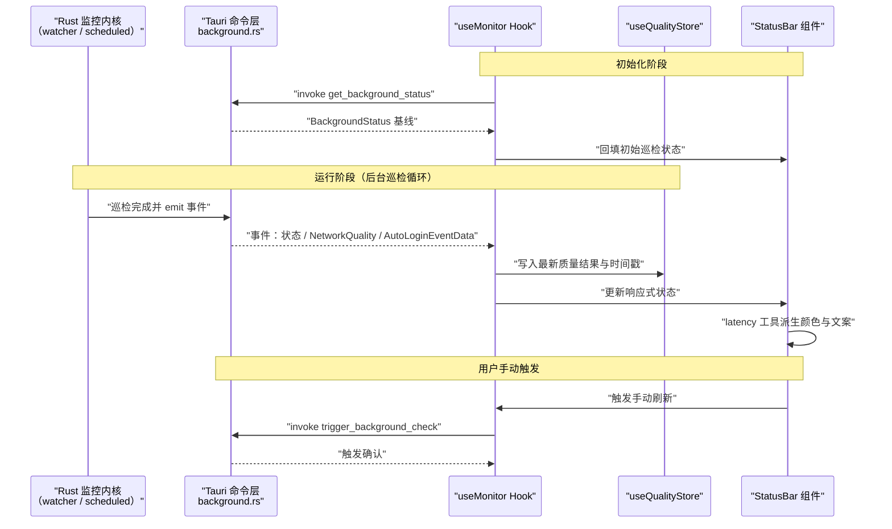
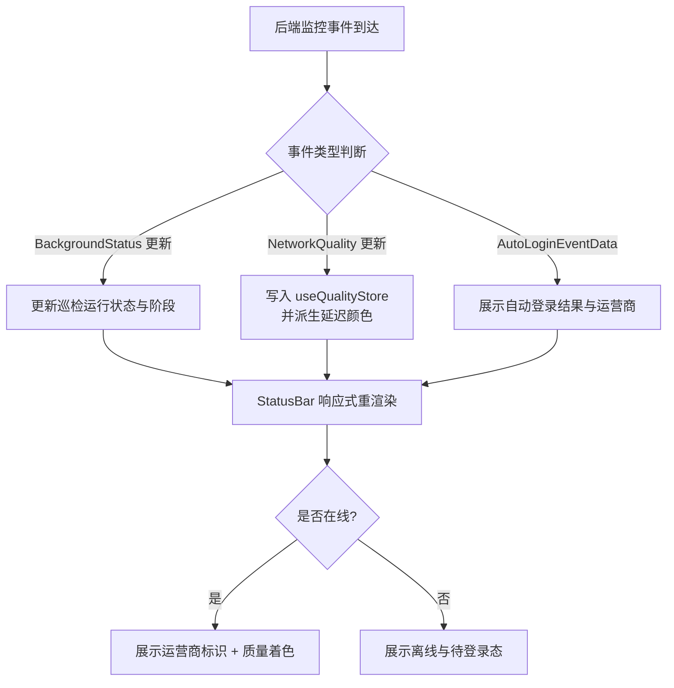

# 桌面端前端监控模块（desktop_frontend_monitoring）

## 模块简介

`desktop_frontend_monitoring` 是校园登录桌面端（Tauri）前端应用中的**状态监控与可视化模块**，位于 `tauri-app/frontend/src/monitor/` 目录下。它负责：

1. **聚合监控状态数据**：通过 `useMonitor` Hook 把后台 Rust 进程的状态（后台巡检、网络质量、自动登录事件、在线运营商）汇总为前端可消费的响应式状态；
2. **渲染状态栏（StatusBar）**：将监控结果以紧凑的状态栏形式呈现在桌面端主界面，实时反馈网络在线状态、运营商标识与网络质量；
3. **类型契约定义**：通过 `types.ts` 定义前后端共享的监控数据结构（`BackgroundStatus`、`NetworkQuality`、`AutoLoginEventData`），保证与 Tauri 后端命令返回值的一致性。

该模块本身不直接发起网络请求或执行巡检逻辑，而是作为**后端监控能力的前端投影层**：真正的巡检循环、动态间隔、夜间切换调度由 Rust 侧实现（见 [桌面端后端监控模块](desktop-backend-monitoring.md)），前端只负责订阅、展示与少量状态派生。

## 模块组成

| 文件 | 角色 | 关键导出 |
|------|------|----------|
| `tauri-app/frontend/src/monitor/types.ts` | 类型契约层 | `AutoLoginEventData`、`BackgroundStatus`、`NetworkQuality` |
| `tauri-app/frontend/src/monitor/useMonitor.ts` | 监控状态聚合 Hook | `useMonitor` |
| `tauri-app/frontend/src/monitor/StatusBar.anchor.test.tsx` | 状态栏锚点渲染测试 | `renderBar` |
| `tauri-app/frontend/src/monitor/StatusBar.onlineOperator.test.tsx` | 在线运营商展示测试 | `renderBar` |

> 说明：`StatusBar` 组件本身的实现文件位于主界面组装层，本模块目录下仅包含其配套的渲染测试（锚点布局测试与在线运营商测试），用于验证状态栏在不同监控状态下的展示行为。

## 架构定位

### 模块在整体系统中的位置

### 依赖关系

- **向下依赖**：前端基础设施 Hooks（见 [桌面端前端 Hooks 模块](desktop-frontend-hooks.md)），以及网络质量展示工具（见 [桌面端前端工具库](desktop-frontend-utilities-libraries.md)）。
- **向后依赖**：通过 Tauri 命令与后端交互，对应 [桌面端后端命令模块](desktop-backend-commands.md) 中的 `background.rs`、`network_cmd.rs` 命令族，以及 [桌面端后端监控模块](desktop-backend-monitoring.md) 的巡检调度内核。
- **被依赖**：被桌面端主界面组装层引用，为 `StatusBar` 提供状态；与 [桌面端前端认证模块](desktop-frontend-auth.md)（在线状态来源）、[桌面端前端网络管理模块](desktop-frontend-network-management.md)（适配器/出网信息）协同展示。

## 核心组件说明

### 1. `types.ts` —— 监控数据类型契约

该文件定义了前端监控层消费的三类核心数据结构，是前后端之间关于"监控状态"的约定：

| 类型 | 含义 | 典型字段语义 |
|------|------|--------------|
| `BackgroundStatus` | 后台巡检整体状态 | 巡检是否运行中、当前阶段、最近一次巡检结果、下次预计时间等 |
| `NetworkQuality` | 网络质量探测结果 | 延迟、丢包、质量等级（优/良/差），用于状态栏着色 |
| `AutoLoginEventData` | 自动登录事件负载 | 自动登录触发原因、结果（成功/失败）、运营商标识，用于状态栏提示 |

这些类型与后端 Rust 结构体（如 [桌面端后端监控模块](desktop-backend-monitoring.md) 中的 `PortalCheckResult`、`DynamicInterval` 的检查结果）通过 serde 序列化对齐，前端以只读方式消费。

### 2. `useMonitor` —— 监控状态聚合 Hook

`useMonitor` 是本模块的运行时核心，承担以下职责：

- **状态获取**：初始化时通过 `tauriApi.invoke` 拉取 `get_background_status` 等命令，建立监控状态基线；
- **事件订阅**：借助 `useEventListeners` 集中订阅后端推送的监控事件（巡检结果、网络质量更新、自动登录事件），将最新数据写入本地响应式状态；
- **状态派生**：结合 `useQualityStore` 的质量缓存与 `lib/latency.ts` 的展示派生函数（`getLatencyColor`、`resolveQualityDisplay`），计算状态栏应展示的颜色与文案；
- **主动触发**：暴露手动触发巡检（`trigger_background_check`）或停止巡检的能力，供界面交互调用。

### 3. `StatusBar` 渲染测试

两个测试文件基于 Vitest + React Testing Library（配置见 `tauri-app/frontend/vitest.config.ts`，jsdom 环境）对状态栏行为进行断言：

- **`StatusBar.anchor.test.tsx`**（`renderBar`）：验证状态栏在不同锚点（布局位置）下的渲染结构是否完整；
- **`StatusBar.onlineOperator.test.tsx`**（`renderBar`）：验证当存在在线运营商信息时，状态栏是否正确展示运营商标识（配合 [桌面端前端账号管理模块](desktop-frontend-account-management.md) 中的 `operatorChip` 样式约定）。

## 数据流

## 状态展示流程

## 构建与测试

- **构建**：本模块源码随前端整体打包，遵循 `tauri-app/frontend/vite.config.ts` 的构建配置（`manualChunks` 将 React、framer-motion、gsap、@radix-ui 拆分为独立 vendor chunk，见 [构建部署配置模块](build-deployment-configuration.md)）。
- **测试**：使用 `npm test`（vitest，jsdom 环境）运行，配置见 `tauri-app/frontend/vitest.config.ts`；本模块的两个测试文件通过 `renderBar` 辅助函数渲染状态栏进行断言。
- **别名解析**：测试与源码均通过 `@` 别名指向 `./src`，确保类型与 Hook 引用路径稳定。

## 与其他平台的对应关系

- **Android 端**：对应模块为 [android_frontend_monitoring_network](android-frontend-monitoring-network.md)（其中的 `useMonitor`），但 Android 端监控运行在前台服务插件之上（见 [android_plugins_foreground_service](android-plugins-foreground-service.md)）；桌面端的 `BackgroundStatus` 类型在 Android 侧由 `android/src-tauri/src/monitor_loop.rs` 提供，职责划分不同。
- **后端监控内核**：前端展示的所有状态最终来源于 [桌面端后端监控模块](desktop-backend-monitoring.md)（动态间隔 `DynamicInterval`、夜间切换 `outbound_night`、门户检查 `portal_check`）。

## 设计要点小结

1. **只读投影原则**：前端监控模块不实现巡检调度，只做状态的订阅、派生与展示，保持与后端 Rust 监控内核的清晰边界；
2. **类型契约先行**：`types.ts` 作为前后端共享的数据约定，降低联调成本；
3. **复用基础设施**：网络质量缓存（`useQualityStore`）、事件订阅（`useEventListeners`）、延迟展示派生（`lib/latency.ts`）均复用通用层，避免重复实现；
4. **可测试性**：状态栏展示行为由独立测试文件覆盖，确保锚点布局与运营商展示在各状态下符合预期。
