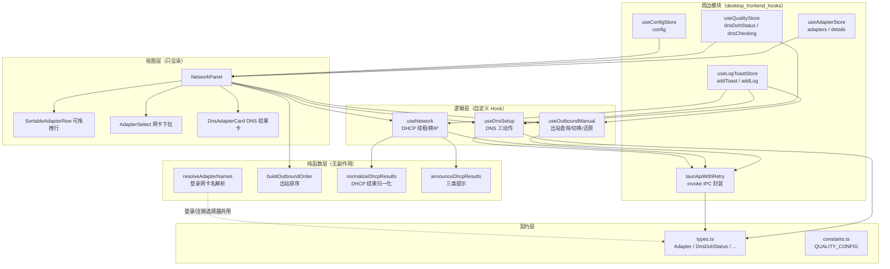
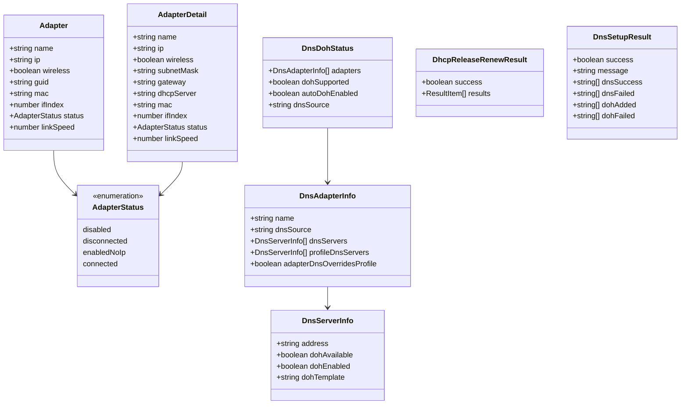
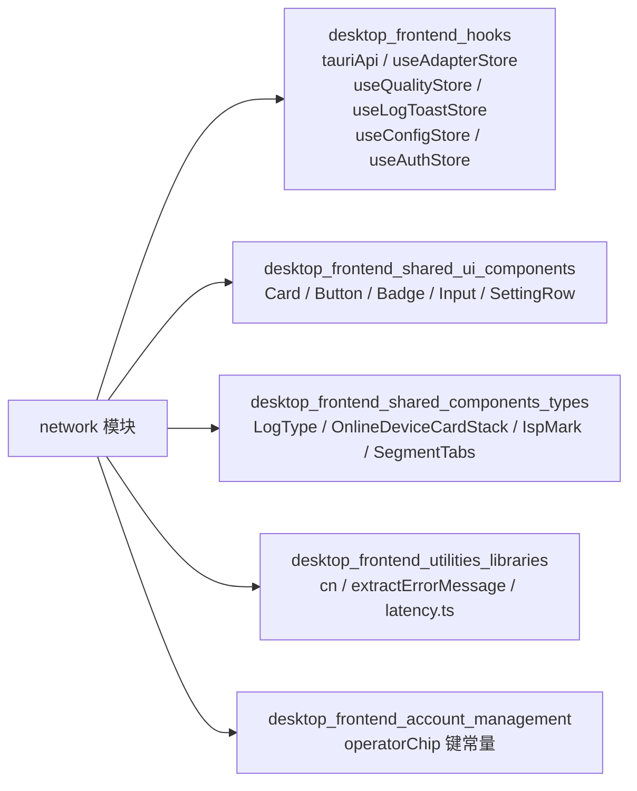
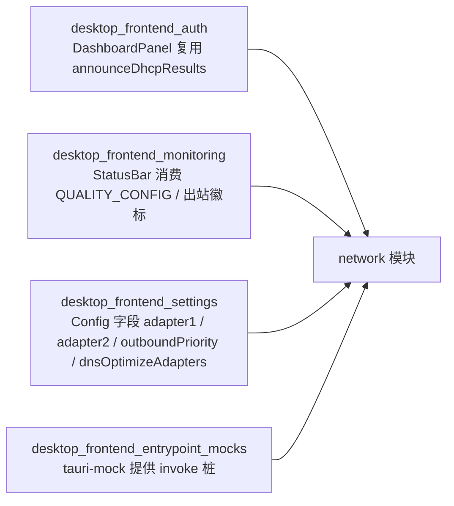
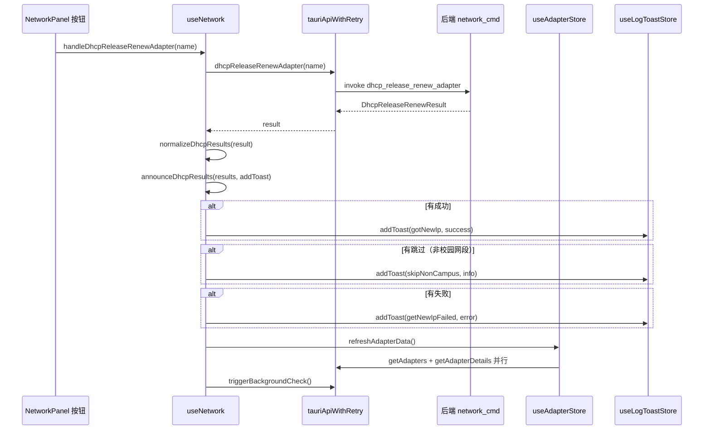
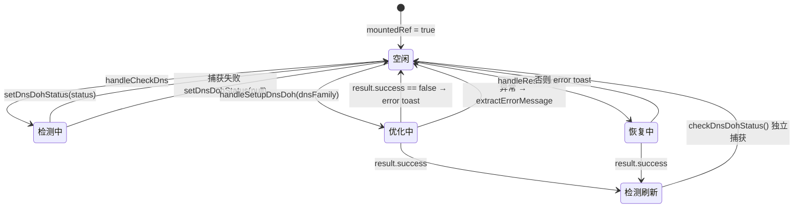
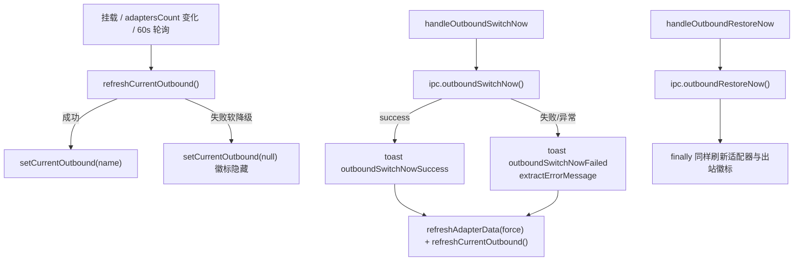
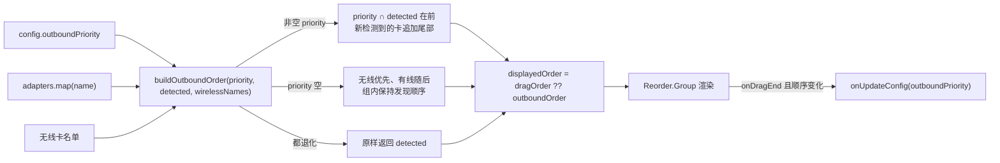

# 桌面前端网络管理模块（desktop_frontend_network_management）

## 简介

`desktop_frontend_network_management` 是 Tauri 桌面应用前端（`tauri-app/frontend/src/network/`）中负责**网络控制面板**的领域模块。它向用户呈现本机所有网卡适配器，提供 DHCP 续租/换 IP、适配器启用、DNS / DoH 一键优化、夜间出站切换的手动触发与拖拽排序、以及主/副登录网卡与账号绑定的配置入口。

模块遵循「面板只渲染、逻辑全部外移」的分层原则：`NetworkPanel` 负责视图与交互编排，业务逻辑收敛在 `useNetwork` / `useDnsSetup` / `useOutboundManual` 三个自定义 Hook，纯计算（适配器名解析、出站排序）放在无副作用的 `adapters.ts` / `outboundOrder.ts`，类型契约集中在 `types.ts` 并经 `index.ts` 桶文件再导出。所有与本机的交互均通过 [hooks 模块的 `tauriApiWithRetry`](desktop_frontend_hooks.md) 发起 Tauri IPC（`invoke`），本模块不直接调用 `@tauri-apps/api`。

## 目录与组件总览

| 文件 | 角色 | 核心导出 |
| --- | --- | --- |
| `index.ts` | 桶导出：面板、Hook、类型、质量常量 | `NetworkPanel`、`useNetwork`、`* from './types'`、`* from './constants'` |
| `NetworkPanel.tsx` | 网络面板主组件（含可拖拽行 `SortableAdapterRow`） | `NetworkPanel` |
| `AdapterSelect.tsx` | 主/副网卡选择下拉（三段分组） | `AdapterSelect` |
| `DnsAdapterCard.tsx` | DNS 检测结果单卡（含质量评级 `getDnsQuality`） | `DnsAdapterCard`、`getDnsQuality` |
| `types.ts` | 与后端 IPC 对齐的类型契约 | `Adapter`、`AdapterDetail`、`DnsDohStatus`、`DhcpRenewResult`、`DhcpReleaseRenewResult`、`DnsSetupResult`、`EnableAdapterResult` |
| `constants.ts` | 网络质量分级视觉配置 | `QUALITY_CONFIG` |
| `adapters.ts` | 登录网卡名解析（纯函数） | `resolveAdapterNames`、`AUTO_DETECT_ADAPTER` |
| `outboundOrder.ts` | 夜间出站优先级排序（纯函数） | `buildOutboundOrder` |
| `useNetwork.ts` | DHCP 续租/换 IP 动作 + 结果归一化与提示 | `useNetwork`、`normalizeDhcpResults`、`announceDhcpResults` |
| `useDnsSetup.ts` | DNS 检测/一键优化/恢复自动获取三动作 | `useDnsSetup`、`RECOMMENDED_DNS`、`ALI_DNS` |
| `useOutboundManual.ts` | 当前出站查询轮询 + 手动切换/还原 | `useOutboundManual` |
| `adapters.test.ts` / `useNetwork.test.ts` | vitest 单测 | `makeAdapter`、`capture` |

## 架构图

下图展示模块内部分层以及与周边模块的关系（数据从下层 store 向上流入面板，动作从面板向下经 IPC 到达后端）：

**要点说明**：

- `NetworkPanel` 通过 `useShallow` 自订阅 `useConfigStore.config` / `useAdapterStore` / `useAuthStore.bgStatus`，使 App 外壳不再因任意配置字段变化而级联重渲染。
- DHCP 结果的「归一化 + 成功/跳过/失败三类提示」由 `useNetwork` 导出的 `normalizeDhcpResults` / `announceDhcpResults` 实现，`DashboardPanel` 与 `NetworkPanel` 两个入口共用同一套 i18n 文案（键：`network.gotNewIp` / `network.skipNonCampus` / `network.getNewIpFailed`）。
- 适配器刷新统一走 `refreshAdapterData()`（定义在 [hooks 模块的 `useAdapterStore`](desktop_frontend_hooks.md)），收敛了三处历史重复实现（缺陷 P2-F10）。

## 类型契约（types.ts）

`types.ts` 是前端与后端 IPC 的对齐契约，被 [hooks 模块的 `TauriApi`](desktop_frontend_hooks.md) 直接引用：

- `Adapter.linkSpeed` 单位为 bit/s，0 表示未知；`NetworkPanel.formatSpeed` 统一格式化为 Mbps / Kbps。
- `Adapter.status` 四段互斥：`connected`（有 IP）/ `enabledNoIp`（无 IP 未禁用）/ `disconnected` / `disabled`；禁用卡仍会出现在 `adapters` 列表中（后端 `discovery/windows.rs` 所有卡都推入），`NetworkPanel` 据此派生出 `effectiveDisabledAdapters`。
- `DnsAdapterInfo.dnsSource` 取值 `'profile' | 'manual' | 'dhcp'`，驱动 `DnsAdapterCard` 的来源徽章与「适配器级覆盖配置文件级」警告。

## 依赖关系

### 上游（本模块依赖）

### 下游（本模块被谁使用）

**跨端对照**：Android 端仅保留 DNS 设置与轮询两条精简能力（见 [android_frontend_monitoring_network](android_frontend_monitoring_network.md)），DHCP 换 IP、适配器启用、夜间出站拖拽排序均为桌面端专属，与本模块形成「桌面全量 / 移动精简」的对照。

### IPC 命令清单（前端发起 → 后端命令）

下表为本模块经 `tauriApiWithRetry` 发起的全部 Tauri 命令，后端实现见 [desktop_backend_commands](desktop_backend_commands.md) 的 `network_cmd.rs`：

| 前端方法 | IPC 命令 | 用途 |
| --- | --- | --- |
| `getAdapters(force?)` | `get_adapters` | 拉取全部适配器（含禁用卡） |
| `getAdapterDetails()` | `get_adapter_details` | 拉取子网/网关/DHCP 服务器等详情 |
| `enableAdapter(name)` | `enable_adapter` | 启用被禁用的适配器 |
| `dhcpRenewAll()` | `dhcp_renew_all` | 全量续租 |
| `dhcpReleaseRenew()` | `dhcp_release_renew` | 释放后重新申请 IP（仅校园网段） |
| `dhcpReleaseRenewAdapter(name)` | `dhcp_release_renew_adapter` | 单卡换 IP |
| `checkDnsDohStatus()` | `check_dns_doh_status` | DNS / DoH 状态检测 |
| `setupDnsDoh(family)` | `setup_dns_doh` | 一键优化为阿里/腾讯公共 DNS + DoH |
| `resetDns()` | `reset_dns` | 恢复自动获取 |
| `getCurrentOutboundName()` | `get_current_outbound_name` | 默认路由 metric 求和判定的当前出站 |
| `outboundSwitchNow()` | `outbound_switch_now` | 绕过自动切换退避闸手动切换 |
| `outboundRestoreNow()` | `outbound_restore_now` | 清当日保持标记并还原 |
| `triggerBackgroundCheck()` | `trigger_background_check` | 换 IP 后触发后台巡检 |

订阅的推送事件（`adapters-changed` / `adapter-details-changed` / `adapter-disabled-warning`）由后端在适配器变化时 emit。

## 核心流程

### 流程一：DHCP 换 IP（`useNetwork.handleDhcpReleaseRenew*`）

设计要点：单条结果与批量 `{ results: [...] }` 两种形态由 `normalizeDhcpResults` 统一归一化为逐条数组；`announceDhcpResults` 按 成功/跳过/失败 分类各发一条 toast（全跳过只发 info），`useNetwork.test.ts` 的 `capture()` 辅助函数即围绕此行为断言。

### 流程二：DNS 检测 → 一键优化 → 恢复（`useDnsSetup`）

- **推荐地址常量**：`ALI_DNS`（`223.5.5.5` / `223.6.6.6` 及 IPv6）与 `TENCENT_DNS`（`1.12.12.12` / `120.53.53.53.53` 等）并集为 `RECOMMENDED_DNS`，用于「是否推荐 DNS」判定与服务器行的阿里/腾讯归属标签。
- **三态 busy 锁独立**：`dnsChecking` 走全局 `useQualityStore`，`dohEnabling` / `dnsResetting` 为 Hook 本地态，保持按钮禁用时序与原实现一致。
- **检测刷新独立捕获**：优化/恢复成功后的二次 `checkDnsDohStatus()` 失败不会落入外层 catch，避免与刚弹出的成功 toast 矛盾。
- **mountedRef 防护**：兼容 React StrictMode 的 `setup → cleanup → setup`，防止 dev 模式下 async 回调内 `setState` 被丢弃。
- **空名单守卫**：`dnsOptimizeAdaptersCount === 0` 时优化/恢复直接发 warning 日志返回，不调 IPC。

### 流程三：夜间出站查询轮询与手动切换（`useOutboundManual`）

- 当前出站由后端按 `GetIpForwardTable2` 默认路由 metric 求和判定，前端仅消费名字做行内徽标匹配；不在适配器列表（TUN/虚拟网卡）时仅头部 chip 展示别名。
- 切换/还原完成后统一 `force` 刷新适配器并重探出站，因为夜间自动切换（改路由 metric / 临时禁卡）多数不改变适配器数量，依赖 60s 轮询会看到陈旧徽标。
- 配套兜底：`NetworkPanel` 监听 `visibilitychange` / `focus`，WebView2 最小化时定时器被节流，恢复可见后以 5s 节流强制 `refreshAdapterData({ force: true })` + `refreshCurrentOutbound()`。

### 流程四：出站拖拽排序的提交语义（`NetworkPanel` + `buildOutboundOrder`）

- **拖拽期屏蔽外部同步**：`isDraggingRef` 为 true 时，外部 `outboundPriority` 落盘回显到达不会重置本地 `dragOrder`，避免拖拽中闪烁回旧序；`onDragEnd` 才一次性提交，顺序未变化（误触长按未移动）则不落盘。
- **长按起拖**：`DRAG_LONG_PRESS_MS = 250ms`，位移超 `DRAG_DEAD_ZONE_PX = 8px` 视为滚动意图并取消；行右侧按钮区 `stopPropagation`，防止点按钮拖走整行。
- **前后端对齐**：排序语义与后端 `effective_outbound_priority`（见 [desktop_backend_configuration](desktop_backend_configuration.md) 的 `outbound_switch.rs`）保持一致；`adapters.ts` 的 `resolveAdapterNames` 同样要求与后端 `resolve_adapter_names` 规则不漂移，否则登录/注销选择器与实际登录目标对不上。

## 关键设计约定

### 纯函数与 Hook 的边界

- `adapters.ts::resolveAdapterNames(adapters, config)`：配置名有效 → 用配置名；空 / `'自动检测'` / 不在当前列表 → 自动检测（**有线有 IP > 任意有 IP > 第一个**；副适配器自动检测时额外排除主适配器）。`adapters.test.ts::makeAdapter` 覆盖六类场景：配置名直用、自动检测优先级、失效名降级、双适配器开关关闭、仅剩无 IP 卡的 third fallback、空列表返回空名。
- `outboundOrder.ts::buildOutboundOrder(priority, detected, wirelessNames)`：见上文流程四；供 `NetworkPanel` 拖拽列表与 vitest 共用。
- `useDnsSetup` 中的 `mountedRef`、`useOutboundManual` 中的 `mountedRef` 是同一套 StrictMode 兼容模式。

### 错误提示归一化

所有异步动作的 catch 分支统一走 [`extractErrorMessage`](desktop_frontend_utilities_libraries.md)（处理 string / Error / `{message}` 普通对象三种 reject 形态），再交给 `useLogToastStore.addToast` 输出；DEV 环境额外 `console.error` 打印原始异常。

### 网络质量常量（constants.ts）

`QUALITY_CONFIG` 定义 `excellent / great / good / fair / poor / bad / unknown / disabled / busy` 九级，每级携带 label、i18n key、Tailwind 文本/背景/边框色、lucide 图标名、hex、信号条数与 glow 色。[utilities 模块的 `latency.ts`](desktop_frontend_utilities_libraries.md) 按毫秒延迟映射到这些级别（`≤20ms` 极速 … `>400ms` 拥堵，`<0` 视为 bad），[monitoring 模块的 `StatusBar`](desktop_frontend_monitoring.md) 与首页质量卡共用同一份渲染口径。

## 测试

单测基于 vitest（配置见 [build 模块的 `vitest.config.ts`](build_deployment_configuration.md)），由 `tauri-app/frontend/package.json` 的 `test` / `test:watch` 脚本驱动：

- `adapters.test.ts` — `resolveAdapterNames` 全分支（见上）。
- `useNetwork.test.ts` — `normalizeDhcpResults` 的批量/单条形态；`announceDhcpResults` 的「无失败不发失败 toast」「失败汇总为一条 error」「全跳过只发 info」三场景。测试环境不加载全局 i18n，`beforeAll` 注入最小 zh 资源。

## 相关模块索引

- [desktop_frontend_hooks](desktop_frontend_hooks.md) — `tauriApiWithRetry`、`useAdapterStore`（含 `refreshAdapterData`）、`useQualityStore`、`useLogToastStore`、`useConfigStore`
- [desktop_frontend_monitoring](desktop_frontend_monitoring.md) — 网络质量类型 `NetworkQuality`、后台巡检事件消费方
- [desktop_frontend_auth](desktop_frontend_auth.md) — `DashboardPanel` 复用 DHCP 换 IP 提示
- [desktop_frontend_settings](desktop_frontend_settings.md) — `Config` 的 `adapter1` / `adapter2` / `dualAdapter` / `adapter1Account` / `adapter2Account` / `outboundPriority` / `dnsOptimizeAdapters` / `enableNightOutboundSwitch` / `nightRestoreMinutes`
- [desktop_frontend_shared_ui_components](desktop_frontend_shared_ui_components.md) 与 [desktop_frontend_shared_components_types](desktop_frontend_shared_components_types.md) — UI 基元与 `OnlineDeviceCardStack` / `IspMark` 复用
- [desktop_frontend_utilities_libraries](desktop_frontend_utilities_libraries.md) — `cn` / `extractErrorMessage` / `latency.ts`
- [desktop_backend_commands](desktop_backend_commands.md) — `network_cmd.rs` 全部命令后端实现
- [desktop_backend_configuration](desktop_backend_configuration.md) — `outbound_switch.rs` / `night_switch.rs` 出站与夜间切换的后端归一化
- [android_frontend_monitoring_network](android_frontend_monitoring_network.md) — 移动端精简对照（仅 DNS 设置与轮询）
