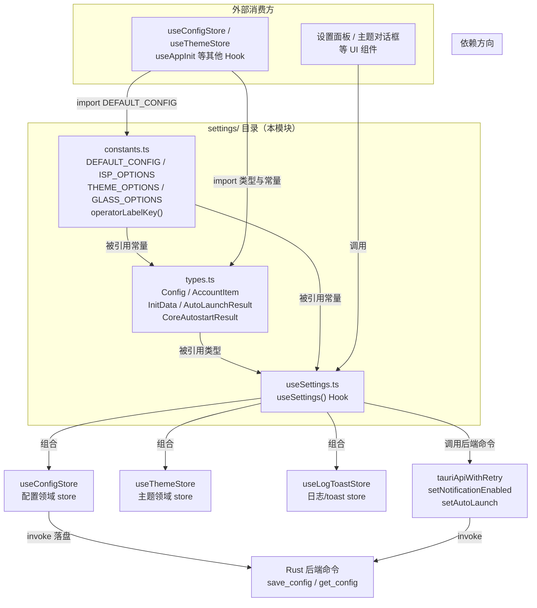
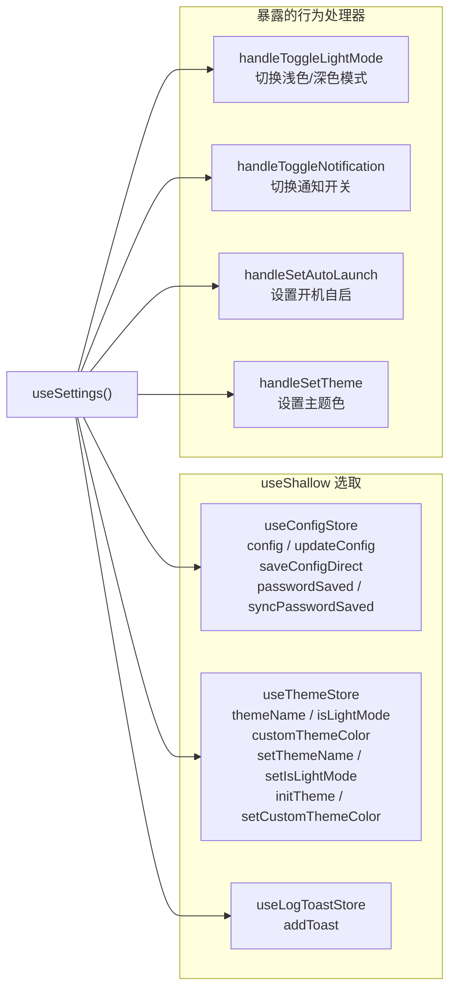
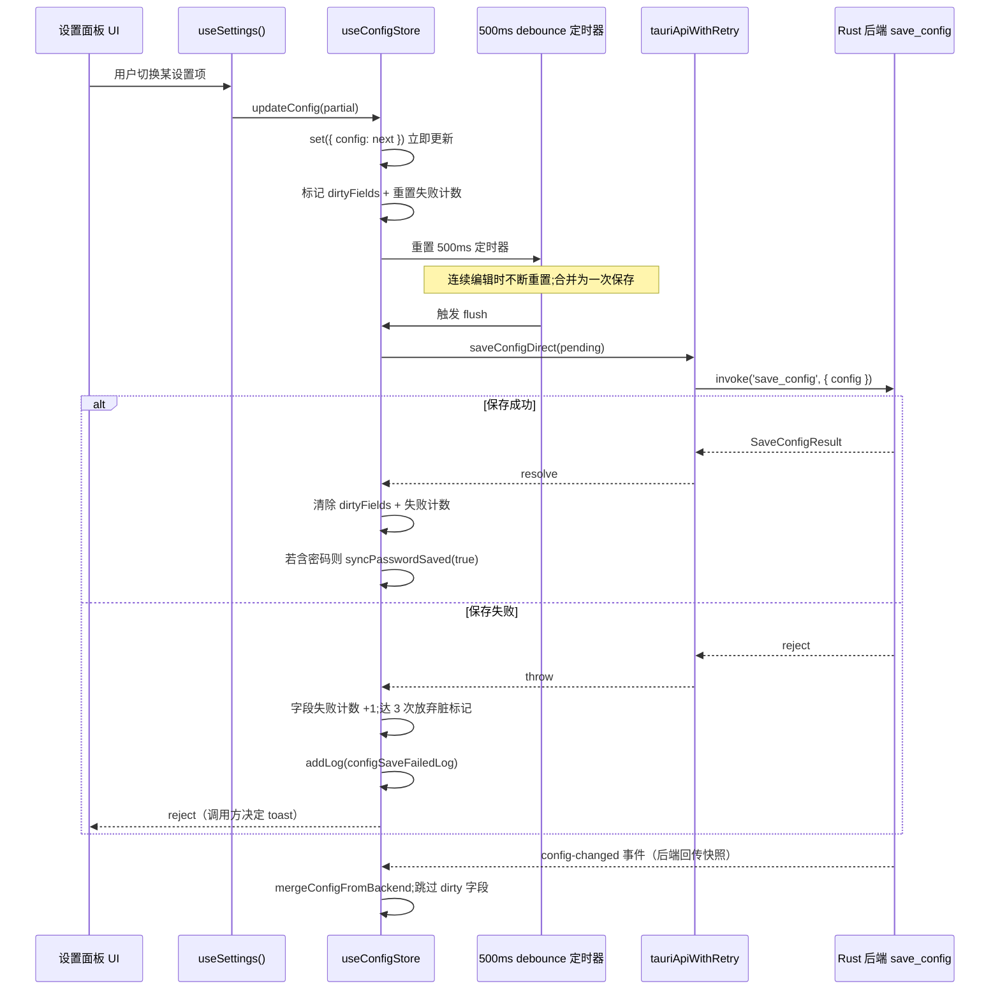
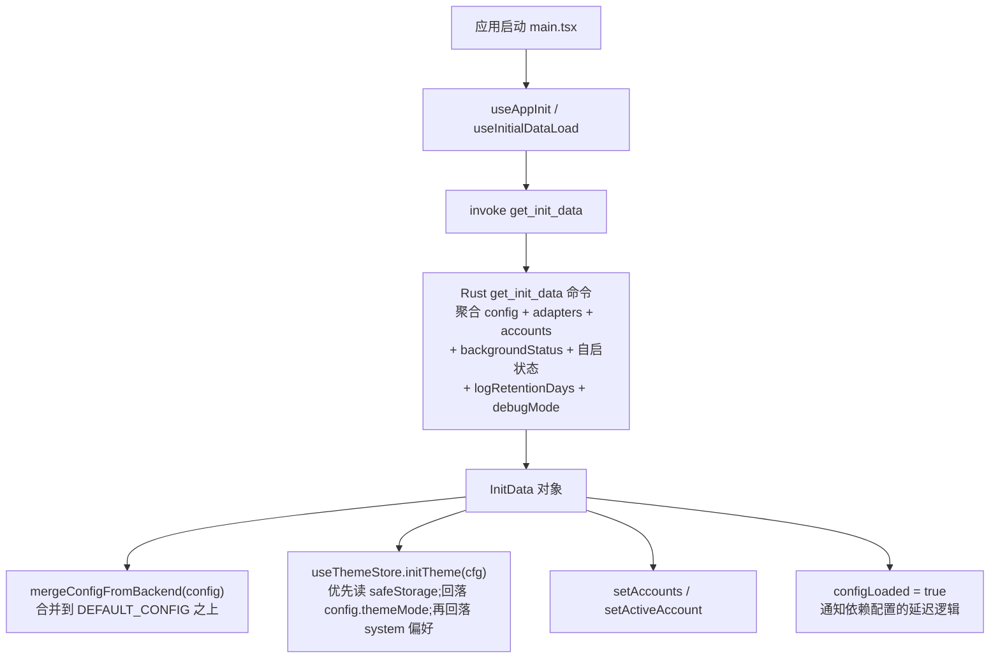

# 桌面端设置模块（desktop_frontend_settings）

## 简介

`desktop_frontend_settings` 是 Tauri 桌面端（`tauri-app/frontend`）前端的设置领域模块，位于 `tauri-app/frontend/src/settings/` 目录下。它承担三大职责：

1. **定义配置领域的 TypeScript 类型**：`Config`（运行期全量配置对象）、`AccountItem`（账号列表项）、`InitData`（启动一次性初始化数据包）等，是前端各模块与 Rust 后端之间配置契约的核心描述。
2. **提供默认配置与静态选项常量**：`DEFAULT_CONFIG`（含全部配置字段的默认值与迁移注释）、`ISP_OPTIONS`（运营商后缀选项）、`THEME_OPTIONS` / `GLASS_OPTIONS`（主题与玻璃质感档位选项）、`operatorLabelKey`（运营商后缀到 i18n 标签键的映射函数）等。
3. **导出 `useSettings` React Hook**：作为设置面板 UI 与底层 Zustand store 之间的薄编排层，聚合配置 store、主题 store、日志 toast store，并实现浅色模式切换、通知开关、开机自启、主题设置等具体行为处理器。

该模块本身不渲染任何界面组件，而是为设置页面、主题对话框、账号面板等 UI 提供类型、常量与行为逻辑支撑；其配置读写的最终落盘由后端命令 `save_config` / `get_config` 完成（详见 [desktop_backend_commands.md](desktop_backend_commands.md)）。

---

## 架构总览

### 模块在前端依赖图中的位置



### 核心组件职责一览

| 组件 | 文件 | 职责 |
| --- | --- | --- |
| `DEFAULT_CONFIG` | `constants.ts` | 全量配置默认值；`configVersion: 5` 标识当前配置模式版本，与后端迁移逻辑对应 |
| `ISP_OPTIONS` | `constants.ts` | 运营商后缀下拉选项（无锡学院 / 电信 / 联通 / 移动），每项带 i18n `labelKey` |
| `operatorLabelKey()` | `constants.ts` | 运营商后缀 → i18n 标签键映射；`null/undefined`（离线/未知）返回 `undefined`，调用方据此隐藏徽标 |
| `THEME_OPTIONS` / `VALID_THEMES` | `constants.ts` | 7 套主题色选项及合法性校验数组 |
| `GLASS_OPTIONS` / `VALID_GLASS_LEVELS` | `constants.ts` | 玻璃质感三档（off / standard / ultra）及合法性校验数组 |
| `DEFAULT_PANEL_OPTIONS` | `constants.ts` | 由 `NAV_ITEMS` 派生的「默认启动面板」选项 |
| `Config` | `types.ts` | 运行期全量配置接口（约 50 个字段，涵盖登录、网络、外观、定时任务、夜间切换等） |
| `AccountItem` | `types.ts` | 账号列表项：`id`（稳定文件名 stem）、`displayName`（可编辑显示名）、`user`/`operator`/`passwordSaved` 扩展字段 |
| `InitData` | `types.ts` | 启动一次性数据包：配置、版本、适配器、账号、后台状态、自启状态等的聚合 |
| `AutoLaunchResult` / `CoreAutostartResult` | `types.ts` | 开机自启（用户级注册表）与核心自启（SYSTEM 计划任务）命令返回体 |
| `useSettings()` | `useSettings.ts` | 编排 Hook：聚合三个 store，暴露 `handleToggleLightMode` / `handleToggleNotification` / `handleSetAutoLaunch` / `handleSetTheme` 四个处理器 |

---

## 组件详解

### 1. `constants.ts` — 默认配置与静态选项

#### `DEFAULT_CONFIG`

`DEFAULT_CONFIG` 是前端 config store 的初始值，也是后端配置缺失字段时的兜底。其字段按功能可分为若干组：

- **登录凭证**：`user` / `password` / `operator`（运营商后缀）、`selfHelloEnabled`（Windows Hello 验证总开关）、`selfReverifyEachAction`（每次操作二次验证）。
- **适配器**：`adapter1` / `adapter2` / `dualAdapter`，其中 `adapter1` 默认值为 `AUTO_DETECT_ADAPTER`（来自 [desktop_frontend_network_management.md](desktop_frontend_network_management.md) 的 `adapters.ts`）。
- **启动与窗口行为**：`autoLoginOnStart`、`autoExitAfterLogin`、`minimizeToTray`、`lightweightMode`（桌面专属：关闭窗口仅留后端与托盘）、`hiddenStart`、`autoLaunch`。
- **后台检测**：`enableBackgroundCheck`、`backgroundCheckInterval`（默认 60000ms）、`autoLoginOnPreparation`。
- **夜间运营商/出站切换**：`enableNightOperatorSwitch`、`nightOperatorRestore`、`enableNightOutboundSwitch`、`nightRestoreMinutes`、`outboundPriority`、`outboundMetricRestore`、`outboundDisabledAdapters`、`outboundStandbyRoute`、`outboundManualHoldDay`、`outboundPendingSwitch`、`nightOutboundRestore`。这些字段中多数为「后端内部状态」（注释中明确标注），前端仅透传，用于与 [desktop_backend_configuration.md](desktop_backend_configuration.md) 的夜间切换评估逻辑对接。
- **DNS 优化**：`dnsOptimizeAdapters: string[]`。
- **外观**：`themeMode`（默认 `'dark'`）、`customThemeColor: '#6366f1'`、`defaultPanel`、`enableNotification`。
- **网络质量与延迟**：`enableLatencyTest`、`latencyTestInterval`（默认 600000ms）、`enableNetworkQuality`、`skipTtfbInLatency`、`skipContentInLatency`。
- **校园网判定**：`portalUrl`、`fixedGateway`、`requiredNetworkName`、`enableNetworkNameCheck`、`campusGateway`、`campusExitOnFail`、`campusExitStartMinutes`（480=8:00）、`campusExitEndMinutes`（1380=23:00）、`campusCheckStartMinutes`（460=07:40）、`campusCheckEndMinutes`（1380=23:00）。
- **定时任务**：`scheduledLoginMinutes` / `scheduledLogoutMinutes`（哨兵值 `1440` 表示禁用，注释说明 `1440` 不是真实 00:00 时刻）。
- **健壮性**：`maxDisconnectReconnect`（默认 3）、`autoLoginCooldownSecs`（默认 60）、`logRetentionDays`（默认 7）。
- **版本**：`configVersion: 5` —— 与后端 `config_version v2→v3` 迁移注释对应（代码注释指出 2026-09-13 起 `campusCheckEndMinutes` 默认值变更由后端迁移一次性刷新）。

> 注：注释中多处历史默认值与迁移说明，体现该配置 schema 经历了多个版本演进；后端侧对应的默认值与反序列化逻辑见 [desktop_backend_configuration.md](desktop_backend_configuration.md) 的 `model.rs`。

#### 运营商选项与 `operatorLabelKey`

```typescript
export const ISP_OPTIONS = [
  { value: '__default__', label: '无锡学院', labelKey: 'settings.isp.wxxy' },
  { value: '@telecom',    label: '中国电信', labelKey: 'settings.isp.telecom' },
  { value: '@unicom',     label: '中国联通', labelKey: 'settings.isp.unicom' },
  { value: '@cmcc',       label: '中国移动', labelKey: 'settings.isp.cmcc' },
] as const

export const operatorLabelKey = (suffix) =>
  suffix === null || suffix === undefined
    ? undefined
    : ISP_OPTIONS.find(o => o.value === (suffix === '' ? '__default__' : suffix))?.labelKey
```

关键设计细节：`bgStatus.onlineOperator` 用空字符串 `''` 表示校园网默认线路，而下拉选项用 `'__default__'` 作为选择值，`operatorLabelKey` 负责在两者间做归一化映射；离线/未知（`null/undefined`）时返回 `undefined`，让徽标组件据此隐藏。

#### 主题与玻璃档位

- `THEME_OPTIONS`：7 套预设（默认蓝 / 活力紫 / 森林绿 / 午夜橙 / 海洋青 / 樱桃红 / 自定义），每项附带 `color` 预览色值。
- `VALID_THEMES`：主题合法性校验数组，供 `useThemeStore` 的 `initTheme` 校验本地存储值是否合法。
- `GLASS_OPTIONS`：三档玻璃质感（`off` / `standard` / `ultra`），注释明确设计语汇借鉴 FlClash 的 `LiquidGlassQuality` 与 Apple Liquid Glass，但未复制任何上游源码（许可证合规说明）。
- `DEFAULT_PANEL_OPTIONS`：由 `NAV_ITEMS`（来自 [desktop_frontend_shared_components_types.md](desktop_frontend_shared_components_types.md) 对应的 `ui-constants.ts`）映射出「默认启动面板」下拉选项。

---

### 2. `types.ts` — 配置领域类型契约

#### `Config` 接口

`Config` 是 `DEFAULT_CONFIG` 的类型对应物，约 50 个字段。几个值得注意的字段语义：

- `nightOperatorRestore` / `outboundDisabledAdapters` / `outboundStandbyRoute` / `outboundManualHoldDay` / `outboundPendingSwitch`：类型为后端内部状态（字符串或数字），前端仅作透传容器，对应后端夜间切换的运行期快照（见 [desktop_backend_monitoring.md](desktop_backend_monitoring.md) 的 `outbound_night.rs` / `outbound_switch.rs`）。
- `deviceAliases?: Record<string, string>`：在线设备自定义别名表，键为 12 位 hex MAC，自助服务面板设备卡卡头展示。
- `adapter1Account` / `adapter2Account`：主/副适配器绑定的账号 id，桌面设备级配置，切账号不改动。
- `displayName?`：当前激活账号的显示名，改名同步落盘；空时回退用账号 id。

#### `AccountItem`

```typescript
export interface AccountItem {
  id: string          // 账号文件名 stem（稳定不变）
  displayName: string // 可编辑显示名（后端已兜底非空）
  user?: string       // 档案内保存的学号（list_accounts 扩展字段）
  operator?: string   // 档案内保存的运营商后缀（'' / '@telecom' 等）
  passwordSaved?: boolean // 只显状态不显明文
}
```

`id` 与 `displayName` 的分离设计：`id` 是文件系统层面的稳定标识，`displayName` 是用户可编辑的友好名称——这与 [desktop_frontend_account_management.md](desktop_frontend_account_management.md) 的账号改名（`rename_account`）逻辑直接对应。

#### `InitData`

`InitData` 是启动一次性加载（`get_init_data` 命令）的返回类型，聚合了前端冷启动所需的几乎全部初始状态：

| 字段 | 说明 |
| --- | --- |
| `config: Partial<Config>` | 后端持久化配置（增量合并到 `DEFAULT_CONFIG` 之上） |
| `version` | 应用版本号 |
| `adapters` / `adapterDetails` | 网卡列表与详情（类型引自 [desktop_frontend_network_management.md](desktop_frontend_network_management.md)） |
| `accounts` / `activeAccount` | 账号列表与当前激活账号 |
| `backgroundStatus` | 后台检测状态（类型引自 [desktop_frontend_monitoring.md](desktop_frontend_monitoring.md)） |
| `isAutoStart` / `autoLaunch` | 用户级自启状态 |
| `notificationEnabled` | 通知开关运行期真实值 |
| `logRetentionDays` / `debugMode` | 原一次性 `get_log_retention_days` / `get_debug_mode` 命令并入此处，减少启动期往返 |
| `refreshRate?` | 显示器刷新率（可选） |

这种「一次性聚合」设计减少了启动时的多次 `invoke` 往返，是启动性能优化的关键（对应后端 `get_init_data` 命令，见 [desktop_backend_commands.md](desktop_backend_commands.md) 的 `system.rs`）。

---

### 3. `useSettings.ts` — 设置行为编排 Hook

`useSettings()` 是一个纯编排层 Hook，本身不持有状态，而是通过 `useShallow` 从三个 Zustand store 中选取所需切片并合并返回：



#### 处理器行为详解

**`handleToggleLightMode`**
1. 读取 `useThemeStore.getState().isLightMode`，取反得到 `next`。
2. 调用 `setIsLightMode(next)` 立即切换（`useThemeStore` 的 subscribe 副作用同步切换 DOM class 与 CSS 变量）。
3. 调用 `useConfigStore.getState().updateConfig({ themeMode })` 把 `'light'/'dark'` 写入配置（经 debounce 落盘）。
4. 用 `safeStorage.set('campus-light-mode', ...)` 写本地存储，供下次启动 `initTheme` 优先读取。

**`handleToggleNotification`**
1. 读取当前 `configEnableNotification`，取反。
2. `updateConfig` 先更新本地 UI 状态（乐观更新）。
3. `await api.setNotificationEnabled(next)` 调后端命令；失败仅在 DEV 环境打 console.error，不回滚 UI（通知开关非关键路径）。

**`handleSetAutoLaunch(enabled)`**
1. 同样先 `updateConfig({ autoLaunch: enabled })` 乐观更新。
2. `await api.setAutoLaunch(enabled)`；**失败时通过 `store.addToast(i18next.t('settings.autoLaunchFailed'), 'error')` 提示用户**——因为 UI 已显示开启但注册表未生效，必须显式告知。

**`handleSetTheme(name)`**
1. `setThemeName(name as ThemeName)` 切换主题（subscribe 副作用切换 `theme-*` class / CSS 变量）。
2. `safeStorage.set('campus-theme', name)` 持久化选择。

> 值得注意的是：主题切换**只写本地存储**而**不立即落盘后端配置**（`updateConfig({ themeMode })` 仅在浅色模式切换时触发）。这是因为主题色是纯前端外观偏好，存在 `localStorage`（经 `safeStorage`）即可，无需进入后端配置 schema。

---

## 与其他模块的依赖关系

### 上游依赖（本模块 import 的模块）

| 依赖模块 | 被引用的内容 | 文档链接 |
| --- | --- | --- |
| `@/shared/ui-constants` | `NAV_ITEMS`（派生 `DEFAULT_PANEL_OPTIONS`）、`PASSWORD_MASK`（config store 使用） | [desktop_frontend_shared_components_types.md](desktop_frontend_shared_components_types.md) |
| `@/shared/ui-types` | `ThemeName`、`GlassLevel`、`PanelName` 类型 | [desktop_frontend_shared_components_types.md](desktop_frontend_shared_components_types.md) |
| `@/network/adapters` | `AUTO_DETECT_ADAPTER` 常量 | [desktop_frontend_network_management.md](desktop_frontend_network_management.md) |
| `@/hooks/useConfigStore` | 配置领域 store（含 debounce 保存、dirty 字段跟踪、`flushPendingConfig`） | [desktop_frontend_hooks.md](desktop_frontend_hooks.md) |
| `@/hooks/useThemeStore` | 主题领域 store（含 DOM 副作用 subscribe） | [desktop_frontend_hooks.md](desktop_frontend_hooks.md) |
| `@/hooks/tauriApi` | `tauriApiWithRetry`（`setNotificationEnabled` / `setAutoLaunch` / `saveConfig` / `getInitData` 等） | [desktop_frontend_hooks.md](desktop_frontend_hooks.md) |
| `@/hooks/useLogToastStore` | `addToast` / `addLog` | [desktop_frontend_hooks.md](desktop_frontend_hooks.md) |
| `@/lib/utils` | `safeStorage`（localStorage 的 try/catch 封装，含内存兜底） | [desktop_frontend_utilities_libraries.md](desktop_frontend_utilities_libraries.md) |
| `@/lib/color` | `hexToHsl`（自定义主题色转 HSL 写 CSS 变量） | [desktop_frontend_utilities_libraries.md](desktop_frontend_utilities_libraries.md) |

### 下游被消费（哪些模块 import 本模块）

- **`useConfigStore`**（[desktop_frontend_hooks.md](desktop_frontend_hooks.md)）：import `DEFAULT_CONFIG` 作为初始值，import `Config` / `AccountItem` 类型。
- **`useThemeStore`**（[desktop_frontend_hooks.md](desktop_frontend_hooks.md)）：import `VALID_THEMES` / `VALID_GLASS_LEVELS` 校验本地存储值。
- **`useAppInit` / `useInitialDataLoad`**（[desktop_frontend_hooks.md](desktop_frontend_hooks.md)）：import `InitData` 类型，调用 `getInitData` 后填充 store。
- **设置面板 UI 组件**：import `ISP_OPTIONS` / `THEME_OPTIONS` / `GLASS_OPTIONS` / `DEFAULT_PANEL_OPTIONS` 渲染下拉，import `useSettings()` 获得行为处理器。
- **账号面板**（[desktop_frontend_account_management.md](desktop_frontend_account_management.md)）：import `AccountItem` 类型。
- **状态条/徽标组件**（[desktop_frontend_monitoring.md](desktop_frontend_monitoring.md)）：调用 `operatorLabelKey()` 把在线运营商后缀映射为 i18n 标签。

---

## 配置保存数据流



**关键防缺陷设计**（在 `useConfigStore` 中实现，本模块的 `Config` 类型是其数据基础）：

1. **dirty 字段跟踪**：本地已修改但未被后端确认的字段不被 `config-changed` 回传覆盖，避免后端旧快照（含过期 MASK）覆盖本地新值。
2. **失败计数兜底**：连续保存失败达 3 次的字段放弃脏标记，允许后端回传重新同步，避免 UI 与后端永久脱节（注释明确标注这是「历史缺陷」修复）。
3. **in-flight 保存跟踪**：`saveConfigInFlight` 记录正在发送的保存 Promise，`hasPendingConfig()` / `flushPendingConfig()` 供关窗时等待完成，避免窗口销毁丢弃未落盘数据。
4. **密码 MASK 处理**：`flushPendingConfig` 时若 `password === PASSWORD_MASK` 则删除该字段，让后端识别并保留原密码。

---

## 启动期数据流（InitData 聚合）



`configLoaded` 标志的设计意图（注释明确说明）：自助服务面板的自动验证/回显「已保存」等依赖配置的启动逻辑应等此信号，避免在加载窗口期做出错误判断或提前消耗一次性流程（如 Windows Hello 验证只触发一次）。

---

## 平台差异说明

- **桌面专属字段**：`lightweightMode`（关闭窗口销毁界面仅留后端与托盘）、`adapter1Account` / `adapter2Account`（设备级网卡绑定）、`exportConfig(includePassword)`（DPAPI 密文导出）等仅桌面端存在；Android 端的对应实现见 [android_frontend_settings.md](android_frontend_settings.md)（其 `useSettings.ts` 增加了 `useOnboardingFlow` 引导流程，类型集合也相应裁剪）。
- **`CoreAutostartResult`**：桌面端特有的 SYSTEM 计划任务自启（`set_core_autostart`），对应后端机器级加密配置注册；Android 端无此概念。
- **`safeStorage`**：两端共用的 localStorage try/catch 封装（含内存兜底），桌面端因 WebView 环境稳定而主要直接命中 localStorage。

---

## 关键设计要点总结

1. **配置 schema 版本化**：`configVersion: 5` 与后端迁移逻辑对齐，注释中记录了多次默认值变更（如 `campusCheckEndMinutes` 从 0 改为 1380、`scheduledLoginMinutes` 哨兵值从 0 改为 1440）的历史背景。
2. **乐观更新 + 失败提示**：开机自启等关键开关先更新 UI 再调后端，失败时 toast 提示，避免「UI 显示开启但系统未生效」的静默脱节。
3. **主题偏好轻量化存储**：主题色选择只写 `localStorage`（经 `safeStorage`），不进入后端配置 schema，减少落盘开销；`themeMode`（浅色/深色）则同时写配置以支持跨设备同步。
4. **一次性启动聚合**：`InitData` 把多个原本独立的查询命令（`get_log_retention_days` / `get_debug_mode` 等）合并到单次 `get_init_data` 调用，降低启动期 IPC 往返。
