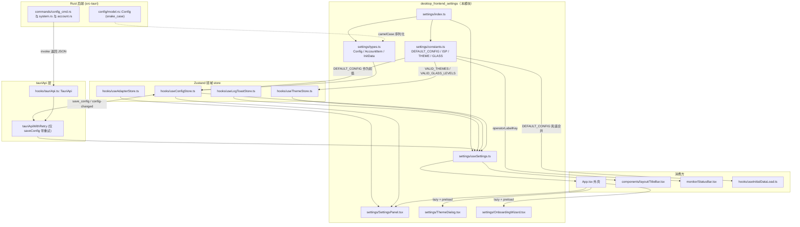
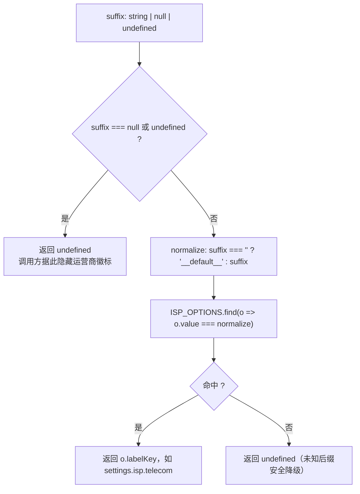
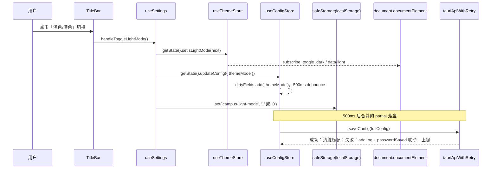
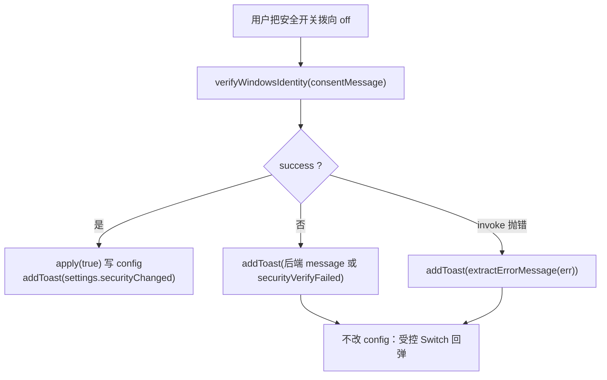
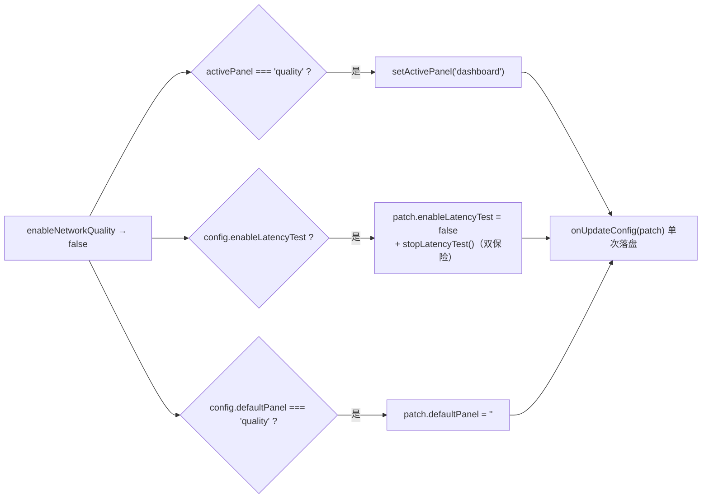
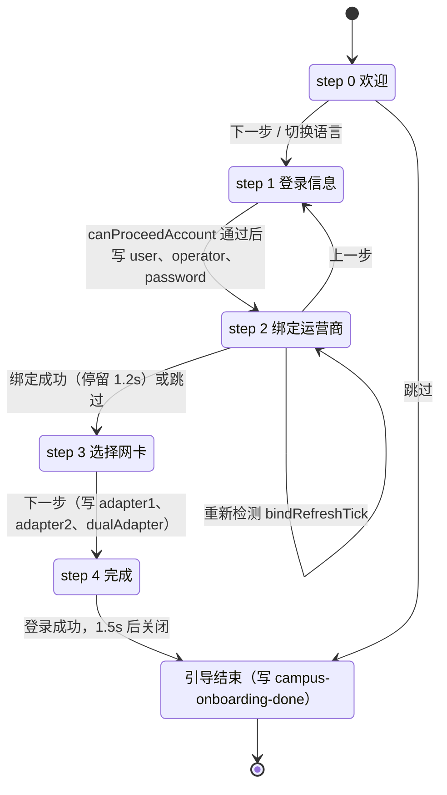
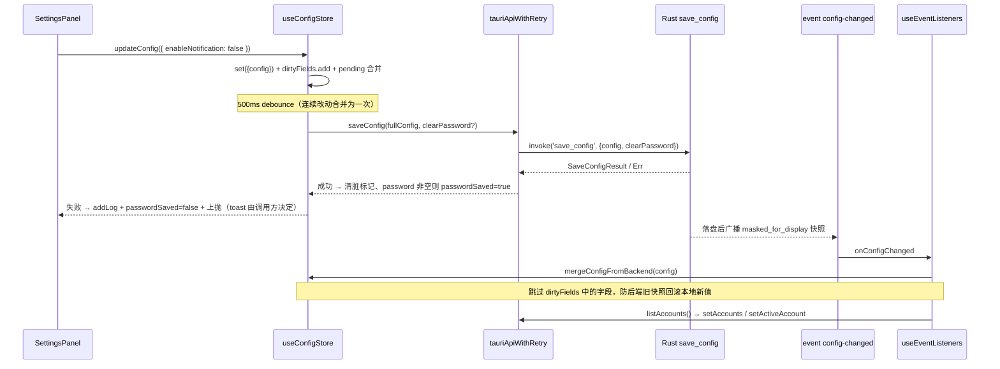
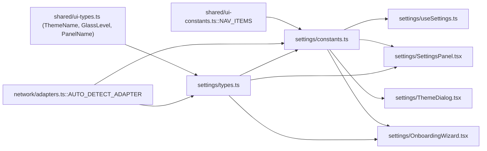

# 桌面端前端设置模块（desktop_frontend_settings）

`desktop_frontend_settings` 对应桌面端前端 `tauri-app/frontend/src/settings/` 目录，是整个桌面 UI 的**配置契约层与设置交互层**。它向上为所有面板提供「配置长什么样、默认值是什么、选项文案怎么取」的唯一权威定义，向下通过 Zustand store 与 Tauri `invoke` 通道把用户的一次点击变成后端落盘的持久化数据。

模块的核心由三类构件组成：

1. **类型契约**（`types.ts`）：`Config`、`AccountItem`、`InitData`、`AutoLaunchResult`、`CoreAutostartResult` —— 前端与 Rust 后端之间所有配置类命令的返回值形状。
2. **常量字典**（`constants.ts`）：`DEFAULT_CONFIG`、`ISP_OPTIONS`、`THEME_OPTIONS`、`VALID_THEMES`、`GLASS_OPTIONS`、`VALID_GLASS_LEVELS`、`DEFAULT_PANEL_OPTIONS` 以及纯函数 `operatorLabelKey`。
3. **行为聚合 Hook**（`useSettings.ts`）：把 `useConfigStore` / `useThemeStore` / `useLogToastStore` 三个领域 store 与后端命令缝合为一个「设置操作」出口，供 `App.tsx` 外壳、`TitleBar`、`SettingsPanel` 复用。

此外 `index.ts` 还对外导出三个设置相关的界面组件：`SettingsPanel`（设置面板）、`ThemeDialog`（主题 / 玻璃质感对话框）、`OnboardingWizard`（首次运行引导卡堆）。

---

## 1. 模块在系统中的位置

模块本身不直接 `invoke` 后端命令（唯一例外是 `SettingsPanel` / `OnboardingWizard` 内的低频命令），持久化一律委托给 [desktop_frontend_hooks](desktop-frontend-hooks.md) 中的 store；这种「类型 + 常量在下、状态在中、行为在上」的切分，使得后端 `Config` 字段增删时，前端只需改 `types.ts` 与 `constants.ts` 两处。

---

## 2. 类型契约（`settings/types.ts`）

### 2.1 `Config`

`Config` 是桌面端唯一的「全量配置」形状，字段以 camelCase 与 Rust 侧 `crate::config::model::Config`（snake_case）通过 serde 重命名对齐。后端配置模型的默认值函数与校验规则详见 [desktop_backend_configuration](desktop-backend-configuration.md)。

按用途可把 `Config` 字段分为九组：

| 分组 | 字段 | 说明 |
| --- | --- | --- |
| 账号与凭证 | `user`、`password`、`operator`、`displayName`、`activeAccount` | `password` 出站恒为掩码 `PASSWORD_MASK`（`'***'`），仅表示「已保存」，明文永不进 webview |
| 自助服务安全 | `selfHelloEnabled`、`selfReverifyEachAction` | Windows Hello 总开关与「每次操作都二次验证」，供 [desktop_frontend_account_management](desktop-frontend-account-management.md) 的验证门读取 |
| 适配器 | `adapter1`、`adapter2`、`dualAdapter`、`adapter1Account`、`adapter2Account`、`outboundPriority`、`dnsOptimizeAdapters` | 后两个 `*Account` 是「仅桌面」的设备级绑定，切账号不改动；解析规则见 `network/adapters.ts::resolveAdapterNames` |
| 启动与窗口 | `autoLaunch`、`hiddenStart`、`minimizeToTray`、`lightweightMode`、`autoLoginOnStart`、`autoLoginOnPreparation`、`autoExitAfterLogin`、`autoExitOnOnline` | 对应后端 `set_auto_launch` / `get_init_data.isAutoStart` / `close_window` 分支 |
| 夜间切换与出站（后端内部状态） | `enableNightOperatorSwitch`、`nightOperatorRestore`、`enableNightOutboundSwitch`、`nightRestoreMinutes`、`nightOutboundRestore`、`outboundMetricRestore`、`outboundDisabledAdapters`、`outboundStandbyRoute`、`outboundManualHoldDay`、`outboundPendingSwitch` | UI 只读或仅暴露开关，其余字段由后端 monitor 层维护，导入配置时会被本机值整体覆盖（见 §6.4） |
| 检测与调度 | `enableBackgroundCheck`、`backgroundCheckInterval`、`maxDisconnectReconnect`、`autoLoginCooldownSecs`、`scheduledLoginMinutes`、`scheduledLogoutMinutes`、`campusExitOnFail`、`campusExitStartMinutes`、`campusExitEndMinutes`、`campusCheckStartMinutes`、`campusCheckEndMinutes` | 分钟数字段以「当日分钟数」编码；`1440` 是禁用哨兵（真实 `00:00` 用 `0`） |
| 校园网判定 | `portalUrl`、`fixedGateway`、`campusGateway`、`requiredNetworkName`、`enableNetworkNameCheck` | 与 [desktop_frontend_monitoring](desktop-frontend-monitoring.md) 的 `BackgroundStatus` 字段同构回传 |
| 质量与延迟 | `enableNetworkQuality`、`enableLatencyTest`、`latencyTestInterval`、`skipTtfbInLatency`、`skipContentInLatency` | `enableNetworkQuality=false` 会联动关闭 `enableLatencyTest` 并清理 `defaultPanel='quality'`（见 §5.1.2） |
| 界面与数据 | `themeMode`、`customThemeColor`、`defaultPanel`、`enableNotification`、`updateSource`、`logRetentionDays`、`configVersion`、`deviceAliases?` | `configVersion` 当前为 `5`，后端 `config_version` 迁移据此一次性刷新历史默认值 |

### 2.2 其余契约类型

- **`AccountItem`**：账号列表项。`id` 是账号文件名 stem（稳定不变），`displayName` 为可编辑显示名；`user` / `operator` / `passwordSaved` 为 `list_accounts` 的扩展字段，旧后端缺省时 UI 显示占位。账号操作命令与结果类型在 [desktop_frontend_account_management](desktop-frontend-account-management.md)（`SwitchAccountResult` 等）与 [desktop_backend_commands](desktop-backend-commands.md)（`commands/account.rs`）。
- **`InitData`**：`get_init_data` 的一次性启动快照，聚合 `config`、`version`、`adapters`、`adapterDetails`、`accounts`、`activeAccount`、`backgroundStatus`、`isAutoStart`、`autoLaunch`、`notificationEnabled`、`logRetentionDays`、`debugMode`、`refreshRate?`。原先的四条一次性只读命令已并入此处，由 `useInitialDataLoad` 分发给各 store。
- **`AutoLaunchResult` / `CoreAutostartResult`**：两者形状相同（`success` + 可选 `message`），分别对应「当前用户注册表自启」与「未登录 Windows 的 SYSTEM 计划任务无头核心自启」。后者开启时后端会写机器级加密配置，详见 [desktop_backend_platform_specific](desktop-backend-platform-specific.md)。

> 值得注意：`account/types.ts` 通过 `export type { AccountItem } from '@/settings'` 复用本模块定义 —— 即 `settings` 是账号类型的**唯一定义源**，账号模块只做再导出。

---

## 3. 常量字典（`settings/constants.ts`）

### 3.1 `DEFAULT_CONFIG`

`DEFAULT_CONFIG` 是 `Config` 的完整前端兜底值（`configVersion: 5`）。它有三个消费点：

1. `useConfigStore` 的 store 初始 state；
2. `useInitialDataLoad` 与后端 `initData.config` 做浅合并（`{ ...DEFAULT_CONFIG, ...initData.config }`），保证后端新增字段在前端不缺失；
3. `getInitData` 失败时的降级配置（此时同时置 `configLoaded = true`，避免依赖该信号的流程被永久阻塞）。

注释中保留了两条**版本化默认值迁移**说明：`2026-09-13` 起 `campusCheckEndMinutes` 由 `0` 改为 `1380`（23:00）、`2026-09-20` 起 `scheduledLoginMinutes/scheduledLogoutMinutes` 的禁用哨兵由 `0` 改为 `1440`（因为 `0` 已是真实的 `00:00`）。存量配置由后端 `config_version` v2→v3 迁移一次性刷新，前端只负责「新装即新默认」。

### 3.2 `ISP_OPTIONS` 与 `operatorLabelKey`

`ISP_OPTIONS` 定义四个运营商选项，`value` 为登录账号后缀：

| value | 含义 | labelKey |
| --- | --- | --- |
| `__default__` | 无锡学院（校园网默认线路） | `settings.isp.wxxy` |
| `@telecom` | 中国电信 | `settings.isp.telecom` |
| `@unicom` | 中国联通 | `settings.isp.unicom` |
| `@cmcc` | 中国移动 | `settings.isp.cmcc` |

`operatorLabelKey` 解决的是**两套编码之间的口径差异**：运行时状态（`bgStatus.onlineOperator`）用 `''` 表示校园网默认线路，而下拉选择值用 `'__default__'`；`null` / `undefined` 表示离线或未知。

主要消费者是 `monitor/StatusBar.tsx`：它用 `operatorLabelKey(onlineOperator)` 渲染在线运营商徽标，并在夜切临时态（`config.operator === '' && nightOperatorRestore !== ''`）用 `operatorLabelKey(nightOperatorRestore)` 在 tooltip 里标注恢复目标。徽标图片映射（`''` → 校徽、`@cmcc` → 移动 logo）由 [desktop_frontend_shared_components_types](desktop-frontend-shared-components-types.md) 的 `shared/IspMark.tsx` 提供，两者共用同一套后缀字面量。

### 3.3 主题与玻璃档位

- `THEME_OPTIONS`：7 种配色（默认蓝 / 活力紫 / 森林绿 / 午夜橙 / 海洋青 / 樱桃红 / 自定义），每项带 `id`（`ThemeName`）、预览 `color` 与 `labelKey`。
- `VALID_THEMES`：字符串数组版白名单，供 `useThemeStore.initTheme` 与 `main.tsx::initTheme` 校验 `localStorage` 中的历史值，防止脏值导致类名注入。
- `GLASS_OPTIONS` / `VALID_GLASS_LEVELS`：玻璃质感三档 `off` / `standard` / `ultra`（不模糊 / 单层雾化 / 完整液体玻璃），注释明确「只借鉴 FlClash 与 Apple Liquid Glass 的设计语汇，未复制任何上游源码」。档位本身**不进 `Config`**，而是由 `useThemeStore` 写入 `localStorage` 的 `campus-glass-level` 并落到 `<html data-glass>` 属性，强度全部由 CSS 变量派生 —— 这样切档无需重载、也不受账号切换影响。
- `DEFAULT_PANEL_OPTIONS`：由 `shared/ui-constants.ts::NAV_ITEMS` 映射而来（`value = item.id`、`labelKey = item.labelKey`），使「默认面板」下拉与导航栏永远同步，新增面板不需要改设置模块。

---

## 4. `useSettings`：三个 store + 后端命令的行为聚合

`useSettings()` 用 `useShallow` 做浅比较订阅，避免任意 config 字段变化引起外壳级联重渲染，然后把三个领域 store 平铺成一个返回对象，外加四个「跨层副作用」处理器：

| 处理器 | 写 store | 写 localStorage | 调后端 | 失败处理 |
| --- | --- | --- | --- | --- |
| `handleToggleLightMode` | `useThemeStore.setIsLightMode` + `useConfigStore.updateConfig({ themeMode })` | `campus-light-mode` = `'1'`/`'0'` | 无（走 500ms debounce 落盘） | — |
| `handleToggleNotification` | `updateConfig({ enableNotification })` | — | `setNotificationEnabled` | DEV console（后端已同步落盘，不再重复提示） |
| `handleSetAutoLaunch(enabled)` | `updateConfig({ autoLaunch })` | — | `setAutoLaunch` | `addToast('settings.autoLaunchFailed', 'error')` |
| `handleSetTheme(name)` | `useThemeStore.setThemeName` | `campus-theme` | 无 | — |

**为什么主题名/浅色模式/玻璃档位写 `localStorage` 而 `themeMode` 又写 `Config`？**
`localStorage` 用于**首帧防闪烁**：`main.tsx::initTheme()` 在 React 挂载前就读取 `campus-light-mode` / `campus-theme` / `campus-glass-level` 直接给 `<html>` 打类名与属性（见 [desktop_frontend_entrypoint_mocks](desktop-frontend-entrypoint-mocks.md)）。`Config.themeMode` 则是**可迁移的语义值**（`light` / `dark` / `system`），供配置导出/导入与 `useThemeStore.initTheme` 在存储缺失时回落 —— `system` 会去查询 `matchMedia('(prefers-color-scheme: light)')`。

**`handleSetAutoLaunch` 的乐观更新权衡**：先改 UI 再调注册表，因此注释要求「API 失败时 UI 已显示开启但注册表未生效，须提示用户」；后端 `set_auto_launch` 本身遵循「先注册表成功再改配置」的顺序，注册表失败会直接返回 `Err` 让前端 `invoke` reject（审计 A14），从而保证这里的 `catch` 分支能被触发。

---

## 5. 界面组件（经 `index.ts` 导出）

### 5.1 `SettingsPanel`

设置面板由 `App.tsx` 在 `case 'settings'` 分支渲染，props 极简（`autoLaunch`、`onUpdateConfig`、`onSetAutoLaunch`、`onShowOnboarding`），其余数据一律自订阅 `useConfigStore(useShallow(s => s.config))` —— 这样外壳不会因为任意 config 字段变化重渲染。布局为「顶部引导横幅 + 手动两列网格」，两列用 `justify-between` 摊开字体渲染带来的残差，保证底缘对齐。

卡片分组与字段映射：

| 卡片 | 控件 → `Config` 字段 |
| --- | --- |
| 启动设置 | `autoLaunch`（经 `onSetAutoLaunch`）、核心自启 `coreAutostart`（独立 state）、`hiddenStart` |
| 登录自动化 | `autoLoginOnStart`、`autoExitAfterLogin`、`autoExitOnOnline` |
| 窗口与界面 | `lightweightMode`、`minimizeToTray`、`defaultPanel`（`''` 用哨兵 `__remember__` 表达「记住上次」） |
| 通知与安全 | `enableNotification`、`selfHelloEnabled`、`selfReverifyEachAction` |
| 数据管理 | 配置导出/导入（`exportWithPassword` 为本地 state） |
| 质量检测 | `enableNetworkQuality` + 弹窗内的 `skipTtfbInLatency`、`skipContentInLatency` |

**布尔开关的读取惯例**：面板里三种写法各有含义，改动时不要统一化。

- `config.x !== false`（`minimizeToTray`、`enableNotification`、`selfHelloEnabled`、`enableNetworkQuality`）：字段缺失时**视为开启**，用于「关闭需明确动作」的保护型开关。
- `config.x || false`（`hiddenStart`、`autoLoginOnStart`、`autoExitAfterLogin`、`autoExitOnOnline`、`lightweightMode`、`skipTtfbInLatency`、`skipContentInLatency`）：缺失即关闭，纯功能开关。
- `config.x === true`（`selfReverifyEachAction`）：只有显式开启才生效，最严格的二次验证语义。

由于 `DEFAULT_CONFIG` 已经把全部字段填满，这三类写法实际只在「旧配置文件 / mock 后端缺字段」时才有差异 —— 它们是对历史配置形状的前向兼容兜底。

#### 5.1.1 安全开关的「关闭方向」必须过 Hello 验证

`handleSecurityDisable(apply)` 统一处理安全类开关的**放宽方向**（安全 → 宽松）：先调用后端 `verify_windows_identity`，成功才执行 `apply(true)` 并提示「已变更」，失败则保持原状态（Switch 受控自动回弹）。开启方向不需要验证。`selfReverifyEachAction` 在 `selfHelloEnabled === false` 时整体禁用，避免出现「主开关关了、子开关还能操作」的错觉。

#### 5.1.2 关闭质量检测的三处联动清理

若不联动清理，`App.tsx` 会对 `quality` 面板渲染 `null`、Dock 隐藏入口，当前面板停在 `quality` 时主区域直接空白；后端 `start_latency_test` 也有同向校验，两端互为双保险。

#### 5.1.3 配置导出 / 导入（桌面专属）

- 导出：`exportConfig(includePassword)`。默认掩码态出站；勾选「含密码」时后端把内存明文重新 DPAPI 加密后写入，wrapper 带 `passwordEncrypted` 标志，**绝不明文落盘**。
- 导入：文件来源是 Tauri 核心的 `getCurrentWebview().onDragDropEvent`（webview 把 HTML5 拖放拦成原生事件，直接拿到真实路径，无需 dialog 插件），关闭即清理监听；另有手工粘贴路径兜底。前端做「必须 `.json`」的轻校验，后端仍做强校验（≤1MB、JSON 解析、结构校验、密码还原、四类失败分列）。导入属破坏性覆盖，必须过全局 `ConfirmDialog` 二次确认。

后端细节见 [desktop_backend_commands](desktop-backend-commands.md) 的 `commands/config_cmd.rs`。

### 5.2 `ThemeDialog`

低频对话框，在 `App.tsx` 中以 `React.lazy` + `preloadPanels()` 组合按需分包（分包规则见 `tauri-app/frontend/vite.config.ts` 的 `manualChunks`，vendor 按 react / framer-motion / gsap / radix 拆分）。对话框内容：

1. **配色**：`THEME_OPTIONS` 两列按钮，选中态描边 + `Check`。
2. **自定义主色**：仅当 `themeName === 'custom'` 展开；原生 `type="color"` 取色器（外观由外层 label 承载，控件透明覆盖）+ 8 个预设色块。每次改动**同时**写 `useThemeStore.setCustomThemeColor`（即时预览）与 `onSetCustomColor` → `updateConfig({ customThemeColor })`（持久化）。历史脏值（空串）用正则 `/^#[0-9a-f]{6}$/i` 兜回 `#6366f1`。
3. **玻璃质感**：三档 `role="radiogroup"`，描述行预留 `min-h-[2rem]`，防止档位文案长短不一把对话框顶高造成「窗口跳一下」。
4. **深浅色**：`Switch` 走 `onToggleLightMode`（即 §4 的 `handleToggleLightMode`）。

自定义色落地时，`useThemeStore` 的订阅者用 `hexToHsl`（`lib/color.ts`）换算并通过 `style.setProperty` **覆盖**同名 CSS 变量 `--primary/--ring/--accent/--accent-foreground`；注释记录了历史缺陷：曾用 `cssText +=` 累积声明导致 inline style 无界增长。

### 5.3 `OnboardingWizard`

五步卡片堆引导（`STEP_TITLE_KEYS`：welcome → accountInfo → bindOperator → selectNetworkAdapter → setupComplete），实现「Apple 卡片堆」观感：`STACK_LAYERS` 定义四档 `y/scale/z`，第 4 层起共用最深档；前进时顶卡先竖直飞起并微旋（`EXIT_UP_MS = 240`）再落回队尾，后退时直接平滑归位。

关键约束与踩坑记录：

- **卡高统一**：`measureDeck` 把卡高临时放开为 `auto` 读 `scrollHeight` 与内层 `offsetHeight` 的最大值，再取 `min(max, max(420, innerHeight - 150))`；短内容步靠底部留白填平，切步时高度不跳。`useLayoutEffect` 保证绘制前完成，首帧 ref 未挂上时用 `requestAnimationFrame` 补测一次。
- **不可见的卡仍会参与 Tab**：被盖住的卡仍在 DOM 里，仅 `pointer-events-none` 挡不住聚焦，因此用 `inert` 属性表达「整棵子树不可交互」。
- **宽度不能用 `w-[760px] max-w-[calc(100vw-32px)]`**：`100vw` 在 WebView2 高 DPI/缩放下与真实布局宽不一致，会让固定宽溢出后被 `html{overflow:hidden}` 裁掉（曾表现为「引导卡左边框被截断」）；改为 `w-full + max-w` 从 flex 父容器取上限。
- **绑定步的 Hello 门**：`useHelloGate()`（来自 [desktop_frontend_account_management](desktop-frontend-account-management.md) 的 `account/selfServiceState.ts`）在 `handleBind` 前先行验证，与后端验证门 TTL 对齐，保证一次通过；而进入步骤自动执行的 `query_bind_status` **不挂门**，避免刚进步骤就弹 Hello 打断引导。
- **末步最终校验**：`handleLoginAndFinish` 重查账号密码必填，且拒绝 `dualAdapter:true` 配 `adapter2:''`/自动检测 的不一致配置（历史缺陷：RightPanel 会把这种组合视为未启用副适配器）。`AUTO_DETECT_ADAPTER` 落盘时统一转换为空串。
- **密码草稿**：初值 `config.password === PASSWORD_MASK ? '' : config.password`，即掩码态显示为空，用户不输入就不覆盖已保存密码（后端 `save_config` 对空串/MASK 一律保留原密码）。
- **跳过即打标**：`handleSkip` 与登录成功均写 `safeStorage.set('campus-onboarding-done','1')`；`App.tsx` 的自动弹出条件为「未打标 且 `!configUser`」，延时 800ms 等启动动画完成。

---

## 6. 数据流与状态一致性

### 6.1 一次开关的完整旅程

三层防御值得留意：

1. **脏字段保护**：`updateConfig` / `updateConfigLocal` 把字段名加入 `dirtyFields`，`mergeConfigFromBackend` 合并时跳过它们，避免后端回传的旧快照（含过期 `enableLatencyTest` 与密码 MASK）覆盖刚改的值。
2. **脏标记有寿命**：保存连续失败 3 次（`DIRTY_FAILURE_LIMIT`）即放弃脏标记并写 warning 日志，防止「保存一直失败 → 字段被永久跳过 → UI 与后端永久脱节」。
3. **关闭前 flush**：`hasPendingConfig()` 同时看 pending 与 in-flight；`flushPendingConfig()` 把本次新发的保存也纳入返回 promise，由关窗方一并等待，失焦路径（`useEventListeners` 的 `window blur`）作为 Alt+F4 兜底。相关窗口生命周期见 [desktop_backend_app_lifecycle](desktop-backend-app-lifecycle.md)。

### 6.2 `config-changed` 与夜切字段的只读消费

`outbound*` / `nightOperatorRestore` 等后端内部状态字段由 monitor 层写入并通过 `config-changed` 回传。`StatusBar` 直接读 `config.operator` 与 `config.nightOperatorRestore` 推断「夜切临时态」，徽标始终显示真实在线运营商 —— 前端不额外发命令，纯靠事件流保持同步。这体现了 `Config` 作为**前后端共享状态总线**的角色，细节见 [desktop_backend_monitoring](desktop-backend-monitoring.md)。

### 6.3 `passwordSaved` 与 `PASSWORD_MASK` 语义链

后端出站（`get_config` / `get_init_data`）密码恒为 `'***'` 或空串，`useConfigStore.passwordSaved` 由 `syncPasswordSaved` 维护：

- `useInitialDataLoad`：`cfg.password === PASSWORD_MASK` → `true`；非空且不是 MASK → `false`（该值既非掩码也非空串，说明掩码未生效，按「凭证未就绪」保守处理）。
- `saveConfigDirect` 成功且 `cfg.password` 非空 → `true`；失败 → `false`（账号面板的 `credReady` 依赖它判定凭证就绪）。

任何新增「把配置发给前端」的命令都必须走 `masked_for_display()`，这是敏感信息出站的唯一出口。

### 6.4 导入时的「本机不可迁移字段」白名单

`import_config` 会显式丢弃导入文件中的 VPN 凭据与全部 `outbound*` 切换态（metric 快照 / 禁用名单 / 兜底路由 / 当日保持 / 待切换），改用本机当前值。原因：这些是本机系统状态，若在切换进行中导入，会把活跃快照整体顶掉，系统残留切换态却再无还原路径。因此**前端设置面板不暴露这些字段**，`types.ts` 仅以注释形式声明其内部状态属性。

---

## 7. 依赖清单

### 7.1 模块内部

### 7.2 外部依赖（按用途）

| 依赖 | 用途 | 相关文档 |
| --- | --- | --- |
| `zustand` + `useShallow` | 领域 store 与浅比较订阅，避免外壳级联重渲染 | [desktop_frontend_hooks](desktop-frontend-hooks.md) |
| `@tauri-apps/api`（`invoke`/`listen`/`webview`） | 命令调用、事件监听、导入用的原生拖放 | [desktop_backend_commands](desktop-backend-commands.md) |
| `i18next` / `react-i18next` | 所有 labelKey 的取词（`settings.*`、`themeDialog.*`、`onboarding.*`）；`setLanguage` 写 `app-language` 并 `changeLanguage` | [desktop_frontend_utilities_libraries](desktop-frontend-utilities-libraries.md) |
| `lib/utils.ts::safeStorage` | `localStorage` 访问的容错封装（异常时退回内存 Map） | [desktop_frontend_utilities_libraries](desktop-frontend-utilities-libraries.md) |
| `components/ui/*`（`SettingRow`、`Switch`、`Select`、`AnimatedCard`、`badgeVariants`） | 面板与对话框的基础控件 | [desktop_frontend_shared_ui_components](desktop-frontend-shared-ui-components.md) |
| `lib/color.ts::hexToHsl` | 自定义主色转 CSS 变量 | [desktop_frontend_utilities_libraries](desktop-frontend-utilities-libraries.md) |
| `account/selfServiceState.ts::useHelloGate` | 引导向导绑定步的身份验证门 | [desktop_frontend_account_management](desktop-frontend-account-management.md) |
| `hooks/useConfigStore` / `useThemeStore` / `useLogToastStore` / `useAdapterStore` | 配置、主题、toast/日志、面板激活态 | [desktop_frontend_hooks](desktop-frontend-hooks.md) |

---

## 8. 开发与验证指引

- **新增一个 `Config` 字段**需要同步五处：`settings/types.ts::Config`、`settings/constants.ts::DEFAULT_CONFIG`（并按需升 `configVersion`）、Rust `config/model.rs`（含 `default_*` 函数与 serde 重命名）、UI 控件、必要时 `config/validate.rs`；迁移语义见 [desktop_backend_configuration](desktop-backend-configuration.md)。
- **新增一个面板**只需改 `shared/ui-constants.ts::NAV_ITEMS`，`DEFAULT_PANEL_OPTIONS` 会自动出现在「默认面板」下拉中；`useInitialDataLoad` 的 `VALID_PANELS` 同源。
- **新增运营商**请同时更新 `ISP_OPTIONS`、`shared/IspMark.tsx` 的 `ISP_MARK_SRC`、以及 `OnboardingWizard` 的 `OPERATOR_KEY_BY_VALUE` / `OPERATOR_VALUE_BY_KEY` / `OPERATOR_STATUS_ORDER` 三张映射表。
- 单测通过 Vitest（`environment: 'jsdom'`、`globals: true`、`setupFiles: ./src/test-setup.ts`、别名 `@ → src`，见 `tauri-app/frontend/vitest.config.ts`）执行；开发期无 Rust 后端时由 `tauri-app/frontend/tauri-mock.js` 提供 `invoke`/`emitEvent` 假实现（见 [desktop_frontend_entrypoint_mocks](desktop-frontend-entrypoint-mocks.md)）。构建脚本 `build`/`dev`/`test`/`test:watch`/`clean` 定义于 `tauri-app/frontend/package.json`，整体构建流程见 [build_deployment_configuration_desktop_build](build-deployment-configuration-desktop-build.md)。

### 8.1 与 Android 端的关系

`android_frontend_settings`（`android/frontend/src/settings/`）与本模块**同构但独立**：`DEFAULT_CONFIG`、`ISP_OPTIONS`、`operatorLabelKey`、`THEME_OPTIONS`、`GLASS_OPTIONS` 的字面量与映射规则保持一致，差异集中在：Android 用 `useOnboardingFlow` 承担引导编排、无 `lightweightMode` / `coreAutostart` 等桌面专属能力、身份验证走生物识别而非 Windows Hello。改动桌面常量时应同步核对：[android_frontend_settings](android-frontend-settings.md)。

---

## 9. 设计要点回顾

1. **契约集中**：`settings/types.ts` + `constants.ts` 是前端唯一的配置真值定义源，账号模块、监控模块、网络模块都反向依赖它，避免多份默认值漂移。
2. **双通道持久化**：可迁移的语义值进 `Config`（DPAPI 加密落盘），纯呈现值（主题名、深浅色镜像、玻璃档位、已完成引导标记、上次面板）进 `localStorage`，后者服务「首帧不闪、切档不重载」。
3. **乐观更新 + 显式失败反馈**：设置类操作一律先改 UI，再保证失败有 toast / 日志 / 脏标记寿命三重兜底，杜绝「假成功」。
4. **安全放宽需自证**：所有让保护变弱的开关方向都必须过 Windows Hello，且受控组件在验证失败时自动回弹。
5. **联动清理优先于渲染兜底**：`enableNetworkQuality`、`defaultPanel`、`activePanel` 三者的耦合在写侧一次性处理干净，读侧才能保持简单。
