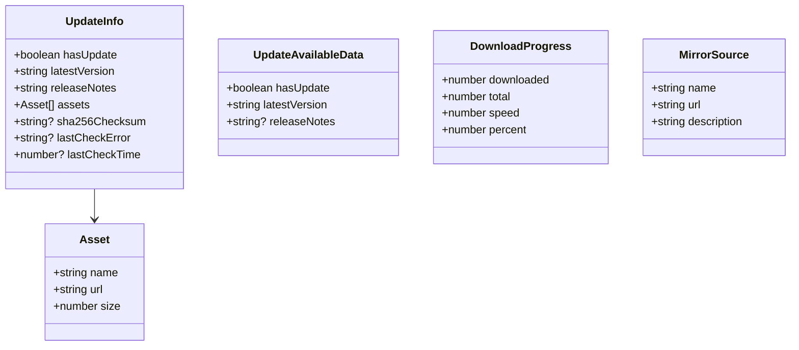
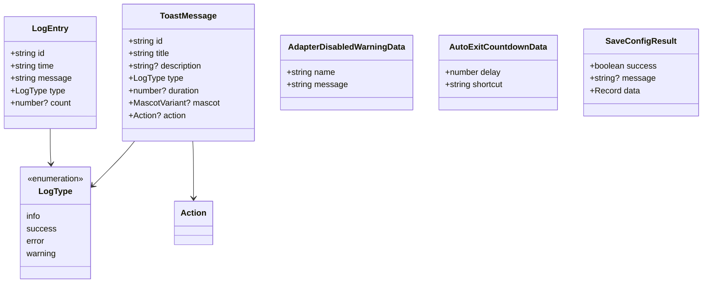
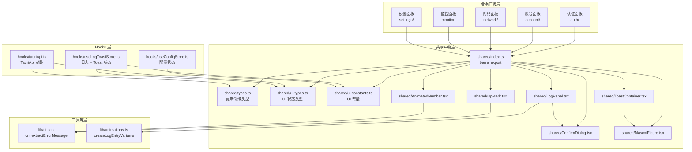
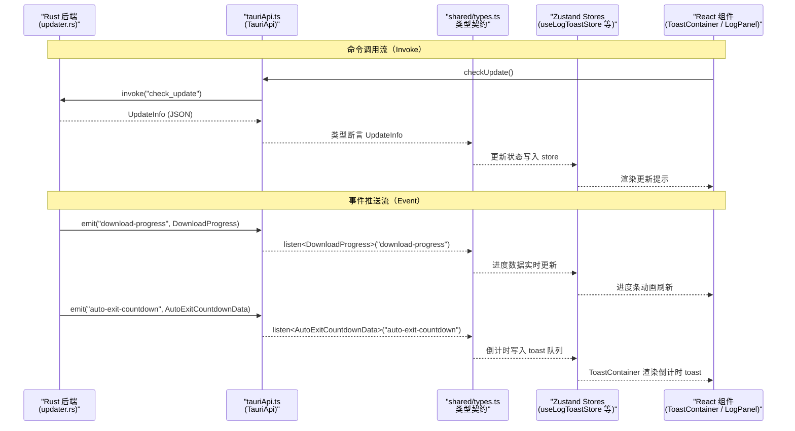
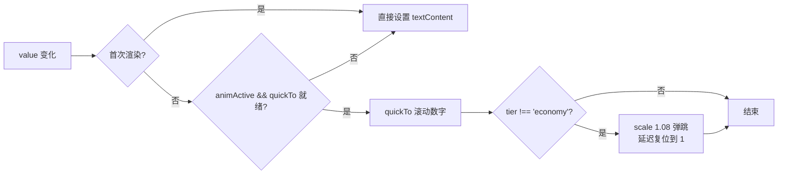
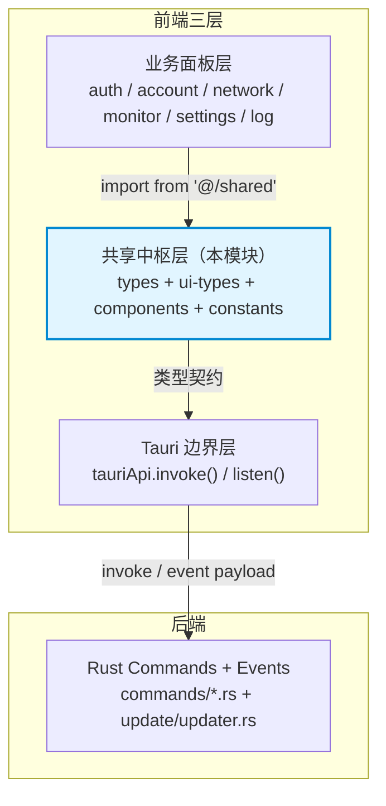

# 桌面端共享组件与类型定义模块（desktop_frontend_shared_components_types）

## 模块概述

`desktop_frontend_shared_components_types` 是桌面端 Tauri 应用前端（`tauri-app/frontend/src/shared/`）的共享资源中枢。它集中存放跨面板复用的 React 组件、UI 类型定义、常量配置与视觉素材出口，充当了前端各业务领域（认证、账号、网络、监控、设置等）与后端 Tauri 命令 / 事件之间的**类型契约层**与**通用 UI 组件库**。

本模块不承载具体业务逻辑，而是提供：

1. **类型契约**——定义与 Rust 后端命令返回值、事件 payload 一一对应的 TypeScript 接口（更新检查、下载进度、事件通知等）；
2. **通用组件**——数字滚动动画、运营商标识、看板娘头像等纯展示组件；
3. **共享 UI 面板**——日志面板、Toast 通知容器、确认对话框等可复用交互组件。

---

## 核心组件清单

| 文件 | 导出 | 职责 |
|------|------|------|
| `shared/types.ts` | `UpdateAvailableData`、`UpdateInfo`、`DownloadProgress`、`MirrorSource` | 应用更新（updater）领域的类型契约 |
| `shared/ui-types.ts` | `LogEntry`、`ToastMessage`、`AdapterDisabledWarningData`、`AutoExitCountdownData`、`SaveConfigResult`、`StatusState`、`PanelName`、`ThemeName`、`GlassLevel`、`LogType` | 全局 UI 状态类型与事件 payload 类型 |
| `shared/ui-constants.ts` | `MAX_LOG_ENTRIES`、`APP_VERSION`、`APP_NAME`、`PASSWORD_MASK`、`NAV_ITEMS` | 全局 UI 常量与导航配置 |
| `shared/index.ts` | 统一 barrel export | 对外聚合导出所有共享模块 |
| `shared/AnimatedNumber.tsx` | `AnimatedNumber` | GSAP 数字滚动动画组件 |
| `shared/IspMark.tsx` | `ispMarkSrc()`、`IspMark` | 运营商后缀 → WebP 标识图映射 |
| `shared/MascotFigure.tsx` | `MascotFigure`、`MascotVariant` | 看板娘（二次元角色）图片出口 |
| `shared/LogPanel.tsx` | `LogPanel` | 系统日志查看 / 过滤 / 清空 / 导出诊断包面板 |
| `shared/ToastContainer.tsx` | `ToastContainer` | 全局 Toast 通知堆叠容器 |
| `shared/ConfirmDialog.tsx` | `ConfirmDialog` | 通用破坏性操作确认对话框 |
| `shared/ErrorBoundary.tsx` | `ErrorBoundary` | React 错误边界组件 |
| `shared/FluidBackground.tsx` | `FluidBackground` | 流体动态背景组件 |
| `shared/RefreshButton.tsx` | `RefreshButton`、`getRefreshIconClass` | 带刷新旋转动画的按钮 |
| `shared/SegmentTabs.tsx` | `SegmentTabs` | 分段式标签页切换组件 |

---

## 类型契约详解

### 更新领域类型（`types.ts`）

以下类型与 Rust 后端 `tauri-app/src-tauri/src/update/updater.rs` 中的结构体一一对应（后端使用 `#[serde(rename_all = "camelCase")]`）：

- **`UpdateInfo`**：`check_update` 命令的完整返回体。`lastCheckError` 携带本次检查前的失败原因快照（自动检查失败后，下次手动检查成功时仍能展示）；`lastCheckTime` 为最近一次检查完成的 unix ms 时间戳。
- **`UpdateAvailableData`**：`update-available` 事件 payload——后端自动检测到新版本时主动推送，字段精简，不携带 assets / checksum。
- **`DownloadProgress`**：`download-progress` 事件 payload——下载过程中高频推送的进度数据（已下载字节 / 总字节 / 速度 / 百分比）。
- **`MirrorSource`**：`get_mirror_urls` 命令返回的镜像源列表（GitHub 原始源失败时按序降级）。

### UI 事件与状态类型（`ui-types.ts`）

- **`LogEntry`**：前端内存日志条目。`count` 字段实现连续重复折叠——相同消息与类型的日志不追加新行，而是累加计数并刷新时间戳（用于诊断"自动登录失败风暴"类问题）。
- **`ToastMessage`**：全局通知消息。`mascot` 字段指定左侧看板娘变体（`portrait` / `celebrate` / `offline` / `alert` / `update`），缺省时按 `type` 取默认变体。`action` 承载可点击按钮（如"取消退出"）。
- **`AdapterDisabledWarningData`**：`adapter-disabled-warning` 事件 payload——后端检测到适配器被外部禁用时推送。
- **`AutoExitCountdownData`**：`auto-exit-countdown` 事件 payload——应用即将自动退出的倒计时数据（含延迟秒数与取消快捷键）。
- **`SaveConfigResult`**：`save_config` 命令返回体——配置保存结果的成功 / 失败标记。

此外，`ui-types.ts` 还定义了全局字面量类型：`StatusState`（`'loading' | 'online' | 'offline' | 'error'`）、`PanelName`（九大导航面板标识）、`ThemeName`（七种主题预设）、`GlassLevel`（玻璃质感三档：`off` / `standard` / `ultra`）。

---

## 组件关系与数据流

### 模块依赖关系

### 后端命令与事件数据流

---

## 关键组件设计

### AnimatedNumber（数字滚动动画）

`AnimatedNumber` 基于 GSAP `quickTo` 实现数值平滑滚动，并附带 scale 弹跳反馈。核心设计要点：

- **动画档位感知**：通过 `useAnimationProfile()` 获取当前动画档位（`economy` 档禁用 scale 弹跳，仅做数字滚动）；通过 `useAnimationActive()` 判断页面空闲状态——非激活时直接跳变，跳过动画。
- **资源安全**：cleanup 阶段显式 `killTweensOf` 底层 tween，修复历史缺陷——quickTo 底层 tween 在组件卸载后仍存活空转、持续占用 CPU。
- **防堆积**：scale 复位的 `delayedCall` 先 kill 旧 call 再注册，避免快速连续变化时多个回调堆积导致跳变。

### IspMark（运营商标识）

将运营商后缀（`@telecom` / `@unicom` / `@cmcc` / 空字符串）映射为 `public/isp/` 下的 WebP 图标。设计细节：

- 校徽（空后缀 / `__default__`）在浅色底上不可读，外层包裹 16px 白色圆形底 + 黑色细环；
- 运营商 logo 原色直出，不加底色；
- 使用 `memo` 包裹，避免父组件重渲染时重复计算。

### MascotFigure（看板娘出口）

统一出口路径 `/girl/mascot-{variant}.webp`，支持七种变体（`portrait` / `welcome` / `empty` / `celebrate` / `sponsor` / `offline` / `alert`）与三档尺寸（`sm` / `md` / `lg`）。`ToastContainer` 中 `ToastMessage.mascot` 字段与该组件的变体体系对齐。

---

## 与其他模块的关系

```mermaid
flowchart TB
    Shared["desktop_frontend_shared_components_types<br/>(本模块)"]

    Shared -->|"提供类型契约"| Hooks["desktop_frontend_hooks<br/>tauriApi / useLogToastStore / useConfigStore"]
    Shared -->|"提供 UI 原语"| UIComp["desktop_frontend_shared_ui_components<br/>button / input / badge / card"]
    Shared -->|"提供展示组件"| Auth["desktop_frontend_auth<br/>DashboardPanel"]
    Shared -->|"提供展示组件"| Acct["desktop_frontend_account_management<br/>AccountPanel / SelfOnlineRecords"]
    Shared -->|"提供展示组件"| Net["desktop_frontend_network_management<br/>useNetwork / adapters"]
    Shared -->|"提供展示组件"| Mon["desktop_frontend_monitoring<br/>StatusBar / useMonitor"]
    Shared -->|"提供展示组件"| Settings["desktop_frontend_settings<br/>useSettings / InitData"]
    Shared -->|"类型契约对应"| BkUpdate["desktop_backend_update<br/>updater.rs UpdateInfo / DownloadProgress"]
    Shared -->|"事件 payload 对应"| BkCommands["desktop_backend_commands<br/>updater.rs / system.rs 事件发射"]
    Shared -->|"对等共享模块"| AndroidShared["android_frontend_shared_components<br/>(Android 端对等实现)"]

    style Shared fill:#e1f5ff,stroke:#0288d1,stroke-width:2px
```

| 关联模块 | 关系说明 |
|----------|---------|
| [desktop_frontend_hooks](desktop_frontend_hooks.md) | `tauriApi.ts` 从 `@/shared` 导入所有类型契约；`useLogToastStore` 消费 `LogEntry` / `ToastMessage` / `LogType`；`useConfigStore` 消费 `PASSWORD_MASK` |
| [desktop_frontend_shared_ui_components](desktop_frontend_shared_ui_components.md) | 本模块的 `LogPanel` / `ToastContainer` 依赖 `ui/button` / `ui/badge` / `ui/animated-card` 等基础 UI 原语 |
| [desktop_frontend_auth](desktop_frontend_auth.md) | 认证面板通过 Toast 系统反馈登录结果，消费 `ToastMessage` 类型 |
| [desktop_frontend_account_management](desktop_frontend_account_management.md) | 账号面板使用 `IspMark` 展示运营商标识、`MascotFigure` 展示空状态插图 |
| [desktop_frontend_network_management](desktop_frontend_network_management.md) | 网络面板通过 `onAdapterDisabledWarning` 事件消费 `AdapterDisabledWarningData` |
| [desktop_frontend_monitoring](desktop_frontend_monitoring.md) | 监控面板使用 `AnimatedNumber` 展示延迟数值 |
| [desktop_frontend_settings](desktop_frontend_settings.md) | 设置面板触发配置保存，消费 `SaveConfigResult`；自动退出倒计时消费 `AutoExitCountdownData` |
| [desktop_backend_update](desktop_backend_update.md) | Rust `updater.rs` 中 `UpdateInfo` / `DownloadProgress` 结构体（`#[serde(rename_all = "camelCase")]`）与本模块 `types.ts` 一一对应 |
| [desktop_backend_commands](desktop_backend_commands.md) | `commands/updater.rs`、`commands/system.rs` 发射的 Tauri 事件 payload 由本模块类型定义约束 |
| [android_frontend_shared_components](android_frontend_shared_components.md) | Android 端对等的共享组件模块，共享 `AnimatedNumber` / `IspMark` / `MascotFigure` 概念但独立实现 |

---

## 常量配置

`ui-constants.ts` 定义了全局共享常量：

| 常量 | 值 | 用途 |
|------|-----|------|
| `MAX_LOG_ENTRIES` | `300` | 前端内存日志最大保留条数（超出时 FIFO 淘汰） |
| `APP_VERSION` | `'2.4.3'` | 应用版本号（与 `version.json` 对应） |
| `APP_NAME` | `'校园网登录助手'` | 应用显示名称 |
| `PASSWORD_MASK` | `'***'` | 密码占位符——配置回传时后端以此掩码表示"密码未变" |
| `NAV_ITEMS` | 九项导航数组 | 面板导航配置（含 i18n key、图标名、快捷键） |

> `APP_VERSION` 为前端静态硬编码，构建期真实版本号以仓库根目录 `version.json` 为准（详见 [build_deployment_configuration](build_deployment_configuration.md)）。

---

## 架构定位总结

本模块在前端架构中扮演**契约翻译官**与**UI 积木库**的双重角色：向上为业务面板提供类型安全的展示组件与共享常量，向下为 Tauri 边界提供与 Rust 结构体对齐的 TypeScript 接口，确保前后端数据流转类型一致、组件复用无歧义。
