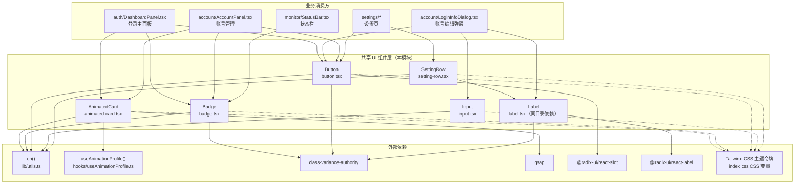
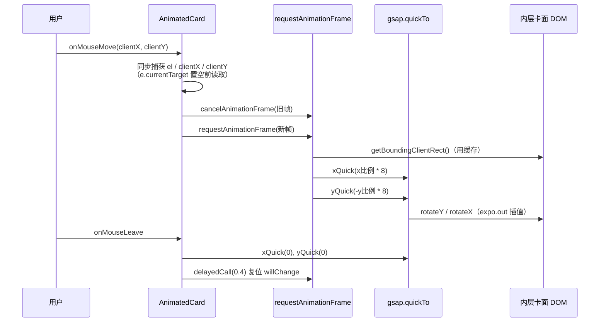
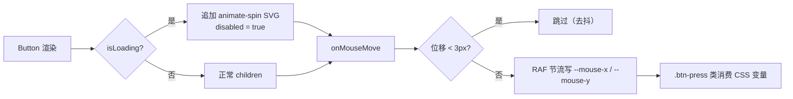
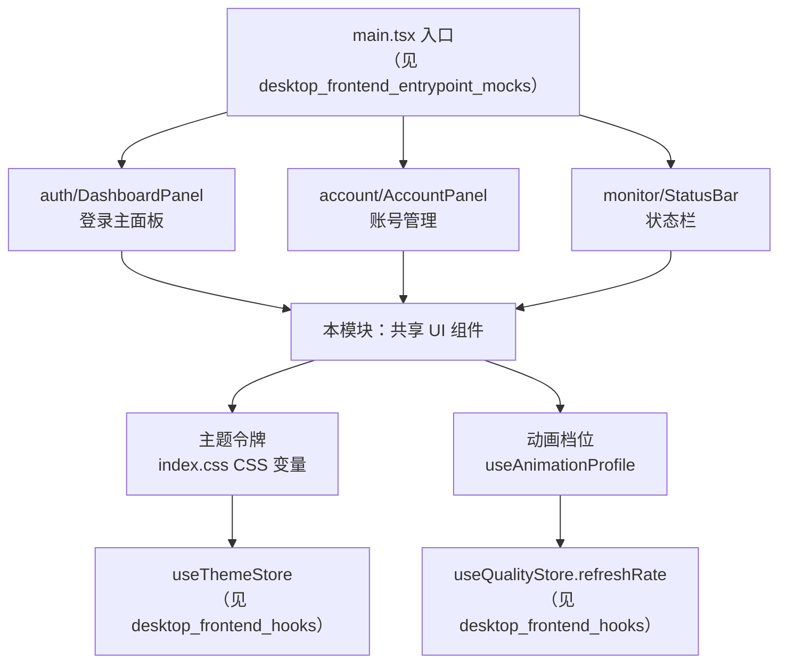

# 桌面端共享 UI 组件库（desktop_frontend_shared_ui_components）

## 模块概述

`desktop_frontend_shared_ui_components` 是 Tauri 桌面应用前端（`tauri-app/frontend`）的共享基础 UI 组件层。该目录下的五个文件提供了整套界面统一的视觉语言——卡片、徽章、按钮、输入框和设置行——是所有业务面板（登录面板、账号面板、监控状态栏等）的基础积木。

该模块定位为**纯展示型组件库**：不包含任何业务状态、不直接调用 Tauri 后端命令，所有交互行为通过 props 与父组件透传。组件内部只负责视觉变体（variant）、动效（GSAP tilt / 鼠标跟随光斑）与无障碍细节（焦点环、加载态、错误态）的统一实现。

核心设计原则：

1. **主题令牌驱动**：全部样式使用 Tailwind 语义类（`bg-card`、`text-primary`、`border-destructive` 等），而非写死颜色，确保自动适配亮色/暗色与三档主题（见 [desktop_frontend_hooks](desktop_frontend_hooks.md) 中的 `useThemeStore`）。
2. **cva 变体系统**：`Button` 与 `Badge` 使用 `class-variance-authority` 定义 variant/size 二维变体矩阵，外部只需传入语义化 prop 即可组合样式。
3. **动效分级可控**：`AnimatedCard` 通过 `noAnimation` / `noEnterAnimation` / `enableTilt` 等开关把进场动画与 3D 倾斜下沉到组件内部，业务面板只需按全局动画配置批量传入开关。

## 组件清单

| 文件 | 导出 | 职责 |
|------|------|------|
| `components/ui/animated-card.tsx` | `AnimatedCard`、`AnimatedCardProps` | 带 GSAP 3D 倾斜、进场动画的可复用卡片容器 |
| `components/ui/badge.tsx` | `Badge`、`badgeVariants` | 圆角状态徽章，8 种语义色变体 × 3 种尺寸 |
| `components/ui/button.tsx` | `Button`、`buttonVariants` | 按钮，8 种变体 × 6 种尺寸，支持 `asChild`、`isLoading`、鼠标跟随光斑 |
| `components/ui/input.tsx` | `Input`、`InputProps` | 输入框，支持左侧图标、错误态边框 + 错误文案 |
| `components/ui/setting-row.tsx` | `SettingRow`、`SettingRowProps` | 「标签左 / 控件右」的标准参数行布局 |

> 目录下还存在同层的 `card.tsx`、`label.tsx`、`dialog.tsx`、`select.tsx` 等 Radix 封装文件（未在本模块树中列出），它们与上述五个组件共同构成完整的 shadcn 风格组件集；`SettingRow` 即直接消费 `Label`。

## 架构与依赖关系

**依赖说明：**

- **`cn()`（`lib/utils.ts`）**：所有组件统一通过 `twMerge(clsx(...))` 合并类名，保证调用方传入的 `className` 能正确覆盖默认变体。详见 [desktop_frontend_utilities_libraries](desktop_frontend_utilities_libraries.md)。
- **`useAnimationProfile()`**：仅 `AnimatedCard` 消费，用于读取全局动画档位（当前恒为 `high`）与 `enableTilt` 开关。档位来源于 `useQualityStore` 的刷新率，详见 [desktop_frontend_hooks](desktop_frontend_hooks.md)。
- **Radix 原语**：`Button` 的 `asChild` 基于 `@radix-ui/react-slot`，`Label` 基于 `@radix-ui/react-label`，保证无障碍语义（点击标签聚焦、按钮样式透传到子元素）。
- **Tailwind 主题令牌**：所有颜色类（`bg-primary`、`border-input`、`text-destructive` 等）映射到 `index.css` 中定义的 CSS 变量，与 `useThemeStore` 联动切换主题。

## 各组件详解

### AnimatedCard — 动效卡片容器

`AnimatedCard` 是桌面端所有主面板卡片的统一容器，基于 `React.memo + forwardRef` 双层包裹。

**Props（`AnimatedCardProps`）：**

| Prop | 类型 | 默认值 | 说明 |
|------|------|--------|------|
| `animationConfig` | `AnimatedCardConfig` | 无 | 预留动效参数（glowIntensity / hoverScale / stiffness 等） |
| `noHover` | `boolean` | `false` | 禁用悬停交互 |
| `noAnimation` | `boolean` | `false` | 完全退化为纯静态 `div`，无进场动画、无倾斜 |
| `noEnterAnimation` | `boolean` | `false` | 仅禁用进场动画（`.card-enter`），保留 hover 倾斜 |
| `enableTilt` | `boolean?` | 取 `profile.enableTilt` | 强制开启/关闭 3D 倾斜；`undefined` 时跟随全局档位 |
| `staggerIndex` | `number?` | `0` | 进场错峰索引，写入 CSS 变量 `--stagger-i` |

**内部实现要点：**

1. **双层 DOM 结构**：外层 `div` 负责 `perspective: 800` 与 `.animated-card-interactive` / `.card-enter` 类；内层 `div`（真实 ref 落点）负责卡面样式 `bg-card text-card-foreground rounded-2xl` 与 `transformStyle: preserve-3d`。这样倾斜旋转只作用于内层，不破坏外层布局。
2. **GSAP quickTo 倾斜**：通过 `gsap.quickTo(el, 'rotateY' / 'rotateX', { duration: 0.35, ease: 'expo.out', force3D: true })` 把鼠标位置连续映射为 3D 旋转角（±8°），每帧只触发一次插值，避免重排。
3. **RAF 节流 + rect 缓存**：`handleMouseMove` 内先 `cancelAnimationFrame` 再 `requestAnimationFrame`，保证同帧多次移动只写一次 DOM；`getBoundingClientRect` 结果缓存在 `rectCacheRef`，直到 `ResizeObserver` 触发失效，强制同步布局（forced synchronous layout）只发生一次。
4. **卸载安全**：cleanup 中断言取消 `tiltRafRef`、kill `resetWillChangeTimerRef`（`delayedCall`）、`gsap.killTweensOf`，杜绝卸载后回调写已卸载节点的历史缺陷。
5. **reduced-motion 降级**：模块级缓存 `window.matchMedia('(prefers-reduced-motion: reduce)')`，匹配时自动跳过进场动画。

### Badge — 状态徽章

基于 `cva` 的二维变体矩阵，导出 `badgeVariants` 供外部复用类名。

**variant 矩阵（8 种）：** `default`（主色）、`secondary`、`destructive`（危险红）、`outline`、`success`（成功绿）、`warning`（警告黄）、`info`（信息蓝）、`ghost`（灰底）。

**size 矩阵（3 种）：** `default`（h-5）、`sm`（h-4 text-[10px]）、`lg`（h-6 text-sm）。

典型消费场景：`DashboardPanel` 用 `success` 标记「当前账号」、`monitor/StatusBar` 用 `info`/`destructive` 标记在线/离线状态。

### Button — 按钮

**Props（`ButtonProps`，在 `ButtonHTMLAttributes` 上扩展）：**

| Prop | 类型 | 默认值 | 说明 |
|------|------|--------|------|
| `variant` | `buttonVariants` 变体 | `default` | 8 种视觉变体：`default` / `destructive` / `outline` / `secondary` / `ghost` / `link` / `glass`（玻璃拟态）/ `soft` |
| `size` | 同上尺寸 | `default` | 6 种：`default` / `sm` / `lg` / `icon` / `icon-sm` / `icon-lg` |
| `asChild` | `boolean` | `false` | 为 `true` 时通过 Radix `Slot` 把样式合并到唯一子元素（常用于 `<a>` 或自定义组件） |
| `isLoading` | `boolean` | `false` | 追加旋转 SVG 并强制 `disabled` |

**内部实现要点：**

1. **拖拽/动画事件剥离**：解构时显式剔除 `onDrag*`、`onAnimation*` 等 React 合成事件，避免误透传到原生 `button` 产生警告。
2. **鼠标跟随光斑**：`onMouseMove` 内做 3px 位置去抖 + RAF 节流，把光标在按钮内的相对百分比写入 CSS 变量 `--mouse-x` / `--mouse-y`，配合外部 `.btn-press` 类实现光斑/涟漪效果。
3. **`asChild` 分支**：加载态下在 `Slot` 内插入旋转 SVG 作为兄弟节点，仍保持子元素为唯一样式接收者。

### Input — 输入框

**Props（`InputProps`，在 `InputHTMLAttributes` 上扩展）：**

| Prop | 类型 | 说明 |
|------|------|------|
| `icon` | `React.ReactNode?` | 左侧绝对定位图标（自动加 `pl-10` 留位），容器为 `text-muted-foreground/50 pointer-events-none` |
| `error` | `string?` | 错误态：边框切为 `border-destructive`、焦点环切为 `ring-destructive`，并在下方渲染 `text-xs text-destructive` 错误文案 |

容器为 `relative w-full` 的 `div`，内部再包原生 `input`，因此图标与错误文案不占用 `input` 自身的布局盒。

### SettingRow — 设置行布局

统一「标签左、控件右」的参数行，替代各面板手写的 `flex justify-between`。

**Props（`SettingRowProps`）：**

| Prop | 类型 | 说明 |
|------|------|------|
| `label` | `React.ReactNode` | 左侧主标签（自动 `truncate`） |
| `description` | `React.ReactNode?` | 主标签下方的辅助说明（`text-xs text-muted-foreground`，`[overflow-wrap:anywhere]`） |
| `icon` | `React.ReactNode?` | 标签前小图标（约定 `h-3.5 w-3.5`） |
| `htmlFor` | `string?` | 透传给 `Label`，实现点击标签聚焦右侧控件 |

布局：外层 `flex items-center justify-between gap-4`；左侧 `min-w-0 space-y-0.5` 保证窄屏截断；右侧 `shrink-0 flex items-center gap-2` 保证控件不被压缩。

## 关键数据流

### AnimatedCard 倾斜交互时序

### Button 加载态与鼠标光斑数据流

## 在整体系统中的位置

**与其他模块的关系：**

- **消费方模块**：
  - [desktop_frontend_auth](desktop_frontend_auth.md) — `DashboardPanel` 是 `AnimatedCard` + `Badge` + `Button` 的最大消费方（五张可拖拽卡片）。
  - [desktop_frontend_account_management](desktop_frontend_account_management.md) — `LoginInfoDialog` 密集使用 `Input`（图标/错误态）、`Button`（`isLoading` 保存态）、`Label`。
  - [desktop_frontend_monitoring](desktop_frontend_monitoring.md) — `StatusBar` 用 `Badge` 表达在线状态。
  - [desktop_frontend_settings](desktop_frontend_settings.md) — 设置页用 `SettingRow` 统一参数行布局。
- **依赖的基础设施**：
  - [desktop_frontend_utilities_libraries](desktop_frontend_utilities_libraries.md) — `cn()` 类合并、`extractErrorMessage`。
  - [desktop_frontend_hooks](desktop_frontend_hooks.md) — `useAnimationProfile`（倾斜开关）、`useThemeStore`（主题令牌）、`useQualityStore`（刷新率驱动 easing）。
- **Android 端对照**：移动端有一份功能对齐但独立的组件集，见 [android_frontend_shared_ui_components](android_frontend_shared_ui_components.md)（含 `MobileQuickActions`、`card.tsx` 等桌面端没有的文件），两端通过复制而非共享代码演进。

## 设计约束与历史缺陷记录

组件源码中保留了若干「历史缺陷修复」注释，是维护时必须遵守的约束：

1. **React 19 事件池陷阱**：`onMouseMove` 回调返回后 `e.currentTarget` 立即被置 `null`，因此 RAF 回调前必须同步捕获 `el` 与 `clientX/Y`。`AnimatedCard` 与 `Button` 均遵守此规则。
2. **卸载后回调**：所有 RAF / `gsap.delayedCall` / `gsap.quickTo` 必须在 cleanup 中显式取消，否则 StrictMode 双调用或快速切换面板时会写已卸载节点。
3. **禁止写死卡面色**：`AnimatedCard` 注释明确禁止 `bg-white` / `dark:bg-[#14161b]`，必须走 `.bg-card` 以保留 `index.css` 的分层阴影 + 上缘高光材质。
4. **reduced-motion 一致性**：进场动画自动降级（`prefers-reduced-motion`），但倾斜/光斑等 hover 交互不受此开关控制（由 `noHover` 显式关闭）。
