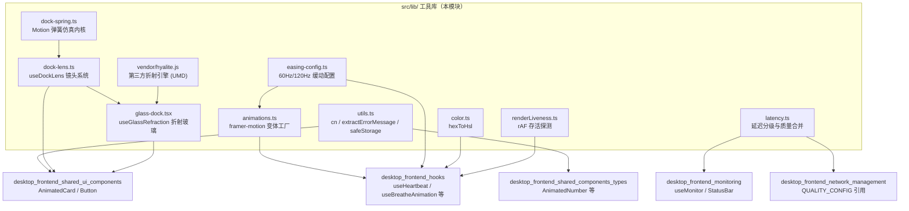
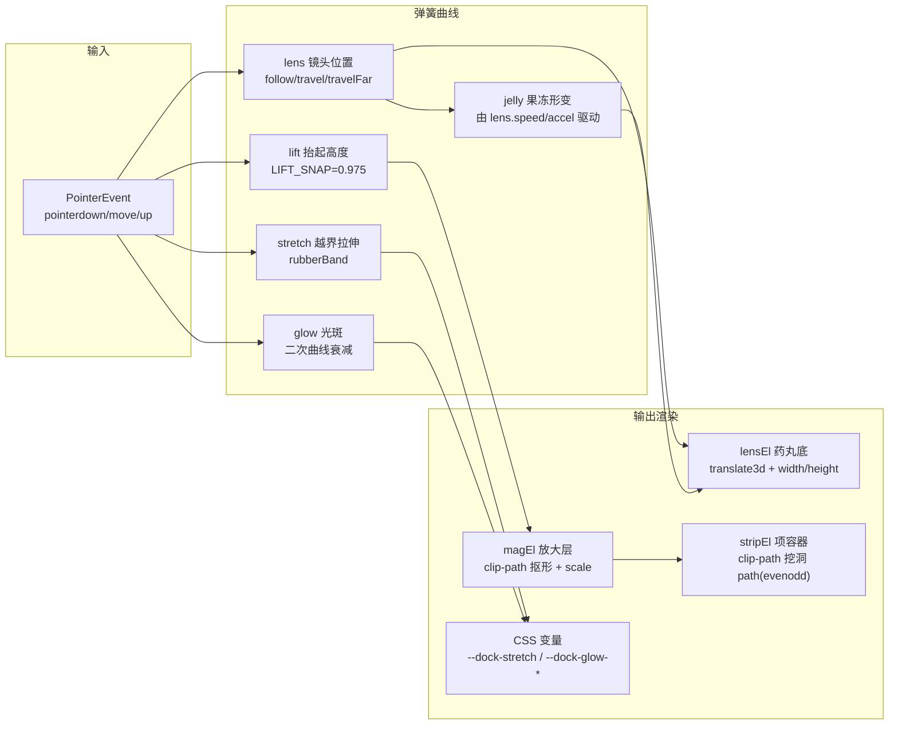
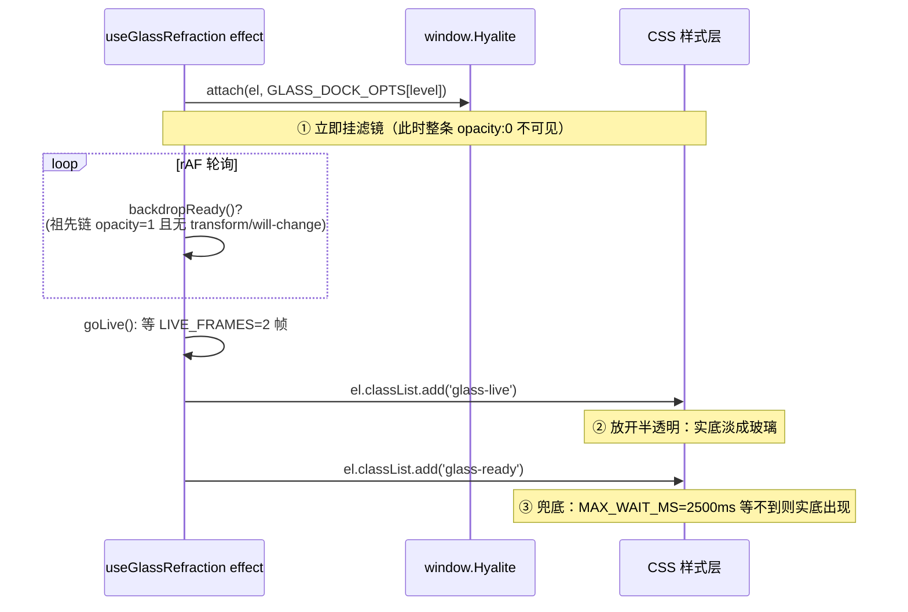
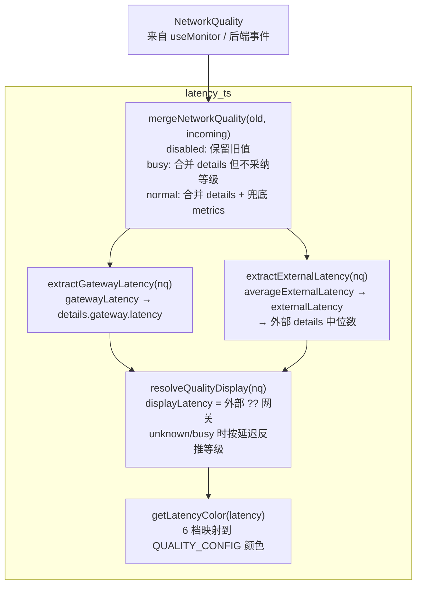
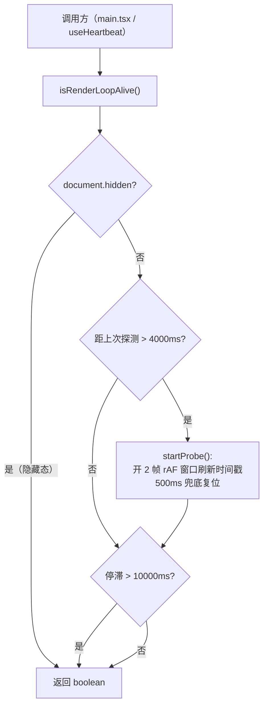

# 桌面端前端工具库（desktop_frontend_utilities_libraries）

## 简介

本模块是桌面端 Tauri WebView 前端（`tauri-app/frontend`）的**共享底层工具库**，位于 `src/lib/` 目录，为上层各业务模块提供五类无业务耦合的基础能力：

1. **UI 动效体系**：弹簧物理仿真、缓动配置、framer-motion 动画变体工厂
2. **视觉渲染特效**：悬浮导航栏（dock）的「镜头放大 + 玻璃折射」系统
3. **网络质量工具**：延迟分级、配色映射、质量增量数据合并
4. **通用辅助函数**：类名合并、错误提取、安全存储
5. **渲染链健康监测**：检测 GPU/合成器渲染循环是否停滞

该模块是整个前端工程中**被依赖最广、但零业务状态**的一层：它不依赖任何 zustand store、不感知 Tauri 后端命令，只被 [hooks](desktop-frontend-hooks.md)、[monitor](desktop-frontend-monitoring.md)、[shared_ui_components](desktop-frontend-shared-ui-components.md) 等上层模块消费。

---

## 模块架构总览



---

## 核心组件详解

### 一、动效体系（animations.ts / easing-config.ts / dock-spring.ts）

#### 1.1 缓动配置 `easing-config.ts`

- **零依赖设计**：文件首行注释明确「独立缓动配置模块 — 零依赖，不存在循环依赖风险」
- **双刷新率档位**：`getEasingConfig(refreshRate)` 根据显示器刷新率返回 `EASING_120HZ` 或 `EASING_60HZ`
- **五档缓动语义**：
  - `enter`：面板转场（戏剧性 expo-out）
  - `exit`：干脆 ease-in 退场
  - `smooth`：卡片/列表平滑
  - `snappy`：日志/徽章等微交互
  - `overshoot`：弹性效果

#### 1.2 动画变体工厂 `animations.ts`

- `createLogEntryVariants(easing)`：日志条目进入/退出的 framer-motion Variants（进入 `x: 20→0`，退出 `x: -16`）
- `createPanelAppleVariants(easing)`：Apple HIG 风格面板变体（spring `stiffness: 320, damping: 24, mass: 0.7`，退出仅 0.04s 降低等待税）

#### 1.3 弹簧物理仿真 `dock-spring.ts`

这是悬浮栏镜头系统的**物理内核**，用半隐式欧拉积分驱动，替代 CSS transition：

| 概念 | 实现 | 目的 |
|------|------|------|
| `Motion` 类 | 标量运动曲线（value/target/velocity） | 拖动时目标每帧改写，保留速度与位置连续 |
| `Motion.constructor(initial, onFrame)` | `this.value = this.target = initial`，并记下每帧回调 `onFrame` | 构造即「已在初始值停稳」，不必再补一次归位 |
| `springOfDuration(durationMs, bounce)` | 由「稳定时长 + 回弹量」反解刚度/阻尼 | 观感标定 |
| `springOfRatio(stiffness, ratio)` | 由「刚度 + 阻尼比」构造 | Flutter `withDampingRatio` 对应物 |
| `loop()` | 共享 rAF，全部静止后自动停表 | 省电 |
| `rubberBand(overshoot, limit)` | 越界指数衰减橡皮筋 | iOS 手感 |
| `saturate(value)` | tanh 型饱和函数 | 速度/加速度归一化 |

**构造契约 `Motion(initial, onFrame)`**（`dock-spring.ts` 第 84–88 行）：

- 两个参数：`initial` 是曲线的起始标量值，`onFrame: (value: number) => void` 是每帧收到当前值的回调（渲染层写 style 的唯一入口）。
- 构造只做三件事：`value`、`target` 双双取 `initial`，保存 `onFrame`。**不会**把自己加入 `active` 集合，也不申请 rAF——因此 `new Motion(...)` 本身零开销，只有第一次调用 `to()` 才启动共享循环。
- `velocity` 保持字段默认值 `0`，`spec` 保持默认 `springOfDuration(300)`；这两项都不从构造参数读取，要换手感得靠 `to(target, spec)` 传入。
- 因为 `target === value`，构造出来的曲线天然是静止态，不需要再调 `jump()` 归位；`dock-lens.ts` 的六条曲线正是按此约定创建：`lens` 以当前 `selected` 为初值（避免首帧从第 0 项滑入），`lift`/`stretch`/`jelly`/`glow`/`glowSpread` 全部以 `0` 为初值。

**关键设计约束**（源码注释）：FlClash 原实现是 GPL-3.0，代码不可带入本项目，因此数值只按观感重标定，不逐值照抄。

---

### 二、悬浮栏特效系统（dock-lens.ts / glass-dock.tsx / vendor/hyalite.js）

这是本模块**技术含量最高**的部分，把 iOS / FlClash 的 tab bar 「镜头放大 + 玻璃折射」语言搬进 DOM。

#### 2.1 镜头系统 `useDockLens`



**核心机制**：
- **DOM 副本方案**：DOM 没有 Flutter 的图层复用，等价物是「第二排副本」——调用方在 `[data-dock-magnify]` 里渲染同一批项（`aria-hidden`），被 `clip-path` 裁成药丸、绕镜头中心放大
- **每帧只写 style，零 React re-render**：这是能在 60fps 下同时跑十余条曲线的原因
- **节点契约**：调用方需提供 `[data-dock-item]`、`[data-dock-lens]`、`[data-dock-magnify]`、`[data-dock-magnify-inner]`、`[data-dock-strip]`
- **手势处理**：`setPointerCapture` 保证拖出栏外仍收到 `pointermove`；`pointercancel`/`blur` 主动收尾避免镜头卡住抬起态；`flingTarget` 用松手速度投影落点
- **落下判定**：必须「抬起到位（lift ≥ LIFT_SNAP）」且「镜头到目标（|goal - value| ≤ LIFT_RELEASE）」才落下，两条曲线回调互查防漏判

#### 2.2 折射玻璃 `useGlassRefraction`

把第三方库 **Hyalite**（vendored，MIT）包成 React hook：



**为什么用 Hyalite 而非 `backdrop-filter: blur()`**：纯模糊只能把背板糊成色块，而玻璃是**弯折**光——边缘把背后世界向内拉扯。Hyalite 按元素真实尺寸与圆角算位移图（R/G=偏移、B=带符号边缘明暗），喂给 SVG 滤镜。

**硬约束（源码注释中的实测结论）**：
- `rim: 0`：Hyalite 自带 Fresnel 亮边会与 CSS 伪元素亮环叠加成「白色外框」
- `bevel: 12 < border-radius 18`：bevel 逼近 radius 会出现「两道同心弧」
- **档位差只做在 `blur` 上**（standard=8 糊成色块 / ultra=1.6 透出轮廓），不做在 thickness/slope/dispersion/shade 上
- ultra 档 `shade: 0.2` 需反向补偿膜厚差（标准档 215.9 → 极致档旧值 0.45 仅 200.8）
- **backdrop root 陷阱**：祖先链任一 `opacity<1` / `transform` / `translate`/`scale`/`rotate` / `will-change` 都会让 Chromium 把这一层当 backdrop root，导致 `backdrop-filter` 采样不到页面内容而填成黑色（「整条发黑」根因）

#### 2.3 Hyalite 类型声明 `vendor/hyalite.d.ts`

定义 `HyaliteAPI`（`watch`/`unwatch`/`attach`/`detach`/`refresh`/`setOpts`/`info`/`supported`/`force`）与 `HyaliteOptions`，并声明全局 `Window.Hyalite`。`hyalite.js` 是 UMD 单文件，通过副作用导入注册到 `window.Hyalite`。

---

### 三、网络质量工具（latency.ts）



**延迟分级阈值**：

| 等级 | 延迟区间 (ms) | 语义 |
|------|--------------|------|
| `excellent` | ≤ 20 | 极佳 |
| `great` | 21–50 | 很好 |
| `good` | 51–100 | 良好 |
| `fair` | 101–200 | 一般 |
| `poor` | 201–400 | 较差 |
| `bad` | > 400 或 < 0 | 不可用 |

**关键设计细节**（源码注释）：
- `mergeNetworkQuality` 的 `busy` 分支：后端增量推送期间等级不采纳——慢网络下终态迟迟不到，采纳 busy 会让胶囊永远显示「检测中」
- `resolveQualityDisplay`：展示门槛一律用 `displayLatency >= 0`，等级在 `unknown`/`busy` 时按延迟推断（首页卡与质量页共用，胶囊另有 dns 延迟源故不用此函数）

测试文件 `latency.test.ts` 用 `makeNq` 工厂覆盖了所有分级边界、合并语义与回退路径。

---

### 四、通用辅助函数（utils.ts / color.ts）

| 函数 | 位置 | 功能 |
|------|------|------|
| `cn(...inputs)` | `utils.ts` | `twMerge(clsx(inputs))` 合并 Tailwind 类名 |
| `extractErrorMessage(e)` | `utils.ts` | 兼容 string / Error / Tauri 插件 reject 的普通对象（取 `message` 字段，避免 `[object Object]`） |
| `safeStorage.get/set` | `utils.ts` | `localStorage` 失败时回退到模块级 `Map`（隐私模式/WebView 禁用存储场景） |
| `hexToHsl(hex)` | `color.ts` | HEX → `{h, s, l}`，非法输入回退默认 `{230, 70, 55}` |

---

### 五、渲染链健康监测（renderLiveness.ts）



**为什么存在**：GPU/合成器崩溃时 `rAF` 停止但 `setInterval` 仍正常跳动，纯 interval 心跳检测不到渲染停滞。原实现是模块级常驻 rAF 无限循环（导入即启动、永不停止），导致 Chromium 合成器按刷新率持续派发 BeginFrame、永不休眠——是前台静态功耗主因。现改为「按需短探测」：距上次探测超过 `PROBE_REFRESH_MS=4000ms` 才开 2 帧窗口，判定语义（10s 停滞阈值）不变。

**调用契约**：窗口隐藏时 rAF 被浏览器节流属正常暂停，调用方须先做可见性短路再调用（本模块对隐藏态直接返回 `true`，避免误判触发整页重载）。

---

## 依赖与被依赖关系

### 内部依赖（本模块文件之间）

| 调用方 | 被调用方 | 用途 |
|--------|----------|------|
| `animations.ts` | `easing-config.ts` | 消费 `EasingConfig` |
| `dock-lens.ts` | `dock-spring.ts` | `Motion` / `rubberBand` / `saturate` / `springOf*` |
| `glass-dock.tsx` | `vendor/hyalite.js` + `hyalite.d.ts` | 折射引擎 |
| `latency.ts` | `@/monitor`（类型）+ `@/network/constants`（`QUALITY_CONFIG`） | 跨模块类型引用 |

### 外部依赖（npm）

来自 `tauri-app/frontend/package.json`：
- `framer-motion` ^12.38.0 — `animations.ts` 的 Variants 类型
- `clsx` ^2.1.1 + `tailwind-merge` ^2.5.0 — `utils.ts` 的 `cn()`
- `gsap` ^3.15.0 — 在 `glass-dock.tsx` 注释中作为「祖先层建 backdrop root」的来源被处理（非直接调用）

### 被哪些模块消费

| 上层模块 | 消费内容 |
|----------|----------|
| [desktop_frontend_hooks](desktop-frontend-hooks.md) | `animations.ts` / `easing-config.ts`（动画 hooks）、`renderLiveness.ts`（useHeartbeat）、`color.ts` |
| [desktop_frontend_monitoring](desktop-frontend-monitoring.md) | `latency.ts`（StatusBar / useMonitor 展示延迟胶囊） |
| [desktop_frontend_shared_ui_components](desktop-frontend-shared-ui-components.md) | `utils.ts::cn`（所有 UI 组件类名合并）、`dock-lens.ts` / `glass-dock.tsx`（悬浮导航栏） |
| [desktop_frontend_shared_components_types](desktop-frontend-shared-components-types.md) | `utils.ts::cn`（AnimatedNumber 等） |
| [desktop_frontend_network_management](desktop-frontend-network-management.md) | 反向提供 `QUALITY_CONFIG` 给 `latency.ts` |

---

## 构建与测试配置

### 别名解析

`tauri-app/frontend/vite.config.ts` 与 `vitest.config.ts` 均配置：

```ts
resolve: { alias: { '@': path.resolve(__dirname, './src') } }
```

因此 `latency.ts` 中的 `@/monitor`、`@/network/constants` 与源码内 `./xxx` 相对导入混用。

### 代码分包

`vite.config.ts` 的 `manualChunks` 将动画库独立分包：
- `vendor-motion`：`framer-motion`
- `vendor-gsap`：`gsap`
- `vendor-react` / `vendor-radix`

本模块的动效体系因此以独立 chunk 加载。

### 测试

`tauri-app/frontend/vitest.config.ts`：
- `environment: 'jsdom'`
- `globals: true`
- `setupFiles: ['./src/test-setup.ts']`

本模块唯一测试文件 `latency.test.ts` 通过 `npm test`（`vitest run`）执行。

---

## 与 Android 端工具库的对应关系

Android 端存在结构高度对应的 [android_frontend_utilities_libraries](android-frontend-utilities-libraries.md)，共享 `animations.ts`、`color.ts`、`dock-lens.ts`、`dock-spring.ts`、`glass-dock.tsx`、`vendor/hyalite.*`、`utils.ts` 等同名文件。两端差异：

- 桌面端多 `easing-config.ts`（按刷新率分档）、`renderLiveness.ts`（rAF 存活探测）、`latency.ts::mergeNetworkQuality`（增量合并）
- Android 端 `dock-spring.ts` 不含 `Motion.jump`/`loop` 等部分成员，`latency.ts` 不含 `mergeNetworkQuality`

维护时两端同步演进，但桌面端承担更复杂的功耗与渲染健康职责。
